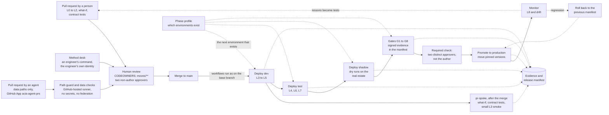

# Design 11 — Delivery and operations

> **What this answers:** *How is the system built, released, run and recovered — by a minimum crew of three and a few contributors (and, in a limited single-operator mode, by one person) — without anything being touched by hand?* Platform facts come from the [options analysis](research/options-analysis.md), the [Foundry research](research/foundry-governance-and-framework.md) and the [Citadel research](research/citadel.md), checked on 2026-10-31. Part of the [design](README.md); the test layers and gates it runs are in [10](10-test-and-evaluation.md), the controls it keeps in [09](09-safeguards-and-drift-controls.md).

---

## 1. The repository

One repository holds everything that defines the system, so a release is a single, signed set of pins.

```
azure-cost-in-action/
  infra/          Bicep (Azure Verified Modules), one deployment stack per layer
  contracts/      Citadel backend, access and publish contracts: one per group, data class and environment
  agents/         one folder per agent: instructions, skills, tests, agent card
  services/       tool services (Python); the execution plane, the Approval service, the Policy service, the Audit Writer and the Teams adapter (C#)
  workflows/      the spine: a Durable Functions app (C# isolated worker), orchestrators and activities
  moves/          the Move catalogue: recipes as YAML data, dry runs, rollbacks and tests as code
  atlas/          claims, profiles, detectors, recipes (the Commons mirror), all data
  evals/          Terrarium generators, exams, baselines, statistical protocols, attack suites
  governance/     control map, policy initiative, DPIA template, system card generator
  tools/          stdlib-only scripts: cost model, price fetcher, documentation lint
  docs/           the north star, the design, the reviews
```

Rules: **the main branch is protected**; every change is a pull request; contracts and `governance/` have CODEOWNERS that name the sponsor, and so do `.github/**` and every code path; **a pull request that touches `moves/**` needs two approvers who are not its author before it merges**, and a Move's schema has **no executable field** (no script, URL or command; parameters come from enumerations only), so a recipe is data and never code; nothing in the repository holds a secret or a customer's data (a scanner enforces both). Agent identities may open pull requests only to data paths ([§3](#3-pipelines)).

## 2. Infrastructure as code

**Bicep with Azure Verified Modules**, deployed as **Deployment Stacks at subscription scope** with deny settings. Published modules (the [AVM Bicep resource index](https://azure.github.io/Azure-Verified-Modules/indexes/bicep/bicep-resource-modules/), read 2026-11-01) cover Container Apps environments and jobs, Cosmos DB, AI Search, API Management, Key Vault, Storage, Log Analytics, Application Insights, the registry and a Foundry account and project pattern. **The modules for Bot Service and for the Durable Task Scheduler are listed as *proposed*, not published**, so those two are plain Bicep behind a thin local module of ours, version-pinned and reviewed like any other code (a module is pinned by version, and the `what-if` still runs on the result). There is no module seen for Container Apps Sandboxes (generally available since September 2026) and none for hosted-agent versions, which are data-plane objects ([§4](#4-deploying-agents)).

| Stack (layer) | Holds | Changes |
|---|---|---|
| `foundation` | resource groups, VNet and peering, DNS links, Log Analytics link, Key Vaults (the **secrets vault** of each spine environment, in a chain environment **one vault per signing party**, and one for the pipeline's image-signing key), registry, Storage (including the chain's queue account `stchain`), Cosmos DB, AI Search, **the Foundry accounts, their two projects each (reasoning and examination) and capability hosts** | rarely; contains the **one-way doors** ([04 §7](04-landing-zone-and-citadel.md#7-the-foundry-layout)) |
| `platform` | Container Apps environments, apps, jobs (**the chain jobs' templates are written only by the pipeline that deploys the environment**, `deploy` for dev and test and `release` for production, which alone holds `jobs/write` and `jobs/start/action` on them, [09 DR-19](09-safeguards-and-drift-controls.md#21-drift-in-what-we-own)), Application Insights, the Bot resource, Azure Monitor alerts, workbooks | with every release |
| `contracts` | the Citadel contracts: one per **group × data class × environment where it has planned work** (twelve contracts, each in at most three environments; `examine-pub` and `forge` have no production product, [04 §4.3](04-landing-zone-and-citadel.md#43-the-access-contracts)) | by pull request; the group's sponsor approves |
| `policy` | the Policy initiative and assignments | rarely; security lead approves |
| `lab` | the Lab management group, the vending module, the reaper | created in the phase that needs it; then rarely |
| `onboarding` | the estate-side module in two parts: **read onboarding** (reader roles, export configuration) and a separate, consented **action onboarding** (the constrained delegation, [§6](#6-onboarding-and-offboarding-an-estate)) | once per estate; the second part only on the owner's consent |

**Stack mechanics that matter** (platform documentation): deny settings accept at most **five excluded principals**, so exclusions are *groups*; **deleting a resource group bypasses deny assignments**, so the stack is deployed at subscription scope with the resource group *in the template*; **moving a managed resource out of its group removes its stack protection**, so each stack's groups follow the lock procedure and the move detection (D17) of [09 DR-1](09-safeguards-and-drift-controls.md#21-drift-in-what-we-own), with a monthly planted-drift test; **creating or deleting deny assignments needs *Azure Deployment Stack Owner*** (*Contributor* cannot, [Learn](https://learn.microsoft.com/azure/azure-resource-manager/bicep/deployment-stacks)), so `foundation` and `policy`, which carry deny settings, are deployed by the **bootstrap** identity, usable only from a protected environment after human approval, and routine stacks by a Contributor-style identity; a stack cannot manage Microsoft Graph resources or delete Key Vault secrets; stacks have no `what-if`, so the pipeline runs it on the underlying deployment. The hub's own resource group may belong to another team: there the control is Policy plus detection ([09 DR-4](09-safeguards-and-drift-controls.md#21-drift-in-what-we-own)).

## 3. Pipelines

GitHub Actions, authenticating to Azure by **workload identity federation** (no stored secret). Pipelines that touch private resources run on **self-hosted runners that are Container Apps event jobs** in the spoke. A pull request opened by an agent is untrusted code, so privilege is separated by **trigger**, not by trust in the author:

1. **Agent identities open pull requests only to data paths**: `atlas/**` and the YAML recipes under `moves/**`. The repository pull-request service (the tools `atlas-propose` and `moves-propose`, [04 §4.4](04-landing-zone-and-citadel.md#44-the-publish-contract-tools-and-who-may-call-them)) enforces it, and a required **path guard** check enforces it again from the pull request's file list; anything else an agent touches fails the check and goes to a person. **Their repository credential is a GitHub App installation**, `acia-agent-prs`, with the *contents* and *pull requests* permissions on this one repository and no *workflows* or *administration* permission; **its private key lives in the spine environment's secrets vault**, readable only by the pull-request service's identity ([07 §6](07-security-architecture.md#6-secrets-keys-and-data-protection)). A GitHub App's permissions are set per repository and permission type, and GitHub's documentation lists no path scope ([GitHub](https://docs.github.com/en/rest/authentication/permissions-required-for-github-apps)), so the **path limit is the service's and the guard's**; a push ruleset with GitHub's *Restrict file paths* rule ([GitHub](https://docs.github.com/en/repositories/configuring-branches-and-merges-in-your-repository/managing-rulesets/available-rules-for-rulesets)) is the candidate third layer. That no narrower scope exists, the plan's entitlement to push rulesets and the exception syntax are *to confirm* in S-DEL-2.
2. **A pull request that touches `moves/**` needs two approvers who are not its author before it merges**, whoever opened it; the `two-approvers` check below counts them. A Move's schema has **no executable field** (no script, URL or command; parameters come from enumerations only), so a merged recipe is data that the runner reads and never code that it runs.
3. **Agent pull requests run only on GitHub-hosted runners with no secrets, no federation and a read-only token** (knowledge CI and schema checks on the data); they never reach a self-hosted runner or an Azure credential.
4. **Privileged workflows** (a secret, a federated credential or a self-hosted runner) start only from triggers that run the workflow *as it is on the base branch*: a push to `main`, a tag, a schedule or a person's dispatch after a human approves. They **never check out or run code from an unmerged pull request**: `pull_request_target` or `workflow_run` combined with an untrusted checkout can be exploited to take over a repository ([GitHub](https://docs.github.com/en/actions/reference/security/secure-use)).
5. The repository setting that lets Actions **create and approve pull requests** is off, so no workflow can count as an approver.

**The method desk** is the human step between a method proposal and a pull request (W10, [05 §3](05-agents-and-orchestration.md#3-the-workflows)): an engineer's command in `tools/` that reads a `method-proposals` record and opens the pull request under the engineer's **own GitHub identity**. No agent opens it, the patch text and the exam evidence travel in the pull request for its reviewers, and the ordinary rules apply, including the two approvers for `moves/**`. The command holds no credential of its own.

**The pipelines read the phase profile.** [14 §4](14-next-phases.md#phase-and-capability-profiles) says what exists in each phase, and `governance/phase-profile.yaml` (changed by pull request, the sponsor approves) is the file the `deploy` and `release` workflows and the `pr-spoke` stage read. **A release deploys to the next environment that exists in the profile**: DEV in phases 0 and 1; DEV, then PROD in shadow, from phase 2; DEV, TEST and PROD from phase 3 at Team and Enterprise scale (at Pilot scale there is no TEST account); never the Lab, where experiments run and which is no release target. **No TEST hub, TEST account or Lab account is required, built or paid for before its phase**, and a gate that the profile does not yet require is recorded as *not applicable in this profile* ([10 §5](10-test-and-evaluation.md#5-environments-and-promotion)), never as passed. The AI Search services are the one exception: they exist from day zero and are priced in [12 §4](12-cost-and-finops.md#4-what-still-costs-money-when-nothing-is-happening).



| Workflow | Trigger | Runs on | Does |
|---|---|---|---|
| **pr** | pull request, any author | GitHub-hosted; no secrets, no federation, read-only token | L0–L2 on recorded fixtures, Bicep build, documentation lint, the path guard, knowledge CI for data paths |
| **pr-spoke** (a stage of **deploy**) | the merge to `main`, never a pull request | self-hosted in the spoke, federated, as on `main` | `what-if`, contract tests against the hub of the lowest environment that exists in the profile (the test hub from phase 3, the dev hub before), a small L3 smoke |
| **deploy** | merge to main | self-hosted, federated, as on `main` | **deploys dev and test**: deploy dev; L3–L5; the `pr-spoke` stage; promote to test, where the profile has one (L4, L6, L7), when green |
| **release** | a release candidate | self-hosted, federated, as on `main` | **deploys production**: shadow → gates → the **two-approver check** and the protected environment → production, for a manifest that has passed dev and, where the profile has one, test |
| **nightly**, **weekly** | cron | self-hosted, federated | nightly: the small exam, the model alarm ([09 DR-8](09-safeguards-and-drift-controls.md#22-drift-under-us)), the detectors that are not continuous; weekly: the full exam, the AI red-teaming run, the cost report |
| **drift** | continuous | the governance plane | the drift controller ([09 §3](09-safeguards-and-drift-controls.md#3-the-drift-controller)) |
| **atlas** | a pull request in `atlas/`, by a person or an agent | GitHub-hosted for the checks | knowledge CI; a human reviewer merges; the signed Atlas release is a privileged workflow on `main` |

**The two-person rule needs its own check.** A protected environment's required reviewers need only **one** of them to approve ([GitHub](https://docs.github.com/en/actions/reference/workflows-and-actions/deployments-and-environments)); *prevent self-review* keeps the person who started the deployment from being that one, but a second approval is still not required. So the **release** also needs a required status check, `two-approvers`, run from the base branch, that counts **distinct people who approved the release pull request, or any pull request that touches `moves/**`, and are not its author** (bots, Actions and approvals made stale by a later commit do not count). The check is the control; the environment adds the pause. Entitlement is **not assumed**: on the Free, Pro and Team plans GitHub offers required reviewers and wait timers only for public repositories, and this one is private, so it needs GitHub Enterprise or the required check is the whole of the control; rulesets and branch protection on a private repository depend on the plan too. Spike [S-DEL-2](14-next-phases.md#3-spike-register) settles all of it (to confirm), including whether the agents' App can be held to the data paths. No spoke run waits for a maintainer to approve a pull request, because **`pr-spoke` runs after the merge, inside `deploy`**: unmerged code never reaches a federated runner.

**Single-operator mode.** With fewer than two people who can satisfy the rule, the platform runs in single-operator mode: promotion is limited to **shadow and reversible Moves**; anything irreversible, every purchase and every autonomy credential waits until a second reviewer exists ([§7.2](#72-support-model)).

## 4. Deploying agents

Hosted agents are **data-plane objects** (generally available since June 2026), so Bicep and stacks cannot own them. The pipeline:

1. builds one **image per group** from a pinned base, scans it, generates the SBOM and **signs** it, and pushes it to the private registry; every night it also builds the **framework-agnostic fallback image** for the same agents, because the Python hosting package is prerelease ([09 §5](09-safeguards-and-drift-controls.md#5-the-preview-register-and-the-dependency-register)) and a fallback that is never built rots;
2. **registers an immutable agent version** for each agent through the Foundry SDK (the Python SDK is stable at 2.x, and `invocations_moderation` needs `azure-ai-projects` 2.7.0 or later, [Learn](https://learn.microsoft.com/azure/foundry/agents/how-to/add-hosted-agent-guardrails); the .NET SDK is still beta), naming the image **digest** and, for an agent on the `invocations` protocol, its moderation setting, then **reads the registered definition back**: a missing `rai_config` fails the pipeline ([10 §2](10-test-and-evaluation.md#2-the-layers), L5);
3. runs the version in **shadow**;
4. on promotion, **moves the version selector** to the new version — an endpoint serves exactly one version, with no traffic splitting, so canarying is done by the shadow environment, not by weighting;
5. **prunes** old versions (the cap is 1,000 per agent and reaching it is a terminal error), **keeping every version that a retained manifest names**: rollback is redeploying a manifest ([§5](#5-releases-and-versioning)), so an agent version's life ([05 §11](05-agents-and-orchestration.md#11-the-life-of-an-agent-version)) ends only when no retained manifest needs it.

The `azd` agent extension is beta and its command shapes have changed between releases; it is the **developer's inner loop** and the Lab's teardown, never the production path. **`azd down` deletes the resource group and is never run in production.** The agent extension also creates managed identities by default, which the pipeline does not use.

## 5. Releases and versioning

- **A release manifest** names every pin: agent versions and image digests, contract versions, model aliases *and the models they resolved to on the day*, the Atlas release, Move versions, workflow versions, the spine's orchestration version, framework and SDK versions, the Citadel commit, **the phase profile it was released under** ([§3](#3-pipelines)), the digests of the **signed gate evidence** ([10 §4](10-test-and-evaluation.md#evidence-every-gate-emits)) and the key ids that the broker and the runner trust (the approval-signing key and the Policy service's key, which signs its permits). The manifest is **signed** and stored with the evidence ([08 §7](08-governance-and-compliance.md#7-the-evidence-pack)).
- **Rollback is redeploying the previous manifest.** Because the pins are immutable (versions, digests, commits), the previous state is exactly reproducible.
- **Cadence.** Weekly release trains; the Agent Framework itself releases about weekly, so a framework bump is its own, gated release rather than a drive-by. **A change of model version, prompt, tool, contract or framework is a release** and passes the gates.
- **Emergency changes** exist: a security fix may skip the train but never the gates G1, G2 and G8; each is recorded with a reason.
- **The Atlas has its own cadence** and its own signed releases; an agent run records the Atlas release it read.
- **Platform version.** Semantic versioning for the system as a whole; a major version means a contract or schema migration.

## 6. Onboarding and offboarding an estate

**Onboarding** is a pull request plus an accepted module, not a project, and it has **two parts**. The second is separate, consented and optional: an estate that never consents stays read-only for ever.

1. **Read onboarding.** The owner of the estate (a management group or subscriptions) deploys the **onboarding module** or accepts it by policy: **Reader, Cost Management Reader and Monitoring Reader**, nothing else, plus the export configuration that writes cost data to our cost lake.
2. The Surveyor builds the first Estate Model; the first questions go to the owners of the largest unexplained blocks ([north star](../01-north-star.md)).
3. The estate runs in **shadow** first: proposals and dry runs, no changes, until the owners see that the proposals are good.
4. **Action onboarding**, later and only on the owner's explicit consent per scope (the consent is a ledger entry). It grants the **credential broker a constrained RBAC delegation**: role-assignment administration with a condition that limits which role definitions it may assign (our custom least-privilege Move roles only), to which principals (the execution identities' principal ids only) and of which principal type; the **sweeper** gets a delete-only delegation ([Learn](https://learn.microsoft.com/azure/role-based-access-control/delegate-role-assignments-overview)), and the **Verifier** the same three reader roles at these scopes, read-only, so that it can check the result of a Move. Before consenting, the owner is shown what the condition **cannot** do: it cannot limit the *target scope*, which is bounded only by where the delegate holds the role. So the estate trusts the broker with a constrained delegation, and **target scoping is deterministic code (the signed target hash and the runner's verification) plus detection, not ABAC**.
5. **Autonomy credentials** are earned per domain, later, by exam ([10 §4](10-test-and-evaluation.md#4-release-gates), G9).

Who holds which authority, where it comes from and who can take it away:

| Authority | Held by | Scope | Granted by | Revoked by |
|---|---|---|---|---|
| Reader, Cost Management Reader, Monitoring Reader | the tool-service identities | the onboarded estate scopes | the estate owner, in read onboarding | the estate owner, in offboarding |
| Reader, Cost Management Reader and Monitoring Reader, read-only | the **Verifier**, to check the result of a Move | the scopes where the estate owner consented to *action* onboarding, and no others; further utilisation reads are *to confirm* before phase 5 ([07 §3.1](07-security-architecture.md#the-execution-chain-who-may-do-what)) | the estate owner, in action onboarding | the estate owner, in offboarding |
| Constrained role-assignment delegation | the credential broker | opted-in scopes only | the estate owner, in action onboarding | the estate owner; the operator's kill switch stops its use at once, removal takes minutes |
| Delete-only role-assignment delegation | the sweeper | the same scopes | the estate owner | the estate owner |
| Custom Move roles | one execution identity per Move class, on a lease | the exact target, for one Move | the broker, after it has verified the approval, the permit and the person's token itself and holds the lease | the broker (revocation probe); the sweeper |
| Write and start rights on the chain's jobs (`Microsoft.App/jobs/write`, `jobs/start/action` on the broker, runner and Verifier jobs) | the pipeline that deploys the environment and no other principal: **`deploy` for dev and test, `release` for production**; the Approval service and every other chain party hold no `Microsoft.App/jobs/*` action | the chain jobs of each chain environment | the platform owner | the platform owner; D16 detects a start of any chain job by a principal other than its queue trigger, or with a template that is not the pinned one |
| Signing keys (the custom role **`acia-signer`**: `keys/read` and `keys/sign/action` only, on the party's own vault) | each signing party in its own vault: the Approval service (approvals), the **Policy service (its permits, so that a compromised Approval service cannot forge one)**, the broker, the runner and the Verifier (their ledger entries), the Audit Writer (the daily digest); verifiers read public keys with `acia-key-reader` (`keys/read` on one key) | our own subscriptions; nobody holds a permission on another party's vault, and **no signing identity holds `keys/update/action`**, which the built-in *Key Vault Crypto User* would add ([09 DR-19](09-safeguards-and-drift-controls.md#21-drift-in-what-we-own), [04 §6](04-landing-zone-and-citadel.md#6-network), [07 §6.1](07-security-architecture.md#61-secrets)) | the platform owner | the platform owner; the approval epoch and the key deny list stop their use ([07 §10.3](07-security-architecture.md#103-kill-switches)) |
| *Azure Deployment Stack Owner* and lock administration | the **bootstrap** identity, usable only from a protected environment after human approval | our own subscriptions | the platform owner | the platform owner |
| Graph authority: app registrations, app-role assignments to the fifteen agent identities, sponsors | an *identity job* holding the narrowest Graph permission that can assign our app roles (to confirm in [S-GW-3](14-next-phases.md#3-spike-register)); stacks cannot manage Graph resources | our tenant | an Entra administrator | an Entra administrator |
| Purchaser role at the billing or subscription scope that fits the agreement type | the purchase execution identity, enabled only in phase 5 | per [S-ACT-1](14-next-phases.md#3-spike-register) | the billing owner | the billing owner |
| The GitHub App `acia-agent-prs` (*contents* and *pull requests* on this repository) | the repository pull-request service; the App's private key sits in the spine environment's secrets vault | this repository, data paths by the service and the path guard ([§3](#3-pipelines)) | the repository owner | the repository owner; uninstalling the App stops every agent pull request at once |

**Offboarding** aborts the estate's in-flight Moves (the runner checks a revocation flag between steps), **revokes the delegation** and the roles, stops the exports, deletes the estate's data according to the retention schedule ([08 §4.3](08-governance-and-compliance.md#43-retention)), and leaves only the pseudonymous approval record that the audit obligation requires. Removing a role can take minutes to take effect, so offboarding is complete only when a **revocation probe** passes: a read of the assignments shows none, and a call with the old identity fails.

## 7. Operating the platform

### 7.1 What is watched

| View | Built with | Shows |
|---|---|---|
| **Platform health** | Azure Monitor workbooks and Azure Monitor dashboards with Grafana (no extra resource) | hub availability, job success, **spine health (orchestration instances running, stuck or failed, queue depth, the task hub's storage)**, **the chain's queues (depth, the age of the oldest message and poison messages on `dispatch`, `run`, `verify` and `spine-events`)**, subnet-exhaustion 429s, session counts against the 1,000 or 2,000 limit, **and the fast-signal path (queue depth, event-to-owner latency at p95, subscription throttling, session and IP headroom)** |
| **Agents** | Application Insights and the Foundry control plane | runs, cost per case, tool errors, judge-score trends, versions serving |
| **Cost of the system** | hub logs and Cost Management | tokens and euros per contract, per agent, per case; the first entries on its own Agenda |
| **Drift** | the drift controller's findings | open findings by layer, time to detect and correct |
| **Safeguards** | detections **D1–D20** ([07 §10.2](07-security-architecture.md#102-detections-we-ship-as-code)); D13 (approval without a matching sign-in) reads Entra sign-in logs, which need Entra ID P1 or P2 through Microsoft Graph ([Learn](https://learn.microsoft.com/graph/api/resources/signin?view=graph-rest-1.0)), so an unlicensed tenant falls back to the Approval service's token record, which is weaker | alerts, kill-switch state (the approval epoch, the key and `azp` deny lists), canary status, the **chain heartbeats, the lease table and quarantined identities, and signing-key operations** |

Managed Grafana is *not* deployed (a private endpoint needs the Standard tier and the Essential tier is deprecated). Alerts go to an action group that reaches the operator by Teams and e-mail.

### 7.2 Support model

Business-hours response, **designed so that nobody needs to be awake**: if the hub or the execution plane fails, the system degrades to *ask-only* ([03 §6](03-logical-architecture.md#6-degraded-modes)); no approval survives its expiry; nothing acts without a human. Severity classes: **S1** a kill switch was pulled, a safeguard failed or a party of the authority chain is failing closed; **S2** a drift finding with no auto-correction, or a failed gate in production; **S3** everything else.

**The minimum crew is three roles**: the **operator**, a **second reviewer and approver** (a different person, so that the two-person rule can be met) and a **security reviewer**; one of the three is the sponsor of record. Nobody holds two of the three roles for the same change. With fewer people the platform runs in **single-operator mode** ([§3](#3-pipelines)): promotion is limited to shadow and reversible Moves, and anything else waits for a second reviewer. The standing load is real (six stack layers, the GitHub workflows of [§3](#3-pipelines), the ten spine workflows W1–W10 and the fast path W3b, the runbooks below, a weekly gated train), which is why a release needs a second person.

**Environments are created in the phase that needs them** ([14 §4](14-next-phases.md#phase-and-capability-profiles), which the pipelines read, [§3](#3-pipelines)): the test account, the Lab account, a second spoke's full standard setup and any further Foundry project wait for their phase, because each private Foundry account carries its own AI Search, Cosmos DB and Storage with a floor that is paid whether or not it is used. The one exception is the AI Search services, created on day zero because their region may refuse a new service ([12 §4](12-cost-and-finops.md#4-what-still-costs-money-when-nothing-is-happening)). The **Citadel pin** moves only through a named, budgeted job ([§7.3](#73-routine-operations)), never as an unplanned evening's work.

#### The minimum viable profile and the operating budget

**The default is the minimum viable profile** ([14 §4](14-next-phases.md#phase-and-capability-profiles)): direct hybrid retrieval (the semantic ranker only if the exam justifies it), typed query tools before sandboxed code, the generally available hosting fallback, and only the leaves and contracts of the current phase. Every option not taken is a service that nobody patches, watches, drills or pays for.

**The operating budget is stated in hours**, because a crew of three is a capacity before it is a list of roles. The starting value at Pilot scale is **40 hours a month**, a stated seed and not a measurement:

| Standing work | Hours a month | Source |
|---|---|---|
| Release train: manifest review, promotion, rollbacks | 8 | the weekly cadence ([§5](#5-releases-and-versioning)) |
| Gate review: the failed critical cases, a fifth of the passed ones, the judges' sample | 6 | one gated domain-release a month, the seed in [12 §2](12-cost-and-finops.md#2-the-results) |
| Drills: the monthly L6 set and the restore drill | 6 | [10 §2](10-test-and-evaluation.md#2-the-layers) |
| Findings and incidents: drift findings, runbooks, S1 to S3 | 8 | [§7.1](#71-what-is-watched), [§7.5](#75-runbooks) |
| Reviews and rotations: access and exception reviews, signing-key rotation, the Citadel pin, base-image and dependency updates | 8 | [§7.3](#73-routine-operations) |
| Community: issue and pull-request triage, release notes | 4 | [§9](#9-the-project-as-open-source) |
| **Total** | **40** | |

The hours are spread over the three roles, with nobody holding two for the same change. They are the breakdown of the operator-declared number of assumption A8 in [01](01-requirements-and-principles.md); [12 §2](12-cost-and-finops.md#2-the-results) carries the rate and the sensitivity (20 to 160 hours) and takes its Pilot line from this total, so a change here is a change there. The hours that are actually logged over the first quarter replace the seed. If the budget is exceeded two months running, **the profile shrinks** (a leaf or a contract waits for a later phase, by pull request); a gate, a safeguard or a drill is not dropped to fit the hours.

### 7.3 Routine operations

| Task | Cadence | How |
|---|---|---|
| Rebuild images on updated base images | weekly | pipeline; Dependabot; the gates run |
| Rotate contract keys | quarterly, and on suspicion | the hub's three-step flow ([04 §4.3](04-landing-zone-and-citadel.md#43-the-access-contracts)) |
| Rotate the signing keys (approval-signing, the Policy service's key, each ledger producer's key, the Audit Writer's digest key) | at least yearly (a starting value), and on suspicion | RB-12, **one scheduled workflow** that rotates one signing party at a time; the rotation policy's near-expiry notification starts it |
| Rotate the private key of the GitHub App `acia-agent-prs` | at least yearly, and on suspicion | create the new key, store it in the secrets vault, switch the pull-request service over, delete the old key (RB-05) |
| Move the Citadel pin | quarterly, as a named job with its own hours | diff the upstream sample since the pin, run the contract tests, release it as a manifest change; the hours belong to the named labour in [Q-COST-1](01-requirements-and-principles.md#4-quality-targets) |
| Fast-signal probe | daily | a planted estate event travels the real path to a test owner; delivery and latency are recorded against the p95 target that spike [S-FAST-1](14-next-phases.md#3-spike-register) sets |
| Lease and quarantine review | weekly | the Auditor lists identities that were quarantined or whose probes ran slow (RB-14) |
| Access review of sponsors, approvers, administrators | quarterly | an Auditor report; the owner confirms |
| Retirement and review dates | continuous | the dependency register alerts at 180, 90 and 30 days |
| Quota and tier checks | monthly | model quota is pooled per subscription; tier eligibility for the GPT-6 family needs Tier 5 or 6 or a quota request |
| Restore and failover drills | monthly | [10 §2](10-test-and-evaluation.md#2-the-layers) L6 |
| Cost review | weekly | the cost report; budgets are a backstop, caps are at the hub |

### 7.4 Who operates the platform: the system itself

The system applies its own pattern to itself (W9): detectors are deterministic jobs; the **Auditor** and the **Conductor** read their findings and open cases *about ourselves*, including the platform's own cost. **Azure SRE Agent is not adopted by default**: its always-on baseline bills 4 *Azure Agent Units* an hour for as long as it exists — **about €283 a month in Sweden Central (€0.096797 a unit-hour) and about €349 in West Europe (€0.119676), before tokens** (4 units × 730 hours; service *Foundry Tools*, product *Azure Agent Unit*, meter *SRE Agent Unit*, from the [price snapshot](cost/prices-snapshot.json) retrieved 2026-10-31) — which contradicts scale to zero, and stopping it does not stop the meter. A 30-day trial in the non-production spoke is allowed. The **Azure Copilot Observability Agent** (consumption-billed, reads Basic and Auxiliary tables) is an optional human aid.

### 7.5 Runbooks

| # | Runbook | Trigger |
|---|---|---|
| RB-01 | Pull a kill switch ([07 §10.3](07-security-architecture.md#103-kill-switches)) and prove it took effect **at its real latency**: seconds for a contract and for the hub's deny list on an agent's `azp`; for the chain's switches (a revoked nonce, a withdrawn credential's own deny list that the broker reads at grant, the approval epoch, the signing key's deny list) the expiry of a party's `controls` cache, **at most 60 seconds**, and a stale cache fails closed; new tokens only for a disabled agent identity; new grants and dispatches at once for the execution plane, while in-flight Moves stop at their next step; minutes for a role removal. Proof is a probe, not an assumption | any S1 |
| RB-02 | Hub degraded or down: confirm ask-only, communicate, recover | hub alert |
| RB-03 | A drift finding that cannot be auto-corrected | drift controller |
| RB-04 | Suspected prompt-injection incident: contain, preserve, assess "what could it have done?", recover, add a golden case | screening spike, D5 |
| RB-05 | Credential or key exposure: rotate, review the audit ledger (a signing key: RB-12; the GitHub App's private key: suspend the App, review the pull requests it opened, store a new key in the secrets vault, then resume it) | D6, scanner |
| RB-06 | A retired or changed model: fall back, run the exam, re-pin as a release | DR-8 |
| RB-07 | A failed approval or a stuck workflow: park, inspect, resume or close (the spine: RB-15) | watchdog |
| RB-08 | Subnet exhaustion or session quota | 429 `subnet_exhausted`, `session_quota_exceeded` |
| RB-09 | Personal-data request or breach (72-hour clock) | the data protection contact |
| RB-10 | Restore in the order of [06 §7.6](06-data-and-knowledge.md#76-recovery): redeploy with every contract suspended and the execution plane stopped, **with a new, empty task hub** (the old one is derived and is not restored); verify the ledger (chain, signatures, digests from the second account); restore `controls` first and keep every revocation; restore the other containers and replay the export in watermark order, then re-apply the tombstones and the erasure register; **raise the approval epoch** to the restore time, so every earlier approval is void and is asked for again if it still matters; start `leases` empty, recreate the `stchain` queues (they are not restored) and quarantine every execution identity until its probe passes; **re-open each open case as `<workflow>:<case id>:<epoch>`** with its spend and its deadlines rebuilt from `budgets` and `cases`, and reconcile any Move dispatched without a ledger entry against the live state; lift the suspensions last (contracts, agents, the execution plane). **After a regional loss** the source is the recovery lake's second-region copy: read the **watermark age** of that copy first, including the export job's duration and its retries, and record the recovery point it gives | restore drill, disaster |
| RB-11 | Quarterly: access review, exception review, key rotation | calendar |
| RB-12 | **Signing keys** (approval-signing, the Policy service's key for its permits, each producer's ledger-entry key, the Audit Writer's digest key), run as **one scheduled workflow**. *Rotation*, one signing party at a time: create the new key version, make every verifier trust its key id before the party signs with it, and let verifiers accept the **previous key id for the longest approval validity**, so approvals and permits in flight stay valid; keep earlier public keys for verifying ledger history; record each change in the ledger; finish with the check of [09 DR-19](09-safeguards-and-drift-controls.md#21-drift-in-what-we-own) that no signing identity holds `keys/update/action`. *Suspected misuse or exposure*: raise the **approval epoch**, **disable the key and add it to the verifiers' deny list**, quarantine every lease (RB-14), export the Key Vault log and the ledger slice and compare the approvals with the sign-in log before any Move runs again; then replace the key as in a rotation. The Policy service signs its permits with a key of its own, so a compromised Approval service cannot forge one | the near-expiry notification of the rotation policy; D13, D15, D16, D18, D20; scanner |
| RB-13 | **A party of the authority chain is down, or the ledger is broken.** Confirm the system failed *closed* (no ledger entry, no change), communicate, recover in the order Audit Writer, signing keys, Policy service, Approval service, broker, and pass the activation and revocation probes before any Move. *Audit Writer failure*: while it is down nothing is granted or dispatched, because a producer proceeds only after it has read its own entry back; a **signed approval is kept** and dispatched when its entry commits (unless its expiry or the epoch passes first), and a **rollback** to the named pre-state runs from the signed outbox and is flagged D19; the writer re-reads the chain head and continues; a sequence gap, a broken chain or a failed producer signature is an S1: the execution plane stays stopped until the chain is verified from the last signed daily digest and the cause is recorded. *Queues*: a growing `dispatch` or `run` backlog, a rising age of the oldest message or any poison message is read as a failing party; a message carries an id only and its receiver re-verifies from the records, so a poison message is inspected and closed, never replayed by hand | a missing chain heartbeat; D19 |
| RB-14 | **Lease quarantine.** A failed revocation probe, a lease violation or an assignment that matches no signed approval takes the execution identity out of service. List its assignments, remove them, probe again, review the incident, release the identity (the broker deletes its lease only after a revocation probe passes); never force a lease | probe failure; D14, D15 |
| RB-15 | **The spine** (the Durable Functions app): inspect an instance by its deterministic id; ship an orchestrator change with **orchestration versioning, a preview** ([09 §5](09-safeguards-and-drift-controls.md#5-the-preview-register-and-the-dependency-register)), and retire an old code path only when the task hub shows no instance on that version (to confirm in [S-ORCH-1](14-next-phases.md#3-spike-register)); **fallback** if versioning is withdrawn or misbehaves: a new orchestrator function name per breaking change, the old name drained, and the Flex `Recreate` strategy only when nothing is in flight; a failed case is re-opened from the case store as `<workflow>:<case id>:<epoch>`, never replayed against changed code; never rename the task hub; terminate or raise an event on a stuck instance | watchdog; an orchestrator change |

## 8. Resilience and recovery

The Foundry platform has **no automatic cross-region failover** (the model router's own failover moves between the models of its set, not between regions, [09 DR-8](09-safeguards-and-drift-controls.md#22-drift-under-us)), and global and data-zone deployments share a primary-region outage risk. A second region is outside the cost target in phase 1, so the strategy is **redeploy from code, with data protected by the redundancy of its stores and by a recovery lake whose second copy sits in a second EU region** ([06 §7.1](06-data-and-knowledge.md#71-the-stores)): storage only, no second compute estate.

| Component | Availability design | Recovery |
|---|---|---|
| Hub | the hub owner's design; Standard v2 has a 99.95 % SLA and no multi-region; the accelerator's answer is *multiple full deployments* | platform runbook; ours degrades to ask-only |
| Hosted agents and jobs | zone-redundant environments where offered; scale-to-zero means nothing to fail over | redeploy the stack; re-register versions from the manifest |
| Audit ledger | immutable (WORM) on a geo-zone-redundant account, which protects the data but is **not a path we can read during a regional loss unless the account is RA-GZRS or fails over**, and a customer-managed unplanned failover can lose the writes since the last sync ([06 §7.6](06-data-and-knowledge.md#76-recovery) has the Learn quotation), so **we rely on neither**; each new entry and each daily signed digest is also copied every hour to the **recovery lake in a second EU region**; one Audit Writer sequences the entries | a restore never rewrites the ledger: the Audit Writer starts a new blob that continues the chain from the last verified head ([06 §7.3](06-data-and-knowledge.md#73-the-audit-ledger), [§7.6](06-data-and-knowledge.md#76-recovery)) |
| Operational store | single-region serverless; an hourly change-feed export and a daily snapshot to the **recovery lake** (an immutable account in the primary region and a second copy in a second EU region, both written by **our own export job**, which also makes the second copy and stamps every object with a watermark) | replay in **restore order** from snapshots and tombstones: erased data is not resurrected, revocations are kept and the **approval epoch is raised**, which voids approvals older than the restore point ([06 §7.6](06-data-and-knowledge.md#76-recovery)) |
| The spine | a Durable Functions app whose task hub lives in storage; the hub is derived and **not restored** | redeploy from the manifest with **a new, empty task hub**; each open case is re-opened from the case store as `<workflow>:<case id>:<epoch>` with its **spend and its deadlines rebuilt** from `budgets` and `cases`. A deterministic instance id makes a replay idempotent on the same hub only; across a restore it is the keys on every effect that let a re-opened step find what the first run did ([05 §4](05-agents-and-orchestration.md#4-how-the-spine-runs), [06 §7.6](06-data-and-knowledge.md#76-recovery)) |
| Cost lake | zone-redundant; raw re-requestable | rebuild derived layers |
| Foundry account | **one-way doors** make a re-creation a deliberate act | a second region's account, quota and subnet are requested and **kept dormant** only if the operator decides the risk justifies it |

| Target | Value | Basis |
|---|---|---|
| **RPO** for approvals, audit trail, Lesson Book | ≤ 1 hour | the **age of the second-region watermark** of the hourly copies, measured **including the export job's duration and its retries** and not the schedule ([06 §7.6](06-data-and-knowledge.md#76-recovery)); the monthly drill fails above the hour |
| **RTO** for the platform | one working day | redeploy from the manifest |
| **RTO** for a single kill-switch recovery | minutes | feature flags and product re-enable |

After any restore the **approval epoch is raised** (RB-10; the broker and the runner read it, [07 §10.3](07-security-architecture.md#103-kill-switches)), so no approval from before the restore point is honoured, every execution identity stays **quarantined until its probe passes**, and the spine runs on a new task hub whose open cases are re-opened under new instance ids. **The copy process is part of recovery**: the hourly export and the copy to the second region are one job of our own, which runs in `snet-aca` (*to confirm*) and writes the second copy through the second-region account's private endpoint in that region's own subnet, across a peering and with a private DNS zone (`privatelink.blob.core.windows.net`) linked to both networks; the route and the zone are specified in [04 §6](04-landing-zone-and-citadel.md#6-network), and the regional-failure drill reaches the account with the primary endpoint blocked ([06 §7.6](06-data-and-knowledge.md#76-recovery)). The monthly restore drill follows the same order, and its regional-failure variant uses the second-region copy ([10 §2](10-test-and-evaluation.md#2-the-layers), L6).

## 9. The project as open source

Issues and pull requests are triaged weekly; every release carries notes that list the manifest changes and any migration; **supported versions** are the current and the previous minor; `SECURITY.md` names private reporting and a response time; deprecations are announced one release ahead. The Commons accepts only generalised content ([08 §9](08-governance-and-compliance.md#9-open-source-governance)).
