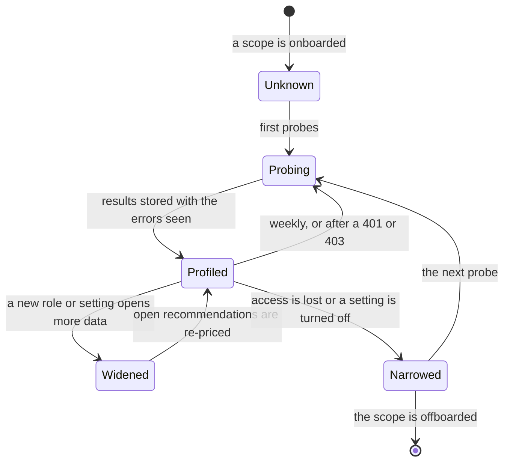

# Agreements and access

**What this document answers.** What the system does under each Azure agreement and with each level of access: which cost data it can read, which prices it can use, who may buy a commitment, and how it finds all of this out. Statements about Microsoft products are sourced to the vendor's pages as read on 2026-11-01 and 2026-11-02; where those pages disagree or leave a point open, the text says so.

## 1. Why this is a design question

The same virtual machine costs different amounts under different agreements, appears in different reports and can be committed to by different people. Who may see the bill, and who may buy a reservation or a savings plan, depends on the agreement and on the role the system was given. A design that assumes one agreement and full billing access works for few organisations. So for every scope the system treats both as facts to discover, not settings to configure. Three rules follow:

- **Probe, don't ask.** The system tries what it needs and records what worked.
- **Label, don't pretend.** Every number says which prices it rests on.
- **Hand over, don't fail.** Where the system may not act, it prepares the request for whoever may.

## 2. The agreements

| Agreement | Who can see costs on a subscription | Price the customer sees |
|---|---|---|
| **Enterprise Agreement (EA)**. Billing scopes: enrollment, department, enrollment account | Cost Management Reader on the subscription **and** the enrollment's "account owners can view charges" setting on | Negotiated; the price sheet sits at enrollment scope |
| **Microsoft Customer Agreement (MCA)**, bought directly. Billing scopes: billing account, billing profile, invoice section | Cost Management Reader **and** the billing profile's "Azure charges" setting on; a billing profile owner changes it | Negotiated or list; the price sheet sits at billing profile scope |
| **MCA through a partner** (Azure plan, CSP). The partner's tenant holds the billing scopes, including a customer scope | Only when the partner has enabled the cost visibility policy for the customer's tenant (off by default), and the person holds a role on the subscription | Retail (pay-as-you-go) rates, without the partner's discounts or credits |
| **Pay-as-you-go**. No billing-account scope in Cost Management (the Billing blade still shows a billing account): subscriptions only | Azure roles on the subscription | List (retail) |

Cost Management also supports Dev/Test, Visual Studio and free-trial offers; it does not support Azure sponsorship offers, Azure for Students or classic CSP subscriptions (those that predate the Azure plan): for those the system reads resources and nothing about cost. Management groups work as a cost scope for EA and pay-as-you-go but not for MCA or partner scopes, and they leave out purchases such as reservations. Sources: [supported offers](https://learn.microsoft.com/azure/cost-management-billing/costs/understand-cost-mgt-data#supported-microsoft-azure-offers) · [scopes](https://learn.microsoft.com/azure/cost-management-billing/costs/understand-work-scopes) · [enabling access](https://learn.microsoft.com/azure/cost-management-billing/costs/assign-access-acm-data) · [partners](https://learn.microsoft.com/azure/cost-management-billing/costs/get-started-partners).

## 3. Cost reach and resource reach

Two things are independent: what the identity can read about **cost**, and what it can read about **resources**. A billing role shows costs but [not the resources](https://learn.microsoft.com/azure/cost-management-billing/costs/understand-work-scopes#billing-scopes), so the system also needs Reader and Monitoring Reader on the subscriptions for inventory and metrics (Advisor, Resource Graph and metrics need only those roles: [Advisor](https://learn.microsoft.com/azure/advisor/advisor-overview#frequently-asked-questions), [Resource Graph](https://learn.microsoft.com/azure/governance/resource-graph/overview#permissions-in-azure-resource-graph)). Without resource reach it reasons from bill lines alone and says so.

| Cost reach | The identity holds | It can read | Prices it can use |
|---|---|---|---|
| **Billing** | A billing role: enterprise administrator or reader (EA); billing profile owner, contributor, reader or invoice manager (MCA) | Costs of every subscription under the scope; billing-scope exports; price sheet; reservation and savings plan data; a spending commitment (section 6) | Price sheet, and the unit prices on bill lines |
| **Subscription, with costs** | Cost Management Reader (or Contributor) on one or more subscriptions, with the agreement's cost visibility setting on | Costs of those subscriptions; reservation and savings plan recommendations at subscription scope | Unit prices on bill lines; a price sheet only if the subscription-scope price sheet API returns one (the probe finds out) |
| **None** | Resource roles only, or cost visibility off | Inventory, metrics, Advisor | List prices from the public Retail Prices API |

A person with no billing role sees nothing about the agreement beyond the bill lines; central teams often hold billing roles, application teams only roles on their own subscriptions. Partner billing roles (admin agent, billing admin) exist only in the partner's tenant, so a deployment in the customer's tenant never has billing reach over a partner-sold subscription.

## 4. Reading cost and prices

### Cost data paths

| Path | Works for | Role | Limits |
|---|---|---|---|
| [Exports](https://learn.microsoft.com/azure/cost-management-billing/costs/tutorial-improved-exports) (FOCUS, actual, amortised) | EA and MCA (direct or through a partner) at billing, subscription and resource group scope. Pay-as-you-go subscriptions cannot export FOCUS (Learn says so); the probe may try the other export datasets and otherwise falls back to the Usage Details or Query API. Management group scope is limited (usage CSV only) | Cost Management Contributor, Contributor or Owner on the subscription; a billing role at billing scope | Preferred where it works: files in Blob; past months by rerunning the export |
| [Cost Details API](https://learn.microsoft.com/azure/cost-management-billing/automate/get-small-usage-datasets-on-demand) | EA and MCA, not management groups | Cost Management Reader | One month per report, up to 13 months back; refreshed every four hours, so call at most daily; above about 2 GB a month use exports |
| [Usage Details API](https://learn.microsoft.com/azure/cost-management-billing/automate/migrate-consumption-usage-details-api) (legacy) | Pay-as-you-go, MSDN, Visual Studio | Cost Management Reader | Planned for deprecation; no date set |
| [Query API](https://learn.microsoft.com/rest/api/cost-management/query/usage) | Every supported agreement, including management groups and partner customer scope | Cost Management Reader | Aggregates only, two group-bys; [throttled](https://learn.microsoft.com/azure/cost-management-billing/costs/manage-automation#data-latency-and-rate-limits) by query units (12 per 10 seconds, 60 a minute, 600 an hour; a month of data costs one) |

For each scope the ingestion workflow ([05](05-data-and-integrations.md)) takes the first path that works, in that order, and writes the same cost lake layout: FOCUS columns where the source has them, mapped columns where it does not, and on every row the `source` and the `price basis`. `cost-query` and `price-sim` do not care which path filled it. Cost Management's figures [leave out credits, taxes and support charges](https://learn.microsoft.com/azure/cost-management-billing/costs/understand-cost-mgt-data#costs-included-in-cost-management), so reconciling a month needs its invoice; where none is readable (under a partner agreement it is the partner's) the invoice status is "Invoice not available" ([08](08-testing-and-evaluation.md#4-measures-and-the-report-card)).

### The price order

| Basis | Where it comes from | Good for | The recommendation says |
|---|---|---|---|
| **Contracted** | The price sheet, at enrollment scope (EA) or billing profile scope (MCA) ([EA](https://learn.microsoft.com/azure/cost-management-billing/automate/migrate-ea-price-sheet-api), [MCA](https://learn.microsoft.com/azure/cost-management-billing/costs/migrate-cost-management-api#price-sheet-for-a-scope-by-billing-account)), or the subscription-scope [price sheet API](https://learn.microsoft.com/rest/api/consumption/price-sheet/get) where it returns one | Any meter and SKU, including ones never used | "Priced at your contracted rates" |
| **Billed** | Unit prices on bill lines: `ContractedUnitPrice`, `x_BilledUnitPrice` and `x_EffectiveUnitPrice` in the [FOCUS file](https://learn.microsoft.com/azure/cost-management-billing/dataset-schema/cost-usage-details-focus) | Meters already used. For others, the discount seen on similar meters (`ContractedUnitPrice` against `ListUnitPrice`) gives an estimate, labelled as one | "Priced at the rates on your bill" or "estimated from your observed discount" |
| **List** | The public [Retail Prices API](https://learn.microsoft.com/rest/api/cost-management/retail-prices/azure-retail-prices): undiscounted, no sign-in | Anything, indicatively; it does not reconcile with invoices | "Scenario at list prices: your rates are not visible to me" |

`ContractedUnitPrice` leaves out commitment discounts, so reservation and savings plan effects come from `EffectiveCost` and the commitment columns. A subscription sold through a partner never shows the partner's price: its cost lines in the customer's tenant are at retail rates, and a recommendation says so.

## 5. The capability profile

The Estate refresh workflow builds a **capability profile** for every scope it is given: when the scope is onboarded, every week, and after any 401 or 403. The probes are read-only calls made by plain code in the `tools` app, with no model involved; the workflow stores the result with the Estate model, and the Surveyor (the role that maps the estate, [03](03-agents-and-workflows.md)) reads it and explains the errors. A probe tries cheap calls and keeps what worked and the error that showed what did not.

1. **Read the subscription.** The record carries the quota id and any tenant that manages the subscription (`managedByTenants`: a sign of a managed environment) ([Learn](https://learn.microsoft.com/rest/api/resources/subscriptions/get)). The quota id is only a hint: [Learn's table of supported offers](https://learn.microsoft.com/azure/cost-management-billing/costs/understand-cost-mgt-data#supported-microsoft-azure-offers) lists the same id for an Enterprise Agreement and a direct Microsoft Customer Agreement subscription, and for a partner-sold Azure plan and a classic CSP subscription.
2. **List the billing accounts the identity can reach** ([Learn](https://learn.microsoft.com/rest/api/billing/billing-accounts/list)). Each account names its account type and agreement type, so one or more Enterprise Agreement, Microsoft Customer Agreement or partner accounts means billing reach and settles the agreement. A pay-as-you-go billing account does not count as billing reach: Cost Management has no billing scope for it.
3. **Query the subscription's cost.** Success means cost visibility. The documented failures name what is missing: `AccountCostDisabled` (Enterprise Agreement: account owners cannot view charges), `DepartmentCostDisabled` (the department setting is off), `IndirectCostDisabled` (an Enterprise Agreement bought through a partner who has not published prices: ask the partner) and, on a Microsoft Customer Agreement, a 401 that means the identity holds no role that can view charges ([error codes](https://learn.microsoft.com/azure/cost-management-billing/costs/cost-management-error-codes)). The Azure charges setting of a billing profile is probed separately by what the query returns.
4. **Try each richer source:** price sheet, exports, cost details, reservation and savings plan data. Each success or failure becomes a flag.
5. **Read a month of bill lines.** The FOCUS columns name the billing account type, the offer (`x_SkuOfferId`: for example `MS-AZR-0017P` for an Enterprise Agreement, `MS-AZR-0017G` for a Microsoft Customer Agreement) and, for partner-sold subscriptions, the reseller; the unit-price columns show which price basis the lines support. A scope with neither billing accounts nor bill lines stays *unknown*, and the system says so.

| Field in the profile | Example |
|---|---|
| Agreement family | EA · MCA · partner-sold · pay-as-you-go · other · unknown |
| Cost reach | billing · subscription with costs · none, and the error that shows why not more |
| Cost source and depth | exports from 2025-11 · cost details, 13 months · query only |
| Price basis | contracted · billed · list |
| Commitments visible | reservations · savings plans · spending commitment: yes or no |
| Purchase path | buy · ask the billing owner · ask the partner · not available (section 6) |
| Resource reach | Reader · Monitoring Reader · Log Analytics Reader |
| As of | date of the last probe |

Every Recommendation carries the price basis, and one line says what more access would buy: "with the price sheet I could replace list prices with yours on N open recommendations". The system never asks for more access than a question needs; each Case concerns one scope, and its cards go to that scope's owners of record.

## 6. Buying commitments under each agreement

| | EA | MCA, direct | Sold through a partner | Pay-as-you-go |
|---|---|---|---|---|
| **Reservation** | Owner or Reservation Purchaser on an EA subscription; an enrollment setting can limit purchases to enrollment admins | The same roles; a billing profile owner can restrict them by a policy, which does not bind billing profile and billing account owners | The partner, in Partner Center or the Azure portal; or the customer, once the partner turns customer permissions on (off by default) and the customer holds a purchasing role on the subscription (the Reservations page names Reservation Purchaser, the Partner Center page Owner) | Owner or Reservation Purchaser on the subscription |
| **Savings plan** | An enterprise administrator with write access, or Owner or Savings plan purchaser on a subscription of the enrollment; the Add Savings Plan policy can limit purchases to administrators | A billing profile contributor or higher, or Owner or Savings plan purchaser on a subscription of the billing profile; billing profile and billing account owners can buy even when the Add Savings Plan policy is off | The partner, in Partner Center or the Azure portal; customer self-service only if the partner allows it (off by default) and the customer holds Owner | Not offered: savings plans exist for EA, MCA and partner agreements |

Sources: [reservations](https://learn.microsoft.com/azure/cost-management-billing/reservations/prepare-buy-reservation) · [savings plans](https://learn.microsoft.com/azure/cost-management-billing/savings-plan/permission-buy-savings-plan) · [partner permission](https://learn.microsoft.com/partner-center/customers/give-customers-permission). A custom role that mimics Owner or Reservation Purchaser cannot buy.

**Scope.** A reservation or savings plan has one scope: a resource group, a subscription, a management group or a **shared** scope. Shared means the enrollment (EA), the billing profile (MCA) or all eligible subscriptions created by the account administrator (pay-as-you-go) ([Learn](https://learn.microsoft.com/azure/cost-management-billing/reservations/prepare-buy-reservation#scope-reservations)); a management group covers only its subscriptions in the enrollment or billing profile of the paying subscription ([Learn](https://learn.microsoft.com/azure/cost-management-billing/savings-plan/scope-savings-plan)). The system proposes the narrowest scope the evidence supports and says what the scope covers under this agreement.

**Currency.** A savings plan under an MCA or a partner agreement is priced in US dollars and billed in the local currency at the month's exchange rate ([Learn](https://learn.microsoft.com/azure/cost-management-billing/savings-plan/savings-plan-overview#how-are-savings-plans-purchased)), so the approval binds the dollar commitment.

**What cannot be undone.** A savings plan cannot be cancelled, refunded or exchanged. A reservation can be exchanged or refunded within limits that change over time ([Learn](https://learn.microsoft.com/azure/cost-management-billing/reservations/exchange-and-refund-azure-reservations)); a partner's customer asks the partner. The Atlas holds these rules with their dates, and a Recommendation quotes the rule in force.

**Renewal.** A reservation renews unless auto-renew is switched off, and Azure shows the renewal price from 30 days before expiry ([Learn](https://learn.microsoft.com/azure/cost-management-billing/reservations/reservation-renew)): the quote states the renewal setting, and an earlier renewal Case carries a scenario.

### Four purchase paths

The decision is the same everywhere: two people with different roles approve a quote-bound plan ([06](06-security-and-governance.md)). Only the execution differs.

| Path | When | The system | Done by | Seen when |
|---|---|---|---|---|
| **Buy** | The agreement and the organisation's policy let the purchase identity hold the purchase right on a billing subscription | Prepares the plan, gets two approvals, buys the stored quote | The runner | The order and the purchase line in the bill, which pay-as-you-go cost data [omit](https://learn.microsoft.com/azure/cost-management-billing/costs/understand-cost-mgt-data#costs-included-in-cost-management) |
| **Ask the billing owner** | Another team holds the billing role | Sends a request with the stored quote (product, term and amount), the scope identifiers and the deadline | The billing owner | As above, before the deadline; otherwise the Case reopens |
| **Ask the partner** | The subscription is sold through a partner | The same request, addressed to the partner contact the organisation names (partners are not in the directory) | The partner, or the customer where the partner allowed it | The partner confirms (the bill may not show it: section 8); otherwise the Case reopens |
| **Not available** | For example a savings plan under pay-as-you-go, or approvers without a phishing-resistant sign-in ([09](09-delivery-and-operations.md#9-onboarding-an-estate)) | Says so and proposes what exists, or nothing | | |

A request to the billing owner or the partner is plain-text e-mail ([05](05-data-and-integrations.md#6-channels)) with an external flag. It holds the stored quote's product, term and amount, the scope identifiers needed to quote or buy (the management group or the subscriptions the purchase applies to) and the deadline: no saving, evidence, resource names, owners, tags or other spend, no figures in the subject line and no link or button. It goes to one recipient address on the platform team's allow-list, and the send step refuses any other, whoever named it. A reply is read as a question and approves nothing; nothing here stops a recipient forwarding it.

### Other levers that depend on the agreement

| Lever | Under which agreements |
|---|---|
| Spending commitment (MACC) | Tracked in the Azure portal only for direct EA and direct MCA customers, and only by the enterprise administrator (EA) or a billing account owner, contributor or reader (MCA) ([Learn](https://learn.microsoft.com/azure/cost-management-billing/benefits/macc/track-consumption-commitment)). A missed milestone or end date is charged as a shortfall, issued as Azure prepayment credit (the saving rule: [08](08-testing-and-evaluation.md#4-measures-and-the-report-card)). Marketplace purchases count only with the "Azure benefit eligible" badge, bought through the Azure portal ([Learn](https://learn.microsoft.com/marketplace/azure-consumption-commitment-benefit)) |
| Azure Hybrid Benefit managed at scope (for SQL Server) | EA and direct MCA; not Windows Server, which has no scope-level option, and not customers whose CSP partner manages Azure for them ([Learn](https://learn.microsoft.com/azure/cost-management-billing/scope-level/overview-azure-hybrid-benefit-scope)) |
| Dev/Test pricing | Enterprise Dev/Test is an EA offer. Pay-as-you-go Dev/Test is a separate offer that needs no EA. MCA and CSP have their own Dev/Test offers ([supported offers](https://learn.microsoft.com/azure/cost-management-billing/costs/understand-cost-mgt-data#supported-microsoft-azure-offers)) |
| AI commitments (provisioned throughput reservations, agent prepurchase plan) | Reservation rules apply; for CSP, only the partner can buy provisioned throughput reservations ([Learn](https://learn.microsoft.com/azure/cost-management-billing/reservations/microsoft-foundry)) |

## 7. What changes in the system

| Part | What it does with the profile |
|---|---|
| `cost-query`, `price-sim` | Return the price basis with every answer; price in the order of the table above |
| Atlas ([04](04-knowledge-and-learning.md)) | A claim's scope names the agreement family; observations shared across estates carry it too |
| Recommendations ([03](03-agents-and-workflows.md)) | Carry the price basis (section 5); estimates are never presented as quotes |
| Action catalogue and purchases ([06](06-security-and-governance.md)) | Choose the purchase path; the approval record binds the quote whichever path runs |
| Directory ([05](05-data-and-integrations.md)) | Holds the billing owner and the partner contact as roles with their evidence |
| Onboarding ([09](09-delivery-and-operations.md)) | Step 1 is a probe, and the profile decides which steps follow |

## 8. What this does not settle

- **A probe shows what the identity can do today, not what the agreement allows.** A missing role looks like a missing feature, so the profile says what to ask for.
- **Partner-sold savings are estimates** until the partner supplies its rates or an invoice settles them.
- **Spending commitments and discounts under a partner agreement are not visible** through these interfaces, and reservation usage shows zero actual and amortised cost in the customer's cost data ([Learn](https://learn.microsoft.com/azure/cost-management-billing/costs/get-started-partners)). The purchase itself shows at pay-as-you-go rates when the cost visibility policy is on, and not otherwise, so the Verifier confirms a partner-held purchase and the partner's price and discount with the partner, not from the bill.
- **The system runs in the customer's tenant.** Cost Management has [limited support for cross-tenant access](https://learn.microsoft.com/azure/cost-management-billing/costs/assign-access-acm-data#cross-tenant-authentication-issues), so a provider that manages several customers runs one deployment per customer.
- **Acceptance test:** the profile matches what that identity sees in the portal (P4, [roadmap](13-roadmap.md)).
