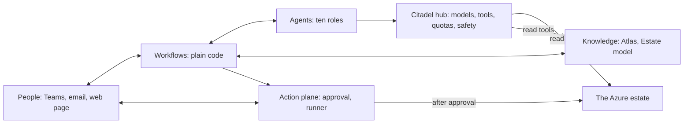

# Azure Cost in Action — design

**What this design answers.** What the system is, how it is built, why it is built that way, and what it costs — in plain words, for anyone who runs Azure. Status: **proposed**. Nothing is built yet; what is unproven is listed at the end.

## What it is

Azure Cost in Action is a team of AI agents that keeps an Azure estate cost-efficient without waiting to be asked. It studies how Azure charges, learns what each estate is for, watches the bill and the usage, investigates where money is wasted or about to be, challenges its own findings, and tells the right owner in plain words — with evidence and options. When a person says OK, or inside a rule a person wrote, it makes the change and checks that it worked. What it learns is kept, tested and shared.

It is built on Microsoft Foundry and Microsoft Agent Framework, and every model and tool call goes through the **Citadel governance hub**. It is not a chatbot: the product is the loop *watch → investigate → decide with a person → act → verify → learn*. It reads Azure Advisor and Cost Management and goes further; it changes nothing without a bound approval; it never deploys resources in order to learn.

## How it learns without a lab

It learns from what already exists: Microsoft's documentation, price lists and resource schemas; the bills it reads; replays of cost history under another SKU or commitment; owners' answers; the outcomes of its own changes; and small, reversible trials that an owner approves. Every claim carries its source, its scope and an evidence level: *documented* and *price-confirmed* in the Atlas, then *bill-observed* and *outcome-confirmed* once one estate's own bills and results confirm it. The honest gap — a meter nobody has used cannot be found this way — is stated in [knowledge and learning](04-knowledge-and-learning.md).

## Ten decisions that shape it

| # | Decision | In one line |
|---|---|---|
| 1 | Workflows are code, agents think, one component writes | Control flow is deterministic; agents never change Azure |
| 2 | Azure Functions for our code | Scales to zero; a workflow can wait days for a person at no cost |
| 3 | Five hosted agents, ten roles | One identity per trust boundary |
| 4 | The Citadel hub is the only door | One contract per hosted agent; quotas, safety and logs in one place |
| 5 | Models by alias | Cheap model first; the judge is another model family |
| 6 | The Atlas lives in Git | Agents propose, people merge; served from AI Search |
| 7 | Approval is bound and single-use | The runner re-checks everything and fails closed |
| 8 | No standing purchase role | Two people with different roles approve; the AI executes |
| 9 | Two profiles | Evaluate on synthetic data; Operate in a private network |
| 10 | Evaluation is part of the system | Learning is shown by comparing frozen and updated memory |

The full list, with alternatives, cost, security and reversibility, is in [decisions](12-decisions.md).

## Words used in this design

| Term | Meaning |
|---|---|
| **Atlas** | The knowledge base of how Azure charges: claims with sources, scope and evidence level, kept in Git |
| **Estate model** | What the system knows about one organisation's resources, purpose, rhythms and owners |
| **Case** | One investigation, from a lead to a verified outcome |
| **Recommendation** | The decision card an owner receives: what, why, options, consequences, how to check |
| **Action** | A versioned, tested recipe for a change; the **Action catalogue** lists them |
| **Agent** | An AI worker with a role, a set of tools and an identity; ten roles live in five hosted agents |
| **Workflow** | Plain code that sequences agents and people and waits for answers |
| **Hub** | The Citadel governance hub in the landing zone: the only route to models and tools |
| **Contract** | The hub configuration that says what one agent may use and how much |
| **Evaluation** | A test run that scores the system on cases with known answers |
| **Lesson** | Something a person taught the system about their estate, with scope and expiry |
| **Detector** | A cheap, compiled check that nominates leads, written once from a confirmed finding |

## What an organisation needs

An Azure subscription and rights to deploy; read access to cost data; a Citadel hub (the organisation's own, or the accelerator deployed from this repository); model quota; Microsoft Entra ID (P1 for Conditional Access on approvers); Microsoft 365 for Teams and email (the web page is the fallback); a Git host. Details and optional licences are in [goals and scope](01-goals-and-scope.md).

## Where to read next

| If you want to know | Read |
|---|---|
| What it is for, who it serves, what is out of scope | [Goals and scope](01-goals-and-scope.md) |
| The parts, the flows, the hub, the two profiles | [Architecture](02-architecture.md) |
| The roles, the workflows, how a person is asked | [Agents and workflows](03-agents-and-workflows.md) |
| How it learns Azure and an estate | [Knowledge and learning](04-knowledge-and-learning.md) |
| Where data lives and how it gets in | [Data and integrations](05-data-and-integrations.md) |
| What can go wrong and what stops it | [Security and governance](06-security-and-governance.md) |
| What drifts and how it is stopped | [Safeguards and drift controls](07-safeguards-and-drift.md) |
| How we know it works and is learning | [Testing and evaluation](08-testing-and-evaluation.md) |
| How it is built, run and recovered | [Delivery and operations](09-delivery-and-operations.md) |
| What it costs to run | [Cost and FinOps](10-cost-and-finops.md) |
| Which technologies, and their status | [Technology register](11-technology-register.md) |
| Why each choice was made | [Decisions](12-decisions.md) |
| In what order it is built | [Roadmap](13-roadmap.md) |

## How this relates to the north star

The [north star](../01-north-star.md) is the idea this design realises. Two things differ. This design has **no lab**: nothing is deployed to learn. And it uses plainer words: *evaluation* for the tests of the system, *recommendation* for the decision card, *Action* for a change recipe; *Atlas* and *Estate model* are unchanged.

## What is unproven

- **Ten proof points** are measurements, not arguments ([roadmap](13-roadmap.md)): the hub path, workflow-to-agent calls, approval integrity, cost data at scale, retrieval, agent quality on verified cases, injection paths, runner roles, tool pinning, tokens per case.
- **Preview features** are used only behind a switch with a generally available fallback; the [register](11-technology-register.md) says which.
- **Cost figures** are model outputs from a price snapshot and seeded volumes, replaced by measurements in proof point 10.
- A safeguard is only as good as what it stops: each document says what its safeguards do **not** stop.

An earlier draft of this design was withdrawn and is kept for the record in the [archive](../_archive/design-v1/README.md). How the decisions here were challenged is in the [review record](../reviews/README.md).
