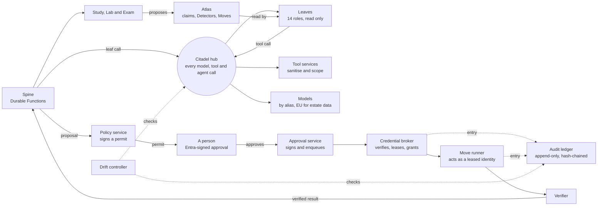

# Design — phase 1

> **Status:** `design-v1`, 2026-11-01 · builds on the ideation ([north star](../01-north-star.md), tag `ideation-v4`). **Rubber-duck record:** three passes, a closure check and nine models — two full rounds with a different model on each lens, a targeted third pass by two further models on the parts the second round redesigned, and a closure check by those two models on the fixes (it reopened eight findings and found fourteen new defects, all fixed or stated as residuals), followed by a bounded re-check — see [the review record](../reviews/README.md).
> This folder is where the idea becomes a design: architecture on Microsoft Foundry and the Microsoft Agent Framework, deployed through the Citadel framework in the operator's landing zone, with security, governance, drift control, testing and cost designed in. The ideation documents stay the north star; nothing here changes what the system is *for*.

**Read this first.** The system is a *deterministic spine with agentic leaves*: ordinary workflows (Durable Functions) call hosted agents — fourteen roles, fifteen identities, eleven contract groups — one step at a time through the hub with a budget; the agents can only read; the one place that can change an estate is a small execution plane in which **no single credential completes a change that needs a person's web-page approval**: the Policy service signs a permit, a person approves with an Entra-signed token bound to the target and to the decision, the Approval service signs and enqueues (it starts nothing), the credential broker verifies all of it itself — including that the approval's entry is in the ledger — before it grants, and an event-driven Move runner verifies again, checks the live state and acts with an identity that exists only for that Move (what still remains is stated in [07 §3.3](07-security-architecture.md#33-the-execution-identity-just-in-time-without-pim)); and every model, tool and agent call passes the Citadel governance hub. Drift is controlled by deterministic detectors; a preview feature is used only behind a switch with a generally available fallback; the cost of the platform itself is modelled, **budgeted by the spine's atomic reservation**, limited at the hub as a second layer and tracked as *cost per verified euro saved*.

*The system on a page: the hub in the middle of every call, the loop that ends a change in a verified result, the ledger beside it, and the learning loop (study, test, propose, read) that makes the Atlas better.*

## The design

| Document | What it answers |
|---|---|
| [01 · Requirements and principles](01-requirements-and-principles.md) | What the design must satisfy: constraints, assumptions, functional requirements, quality targets, principles |
| [02 · Technology landscape](02-technology-landscape.md) | What the Microsoft AI ecosystem offers today (817 updates, triaged), the twelve hypotheses judged, the technology map, the findings that moved decisions |
| [03 · Logical architecture](03-logical-architecture.md) | The parts, the planes, the trust boundaries and the main loop — before any product is chosen |
| [04 · Landing zone and Citadel](04-landing-zone-and-citadel.md) | Where the solution lives, what it needs from the landing zone, the hub, the contracts per agent group, the network, the Foundry layout, the gateway-bypass register |
| [05 · Agents and orchestration](05-agents-and-orchestration.md) | The spine and the leaves, the roster, the workflows, the models and aliases, the token economy, what is deliberately not used |
| [06 · Data and knowledge](06-data-and-knowledge.md) | The information model, the knowledge pipeline, cost data, privacy, and the physical stores |
| [07 · Security architecture](07-security-architecture.md) | Trust zones, identity, the just-in-time execution identity, approvals, nine layers against injection, the capability matrix, detection and kill switches |
| [08 · Governance and compliance](08-governance-and-compliance.md) | Roles and decision rights, policy as code, the EU AI Act, GDPR, NIS2, ISO/IEC 42001, NIST AI RMF, the evidence pack, the risk register |
| [09 · Safeguards and drift controls](09-safeguards-and-drift-controls.md) | Nineteen drift layers with prevent, detect and correct; the drift controller; the safeguards between a mistake and an irreversible action; the preview register |
| [10 · Test and evaluation](10-test-and-evaluation.md) | The layers, the Terrarium, the release gates, environments, and the platform mapping |
| [11 · Delivery and operations](11-delivery-and-operations.md) | Repository, infrastructure as code, pipelines, deploying agents, releases, onboarding, operations, recovery |
| [12 · Cost and FinOps](12-cost-and-finops.md) | A reproducible cost model at three scales, the always-on ledger, levers, how the system's own spend is governed |
| [13 · Decisions](13-decisions.md) | Thirty-seven architecture decision records, each with its strongest alternative |
| [14 · Next phases](14-next-phases.md) | Spikes that could invalidate a decision, the build phases and their evidence, the next design documents |

## The evidence

Everything above rests on research done on 2026-10-31 from pages read that day. It is evidence, not design.

| Document | What it holds |
|---|---|
| [Research brief](research/00-research-brief.md) | How the research was commissioned: constraints, hypotheses, vocabularies, assignments |
| [Feature register](research/feature-register.md) | All 817 updates of the operator's list, triaged exactly once into 267 clusters (generated by `tools/merge-features.py`) |
| Slice digests: [F1](research/features-01.md) · [F2](research/features-02.md) · [F3](research/features-03.md) · [F4](research/features-04.md) · [F5](research/features-05.md) · [F6](research/features-06.md) · [F7](research/features-07.md) · [F8](research/features-08.md) | The evidence behind each cluster: status, fit, sources |
| [Citadel](research/citadel.md) | The Citadel Governance Hub read to parameter level: contracts, safeguards, cost, gaps |
| [Foundry Agent Service](research/foundry-agent-service.md) | Agent types, hosted agents, models and prices, knowledge, memory, voice, behaviour behind a gateway |
| [Foundry governance and the Agent Framework](research/foundry-governance-and-framework.md) | Control plane, guardrails, agent identity, networking, observability, evaluation, the framework, Teams delivery |
| [Security and compliance](research/security-and-compliance.md) | A control catalogue with licences and meters, the threat model, the EU AI Act, GDPR, NIS2 |
| [Options analysis](research/options-analysis.md) | Hosting, cost analytics, stores, vectors, messaging, delivery, observability, channels, the Lab |
| [Prices](research/prices.md) | How the reproducible price snapshot was built and checked; the snapshot is [`cost/prices-snapshot.json`](cost/prices-snapshot.json) |

## How it was reviewed

Each design document and every ADR went through **two full rubber-duck rounds** (architecture, security and safety, cost and operability, AI engineering, platform fact-check), with a **different model on each lens in the second round** (four families across the five lenses, so no lens saw its own model twice). Round 1 found the seams of a first draft; Round 2 attacked the revisions and found what a large revision breaks — above all a signer that could also start the runner, a leaf that would be deprovisioned mid-run, and a cost model that claimed a closure it did not have. The parts Round 2 redesigned (the authority chain, the leaf-call rule, the spend budget, the contract × environment model) went through a **targeted third pass** by two further models that had reviewed nothing before; they found 33 more defects in the redesign — among them a private endpoint that cannot live in a delegated subnet, cross-environment calls that internal ingress cannot carry, a decline that could be relabelled as an approval, markers that any identity with container access could forge, and a priority tier that no price covered — and every one was fixed or is stated as a residual. Those two reviewers then **checked closure** on the fixes and found that they had reopened eight findings and introduced fourteen new defects, four of them Critical and all in the authority chain — among them a queue role that could also put to its own queue, a sequence that started the approve sign-in before any click, a lock that checked and then acted, and an approval record that the design amended inside a create-only container; each platform claim was verified on Learn before it was acted on, and each defect was fixed or is stated as a residual ([the closure record](../reviews/design-v1-third-pass/disposition.md#6-the-closure-check-at-87925dd-and-the-closure-round)). Raw reports are kept verbatim with the orchestrator's spot-checks and a disposition for every finding; the standing brief is [`reviews/design-review-brief.md`](../reviews/design-review-brief.md). What the design does **not** claim: that a spike passed (each is a *to confirm* until it has run), that the authority chain is safe to switch on (its mechanics — queue-scoped roles, the decision-bound nonce, intent entries before effects, effective revocation, cross-environment ingress — are proven only by S-ID-1, S-ID-3 and S-ACT-1, and nothing changes an estate before they pass), that the cost seeds are measurements, or that the statuses in [13](13-decisions.md) are final.
