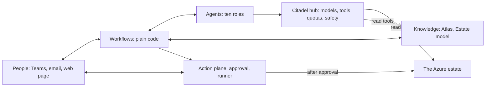

# Meternaut — design

**What this design answers.** What the system is, how it is built, why it is built that way, and what it costs — in plain words, for anyone who runs Azure. Status: **proposed**. Nothing is built yet; what is unproven is listed at the end.

## What it is

Meternaut is designed as a team of AI agents that keeps an Azure estate cost-efficient without waiting to be asked. It studies how Azure charges, learns what each estate is for, watches the bill and the usage, investigates where money is wasted or about to be, challenges its own findings, and tells the right owner in plain words — with evidence and options. When a person says OK, or inside a rule a person wrote, it makes the change and checks that it worked. What it learns about how Azure charges (documented and price-confirmed claims) is kept in the **Atlas** (a tested knowledge base) and shared; an estate's bills, price sheet and outcomes stay in that estate.

It is built on Microsoft Foundry and Microsoft Agent Framework, and every model and tool call goes through the **Citadel governance hub** (an API Management based gateway that Microsoft publishes as an open-source sample). The product is the loop *watch → investigate → decide with a person → act → verify → learn*. It reads Azure Advisor and Cost Management and goes further; it changes Azure only after an approval bound to one exact plan, or inside a rule a person wrote; and it adapts to the agreement and the access it finds, and says what it cannot see ([agreements and access](14-agreements-and-access.md)).

## How it learns

The system learns from what already exists, so learning deploys nothing of its own: Microsoft's documentation, price lists and resource schemas; the bills it reads; replays that re-price past usage under another SKU or commitment; owners' answers; the outcomes of its own changes; and small, reversible trials that an owner approves. Its learning costs model tokens and the platform's own running cost ([cost and FinOps](10-cost-and-finops.md)). Every claim carries its source, its scope and an evidence level: *documented* and *price-confirmed* in the Atlas, then *bill-observed* and *outcome-confirmed* once one estate's own bills and results confirm it. One gap is stated in [knowledge and learning](04-knowledge-and-learning.md): a meter nobody has used cannot be bill-observed this way.

## Ten decisions that shape it

| # | Decision | In one line |
|---|---|---|
| 1 | Workflows are code, agents think, one component writes | Control flow is deterministic; agents never change Azure, only the runner does |
| 2 | Azure Functions for our code | Scales to zero, except one optional always-ready instance for the workflows app (a fixed cost); a workflow waits days for a person without running orchestration code |
| 3 | Five hosted agents, ten roles | One identity per trust boundary |
| 4 | The Citadel hub is the only door | One contract per hosted agent; quotas, safety and logs in one place |
| 5 | Models by alias | Cheap model first; the judge is another model family |
| 6 | The Atlas lives in Git | Agents propose, people merge; served from AI Search |
| 7 | Approval is bound to one exact plan, which runs once | The runner re-checks everything and fails closed |
| 8 | No standing purchase role | Two people with different roles approve; the AI executes where the agreement allows, and otherwise prepares the request for whoever can buy |
| 9 | Two profiles | Evaluate on synthetic data; Operate in a private network |
| 10 | Evaluation is part of the system | Learning is shown by running the same sealed test cases, which the system has never seen, twice: with its knowledge frozen at a date and with what it learned since |

The full list, with alternatives, cost, security and reversibility, is in [decisions](12-decisions.md). One more shapes every document: **the system probes which agreement and which level of access each scope has, and adapts** ([agreements and access](14-agreements-and-access.md)).

## Words used in this design

| Term | Meaning |
|---|---|
| **Atlas** | The knowledge base of how Azure charges: claims with sources, scope and evidence level, kept in Git |
| **Estate model** | What the system knows about one organisation's resources, purpose, rhythms and owners |
| **Case** | One investigation, from a lead to a verified outcome |
| **Evidence level** | What kind of evidence stands behind a claim: `documented` (a source says so), `price-confirmed` (a published price list agrees), `bill-observed` (a closed bill in one estate agrees), `outcome-confirmed` (a change had the predicted effect) |
| **Capability profile** | What the system found out about one scope: which agreement it sits under, which cost data and prices it can read, and who can buy a commitment there ([agreements and access](14-agreements-and-access.md)) |
| **Recommendation** | The decision card an owner receives: what, why, options, consequences, how to check |
| **Action** | A versioned, tested recipe for a change; the **Action catalogue** lists them |
| **Agent** | An AI worker with a role (its job), a set of tools and an identity; ten roles live in five hosted agents ([agents and workflows](03-agents-and-workflows.md)). A set of Azure permissions is an *RBAC role* and a group of people a *directory group* |
| **Credential** | An autopilot rule a person wrote: which Actions may run without a fresh approval, where, and up to what value. (Passwords and keys are called keys and secrets) |
| **Workflow** | Plain code that sequences agents and people and waits for answers |
| **Hub** | The Citadel governance hub in the landing zone: the only route to models and tools |
| **Contract** | The hub's per-agent configuration (Citadel calls it an access contract): what one agent may use and how much. It has nothing to do with an Azure agreement |
| **Approval** | A person's decision, bound to one exact plan and the facts it was made against (a hash and the live state); the plan runs once |
| **Runner** | The only component that changes Azure, and only what an approval names |
| **Evaluation** | A test run that scores the system on sealed cases (kept from the system) with known answers |
| **Judge** | The model that grades answers in an evaluation, from a different model family than the one graded |
| **Report card** | The system's scored record: calibration, verified savings, regrets and surprises |
| **Regret, boomerang** | A regret is an approved change whose verified outcome was worse than doing nothing; a boomerang is a change reversed within weeks |
| **Cost lake** | Blob storage that holds the cost exports (in FOCUS, the FinOps Foundation's open cost and usage format) and the price data |
| **Cost-trap bank** | A catalogue of 145 sourced Azure cost traps, each with its source and a status; the Verified rows become gold labels in evaluation ([research](../research/cost-trap-bank.md)) |
| **Lesson** | Something a person taught the system about their estate, with scope and expiry |
| **Detector** | A cheap, compiled check that nominates leads, written once from a confirmed finding; it declares where it applies and when it expires |

## What an organisation needs

An Azure subscription with deploy rights, read access to cost data (subscription-level Cost Management access is enough to start; billing-level roles add price sheets and purchase rights, and [agreements and access](14-agreements-and-access.md) says where each is available), a Citadel hub (the organisation's own, or Microsoft's open-source accelerator), model quota, Microsoft Entra ID, and a Git host. Microsoft 365 adds Teams and email; the web page is the fallback. People: a platform team to run it, a FinOps lead, owners who answer cards, and Atlas and security reviewers. [Goals and scope](01-goals-and-scope.md) lists every need and the optional licences.

**What it costs.** As modelled from list prices, a pilot costs a few hundred euros a month, about half of it fixed (search, private endpoints, an always-ready function instance), and an enterprise estate several thousand euros a month. The Citadel hub is shared platform cost and is not in these totals ([cost and FinOps](10-cost-and-finops.md) says what a hub of its own adds).

## Where to read next

| If you want to know | Read |
|---|---|
| What it is for, who it serves, what is out of scope | [Goals and scope](01-goals-and-scope.md) |
| The parts, the flows, the hub, the two profiles | [Architecture](02-architecture.md) |
| The roles, the workflows, how a person is asked (with a worked card) | [Agents and workflows](03-agents-and-workflows.md) |
| How it learns Azure and an estate | [Knowledge and learning](04-knowledge-and-learning.md) |
| Where data lives and how it gets in | [Data and integrations](05-data-and-integrations.md) |
| What changes with an Enterprise Agreement, a Microsoft Customer Agreement, a partner (CSP), pay-as-you-go, or only subscription-level access | [Agreements and access](14-agreements-and-access.md) |
| What can go wrong and what stops it | [Security and governance](06-security-and-governance.md) |
| What drifts and how it is stopped | [Safeguards and drift controls](07-safeguards-and-drift.md) |
| How it is shown to work and to learn | [Testing and evaluation](08-testing-and-evaluation.md) |
| How it is built, run and recovered | [Delivery and operations](09-delivery-and-operations.md) |
| What people see, receive and decide | [Experience design](../experience/README.md) |
| What it costs to run | [Cost and FinOps](10-cost-and-finops.md) |
| Which technologies, and their status | [Technology register](11-technology-register.md) |
| Why each choice was made | [Decisions](12-decisions.md) |
| In what order it is built | [Roadmap](13-roadmap.md) |
| How to start building it | The [build plan](../build-plan/README.md), the [roadmap](13-roadmap.md) and [Delivery and operations](09-delivery-and-operations.md) |

## How this relates to the north star

The [north star](../01-north-star.md) describes the idea this design realises.

## What is unproven

- **Ten proof points** (P1 to P10) are measurements the [roadmap](13-roadmap.md) schedules: the hub path, workflow-to-agent calls, approval integrity, cost data at scale, retrieval, agent quality on the source-verified rows of the cost-trap bank, injection paths, runner roles, tool pinning, tokens per case.
- **Preview features** are used only behind a switch with a generally available fallback; the [register](11-technology-register.md) says which.
- **Cost figures** are model outputs from a price snapshot and seeded volumes, replaced by measurements in proof point 10.
- A safeguard is only as good as what it stops: each document says what its safeguards do **not** stop.

How the decisions here were challenged is in the [review record](../reviews/README.md).
