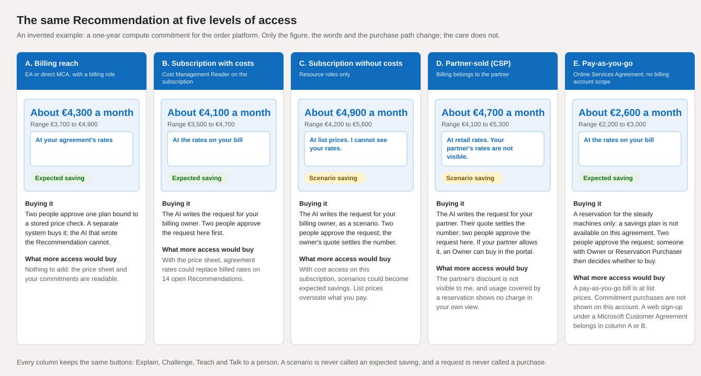
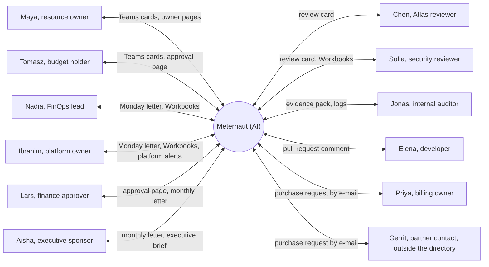

# The people: personas and what changes with access

**What this document answers.** Who the experience is for, what each group needs and which surface reaches whom; then what changes when the system sees less of the bill (five levels of access) and when the organisation is larger, smaller or has no owner of record for part of its estate. Quoted text is what people see; the [README](README.md) defines those screen words.

## Who the experience is for

Twelve invented archetypes stand for everyone the experience serves; their names are placeholders. The table maps each to a persona of the [FinOps Foundation's framework](https://www.finops.org/framework/personas/) where one fits: six core and five allied personas.

| Persona | FinOps Framework persona | What they decide | Where they meet the system | How often |
|---|---|---|---|---|
| **Maya**, resource owner | Engineering | Whether a change to what she owns goes ahead | Teams cards, owner pages, approval page | Weekly desk (a digest of up to five items, each its own decision); at most three other unsolicited messages a week |
| **Tomasz**, budget holder | Product | Whether a spend fits the budget; one of two purchase approvers | Teams cards, approval page | When his budget is touched |
| **Nadia**, FinOps lead | FinOps Practitioner | How much the system may interrupt people; standing permissions | Monday letter, Azure Monitor Workbooks, kill-switch page | Every Monday |
| **Ibrahim**, platform owner | FinOps Practitioner; Engineering (platform) | Which scopes its plans may touch; when to use the kill switch | Monday letter, Workbooks, kill-switch page, platform alerts | Every Monday; on call |
| **Chen**, Atlas reviewer | None (project role) | Whether a change to the Atlas (the shared knowledge of how Azure charges) is merged | Review card on a pull request | Per change |
| **Sofia**, security reviewer | Security (allied) | Whether a recipe for changing Azure, or a permission rule, is safe | Pull-request cards, Workbooks, kill-switch page | Per change; quarterly access review |
| **Lars**, finance approver | Finance | Finance approval of a purchase; which savings the close accepts | Approval page, monthly letter with CSV | Monthly; per purchase |
| **Priya**, billing owner | Procurement | Whether to buy what the system requests, or grant access | E-mail request | Per request |
| **Gerrit**, partner contact (external) | Procurement (the partner it works with) | Whether to buy for the customer, at what quote | E-mail request only | Per request |
| **Aisha**, executive sponsor | Leadership | Whether spend and risk fit business priorities | Monthly letter, executive brief | Monthly |
| **Jonas**, internal auditor | None (governance role) | Whether the records show what happened and who agreed | Evidence pack, audit log, Workbooks | On the audit cycle |
| **Elena**, developer | Engineering | Whether to act on a cost comment | Pull-request comment (optional, later) | Per pull request |

A Teams card shows a plan and opens the approval page; opening a plan approves nothing. Every change is approved there, with the approver's own sign-in to Azure ([approval classes](../design/06-security-and-governance.md)). A standing permission, an optional mode not built, would let a customer's own identity make one kind of change in one place without asking each time. The kill switch stops the system's changes. Cadences and limits are starting values the adopting organisation sets ([attention and trust](08-attention-and-trust.md)).

Delegates, a line manager the owner appointed, and the custodian (the team named for unowned or unreachable estate) provide cover when an owner is away or unknown. They are roles of the moment, not personas.

## What each group needs

Four things never vary: every message says an AI wrote it; a person can always be reached ("Talk to a person" ends every card); claim and decision cards offer Explain, Challenge and Teach, the others Explain only; silence is never consent.

| Aspect | Owners and budget holders: Maya, Tomasz (J1 to J8) | Central roles: Nadia, Ibrahim, Lars, Priya, Aisha (J9 to J13) | Reviewers and contributors: Chen, Sofia, Jonas, Elena (J14 to J17) | Outsiders: Gerrit, and anyone outside the directory |
|---|---|---|---|---|
| Job to be done | Keep workloads running and affordable; decide on what is proposed | Run the FinOps practice: attention, permissions, reconciled savings, commitments | Keep knowledge, recipes and records correct; contribute a fix; audit what the system did | Act on a request without a call; a contractor or shared mailbox only receives, never approves |
| What the system asks and gives | One decision or Question at a time; ranges, price basis, undo, editable Notes | A few dated decisions; Monday letter (400 words at most), monthly letter, report card | One change at a time: claim, receipts, tests, a ten-minute checklist; an evidence pack for the auditor | One plain-text e-mail, complete enough to act on; a quote or a reason comes back |
| Trust needs | Evidence one tap away; disagreement as easy as yes; no surprises in their scope | Figures that reconcile to the invoice, estimates marked, claimed against verified; a kill switch that works | Receipts they can check; no author completes their own review; the GitHub app can never merge | Who asks and why; minimum estate data, omissions stated; no password requests |
| Failure to design against | Fatigue that ends in rubber-stamping or muting: one decision per message, no bulk approve | Savings claimed without proof; two approvers who each assumed the other checked. Safeguards reduce this but cannot prove anyone read the plan | A careless or poisoned change merged by a tired reviewer; a first-time contributor who hears nothing | A request that leaks more estate than the purchase needs, or too little to act on |
| What success looks like | A decision, a refusal included, in about two minutes | Finance accepts a verified figure without a side spreadsheet; each purchase has two informed approvals | A change reviewed in ten minutes, every receipt checked; a first pull request gets an automatic reply | The partner acts on the first request; the item closes or reopens on the answer |

(An invented example.) For a QA environment the system first asks Maya one Question: does anything run at night on the last Tuesday of the month? Her answer, "the month-end regression", becomes a Note with a scope and an expiry. The Recommendation that follows switches it off nights and weekends except that night: about EUR 690 a month (range 620 to 760), At the rates on your bill, Expected saving.

## Which surface reaches whom

These are defaults: each person picks a channel profile, teams-first (once the app is installed), email-first or digest-only. Only members of the organisation's directory receive cards.

| Surface | Main for | Sometimes for |
|---|---|---|
| [Teams cards](04-messages-and-cards.md) | Maya, Tomasz | Nadia, Ibrahim, Lars, Priya |
| [E-mail letters](05-letters-and-requests.md) | Nadia, Ibrahim, Lars, Priya, Gerrit, Aisha | Maya, Tomasz, Sofia |
| [Owner pages](06-web-pages.md) | Maya | Tomasz, Ibrahim, Jonas |
| [Approval page](06-web-pages.md) | Tomasz, Lars | Maya, Ibrahim |
| [Workbooks](07-reports-and-dashboards.md) | Nadia, Ibrahim, Sofia | Chen, Lars, Aisha, Jonas |
| [Pull-request cards and comments](09-reviewers-and-contributors.md) | Chen, Sofia | Ibrahim, Elena |
| [Meetings](10-voice-and-meetings.md), optional | No one | Tomasz, Nadia, Ibrahim, Lars, Aisha |

## What changes with access

Access belongs to a scope, not a person: Maya can own a variant-B subscription and a variant-C one. The system probes each scope and stores a capability profile, which people see as "what I can see here". A probe shows what an identity can do today, not what the agreement allows ([agreements and access](../design/14-agreements-and-access.md)).

| Variant | What the system can read | Price basis people see | Saving words | How a purchase happens (after two people approve) |
|---|---|---|---|---|
| **A. Billing reach** | A billing role on an Enterprise Agreement or direct Microsoft Customer Agreement: price sheet and commitments | At your agreement's rates | Scenario, Expected, Verified | The approver's own sign-in places the order |
| **B. Subscription with costs** | Cost Management Reader on the subscription | At the rates on your bill | Scenario, Expected, Verified | A request to the billing owner |
| **C. Subscription without costs** | Resource roles only | At list prices. I cannot see your rates. | Scenario only; no Result follows, and Done says "I cannot measure this here" | The same request, as a list-price scenario; their quote settles the number |
| **D. Partner-sold (CSP)** | Costs at retail rates only if the partner enables cost visibility (variant C until then); reservation usage shows no charge | At retail rates. Your partner's rates are not visible. | Scenario, Expected; Verified needs partner rates and invoices | A request to the partner, or the customer if the partner allowed it (off by default) |
| **E. Pay-as-you-go** | Subscription roles; the bill is at list prices; no billing-account scope; commitment purchases are not shown | At the rates on your bill | Scenario, Expected, Verified | A request for a reservation; someone with Owner or Reservation Purchaser then decides whether to buy; no savings plan on this agreement |

(An invented example.) In the picture every column keeps a price basis, a saving word and the same three buttons; only the figure, the words and the purchase path change. A Scenario is never called an Expected saving, and a request is never called a purchase.

(An invented example.) Maya owns two unattached disks on a subscription without cost access (variant C). The chip reads "At list prices. I cannot see your rates." and the saving is a Scenario of about EUR 38 a month, never Expected.

### How a person learns what more access would buy

| Moment | What the person sees |
|---|---|
| On every Recommendation | The price-basis chip, for example "At list prices. I cannot see your rates." |
| For central roles | In "what I can see here", then under "What I need from you" in the Monday letter |
| In a Question | If someone can grant it, a Question asks for exactly that; "No" is a complete answer |
| After a yes | The open Recommendations are re-priced; the Monday letter says what moved |

### A web sign-up is not always variant E

Some customers in select regions who sign up on the Azure website at pay-as-you-go rates might have a billing account under a Microsoft Customer Agreement (offer MS-AZR-0017G, not pay-as-you-go's MS-AZR-0003P), and Microsoft is updating older pay-as-you-go accounts to that type. Such an account has billing profiles, so the probe places it in variant A or B by account type, never E.

### When Teams or step-up is missing

**Channel reach** has two parts: whether the Teams cards flow can reach a person, and whether the approval page can ask for step-up (a Microsoft Entra authentication context and, for purchases, a phishing-resistant sign-in; Entra ID P1 or P2, see the [platform register](13-platform-register.md)). Onboarding probes both ([J9](03-organisation-journeys.md)); the profile says what is missing.

| Situation | The person gets | The system refuses |
|---|---|---|
| Teams cards cannot reach people here | First contact by e-mail; every decision on the approval page | Approval by e-mail reply, text or free text |
| No authentication contexts | Small changes still work | Anything above a small change, with an explanation |
| An approver has no phishing-resistant sign-in | The profile says so | A two-person purchase, with an explanation |

Sources, read on 2026-11-02: [partner costs](https://learn.microsoft.com/azure/cost-management-billing/costs/get-started-partners), [reservations](https://learn.microsoft.com/azure/cost-management-billing/reservations/prepare-buy-reservation), [partner permission](https://learn.microsoft.com/partner-center/customers/give-customers-permission), [savings plans](https://learn.microsoft.com/azure/cost-management-billing/savings-plan/permission-buy-savings-plan), [pay-as-you-go scopes](https://learn.microsoft.com/azure/cost-management-billing/costs/understand-work-scopes), [cost data](https://learn.microsoft.com/azure/cost-management-billing/costs/understand-cost-mgt-data), [billing accounts](https://learn.microsoft.com/azure/cost-management-billing/manage/view-all-accounts), [the account update](https://learn.microsoft.com/azure/cost-management-billing/understand/mosp-new-customer-experience).

## What changes with the size of the organisation

### An enterprise

| What is different | What the experience does |
|---|---|
| A spending commitment | Where readable (direct Enterprise Agreement or Microsoft Customer Agreement) the letters show its pace. A reduction made while it is behind is labelled "freed capacity inside the commitment", because a missed commitment or milestone is charged as a shortfall ([Learn](https://learn.microsoft.com/azure/cost-management-billing/benefits/macc/track-consumption-commitment)) |
| A finance calendar | The monthly letter waits for the period to close (starting value: five days after it ends, because charges can change until then) and marks figures that are still estimates. A change freeze goes into a standing permission; a close week is a Note with an expiry |
| Chargeback | An optional cost per business unit, when the organisation supplies a volume, supports showback or chargeback; the CSV lets finance reconcile. Budgets and invoices are as invoiced, savings amortised; a card says which where a commitment makes them differ |

### A mid-size organisation

One person may be the platform owner, the FinOps lead and the billing owner. That person gets one combined desk: the Monday letter lists each item under the role it belongs to (platform, FinOps, billing), and purchase requests for the billing owner arrive there. Authority does not merge: a purchase still needs a second person with another role, and nobody approves a purchase they requested. A delegate, appointed in Settings, covers absence.

### A team with no owner of record

A directory candidate (a tag, a role assignment, whoever created the resource) is only a guess: until the person confirms it, they get only Hello and Questions. With no candidate, the Case (one investigation, from a lead to a verified outcome) goes to the custodian queue as one Question, "Is this yours?", with the line "Ownership or cover needs confirming. Nothing is authorised." No change is proposed and no line manager is told. A named person must claim the Case.

## The people around the system

Each line carries the channel; only Gerrit sits outside the organisation's directory.

## Where to read next

- [02-owner-journeys.md](02-owner-journeys.md): the eight owner journeys (J1 to J8).
- [03-organisation-journeys.md](03-organisation-journeys.md): onboarding, purchases, standing permissions, incidents, letters, audit (J9 to J14).
- [04-messages-and-cards.md](04-messages-and-cards.md): the anatomy of a message and the seventeen Teams cards.
- [08-attention-and-trust.md](08-attention-and-trust.md): the attention budget, coverage routing and trust mechanics.
