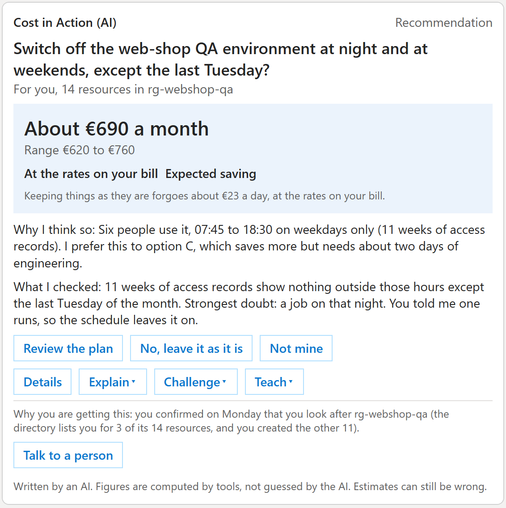
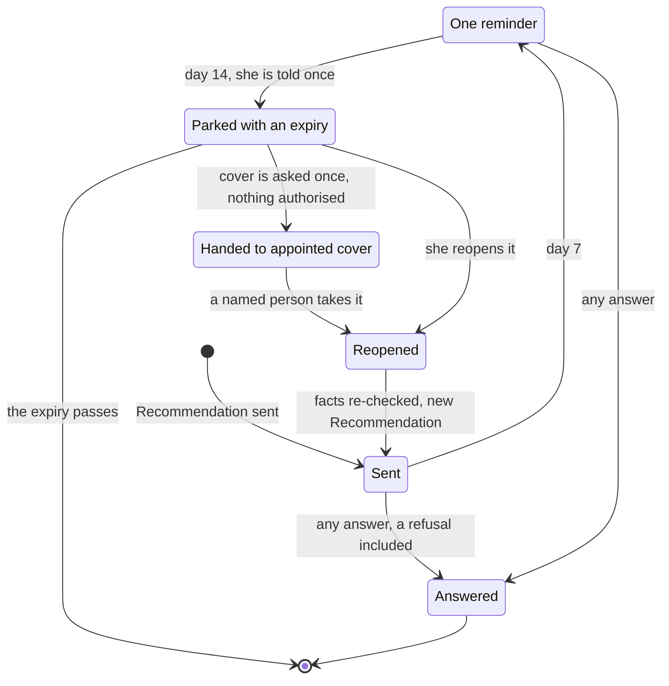
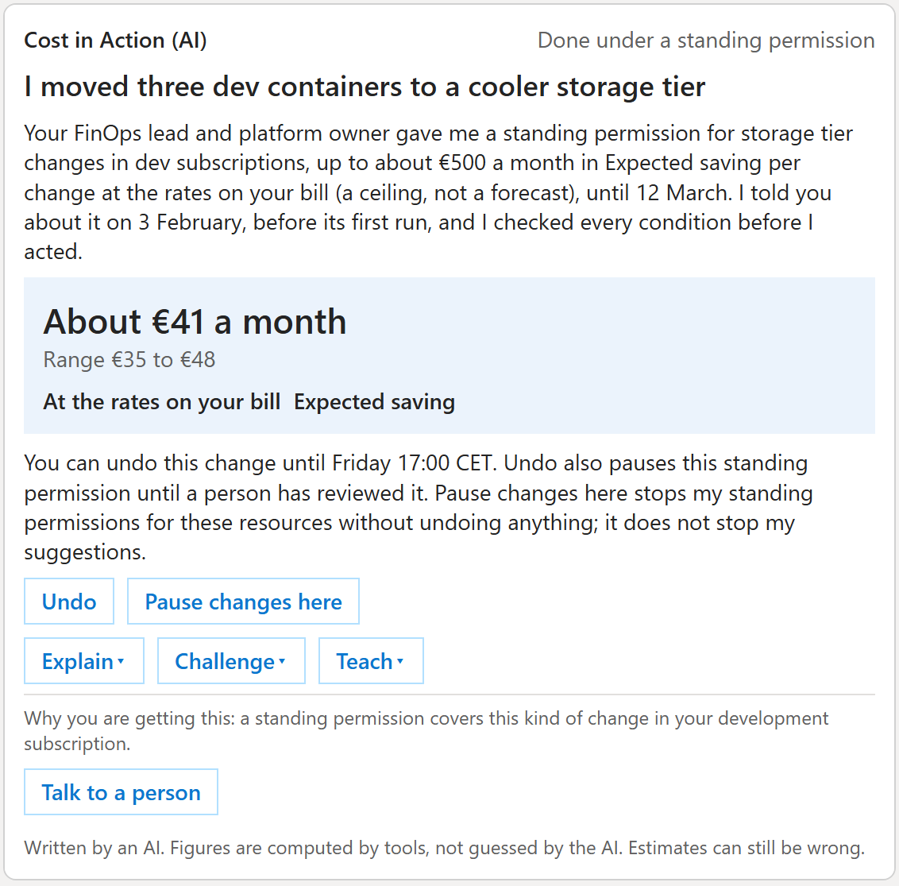
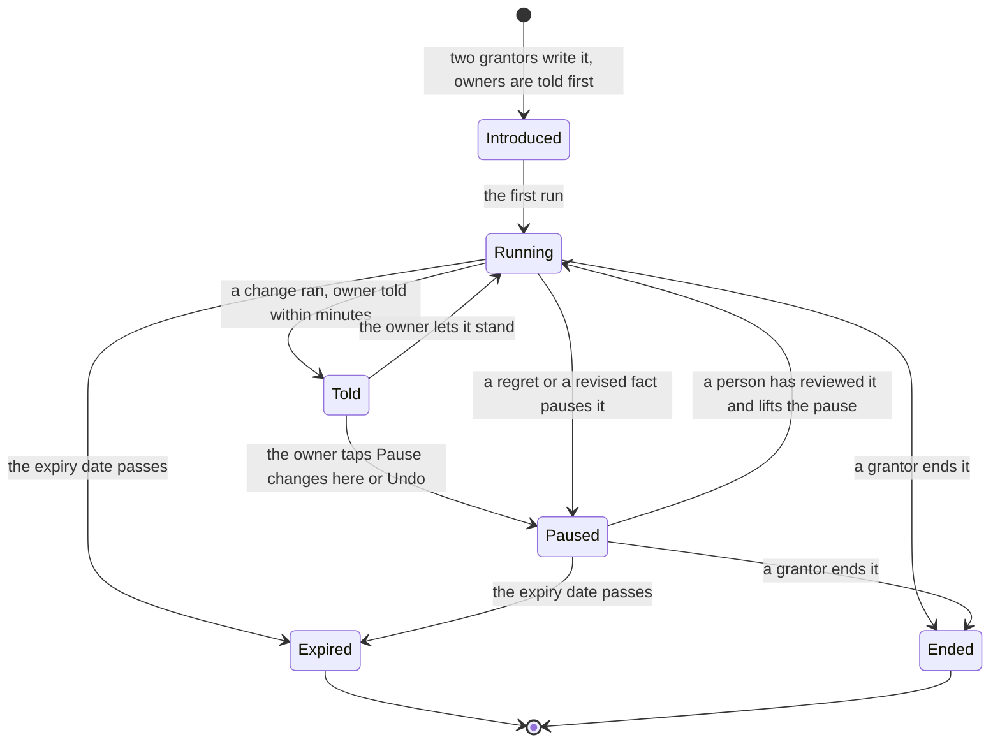

# Journeys of a resource owner

**What this document answers.** What a resource owner sees, does and decides, from the first message to a verified result. Eight journeys (J1 to J8) follow Maya, an invented owner ([the people](01-people.md)). Cards are named by id (C1 to C17); [messages and cards](04-messages-and-cards.md) shows each layout.

**How to read them.** "Person" is what Maya sees or does, in the words people see ([README](README.md)); "System" is what the system does, in the design's words. A *Case* is one investigation; people never see the word.

## J1 First contact

**Trigger and who.** An organisation onboards a scope; the directory names Maya as an owner in it. **Surfaces.** The announcement, Hello (C1), Settings (C14), the first-contact e-mail ([letters](05-letters-and-requests.md)).

(An invented example.) Maya owns 3 of the 14 resources in rg-webshop-qa.

| Step | Person | System |
|---|---|---|
| 1 | Reads the announcement: the app, its publisher, the approval page's one address, and a warning that a sign-in asking for app permissions is fraud | Sent by her organisation before any card |
| 2 | Gets Hello from "Meternaut (AI)". It says why it wrote ("The directory lists you as the owner of 3 of the 14 resources in rg-webshop-qa, and you created the other 11"), what it keeps and who sees it, and that she can pause messages or tap "Talk to a person" | Treats her ownership as a guess. Keeps an object id, a role and stated preferences, no names |
| 3 | Taps "Yes, I look after these", then "My hours and language": working days (any days of the week), time zone, desk day (the weekly desk lists at most five items), quiet hours and language, once. Settings (C14) offers the same | Records what she states, never inferring hours from calendars or presence |

| If | Then |
|---|---|
| Teams cannot be used | The first-contact e-mail says the same, with one link to a page where she confirms and sets her hours |
| "Not mine" | Nothing more is asked about these resources; the [custodian queue](08-attention-and-trust.md) gets them if nobody else is found |
| No answer | Hello is not repeated. Until she confirms, only Questions reach her |

**Rules ([08](08-attention-and-trust.md)).** A slow start: one unprompted message (a push) a week for 30 days, then three (starting values).

**Measured by.** Hello answered within 7 days, whatever the answer; the "Not mine" rate; stops and mutes in 30 days.

## J2 A Recommendation arrives

**Trigger and who.** A Case survives its challenge, and Maya, the owner of record, can decide it. **Surfaces.** Cards C2 to C6 and C10; the approval page; the weekly desk (C12).

(An invented example.) E1, the web-shop QA environment. By default an approval makes one change, at that moment. A daily schedule that switches machines on and off needs the customer's own automation or the optional standing-permission mode (not built).

| Step | Person | System |
|---|---|---|
| 1 | Question (C2): "Does anything run in rg-webshop-qa at night on the last Tuesday?" Activity shows at 02:10–02:50. She taps "Something else", writes "that is the month-end regression" and taps "Yes, that is right" on the read-back (C10) | Asks first: the strongest objection is a fact only she knows. Stores a Lesson (her Note) with an expiry |
| 2 | Recommendation (C3): switch off 19:30–07:30 and weekends, except the last Tuesday. About EUR 690 a month (range 620–760), "At the rates on your bill", "Expected saving". Keeping things as they are forgoes about EUR 23 a day, at the rates on your bill | Details holds two other options and the rest of the [ten-part Recommendation](../design/03-agents-and-workflows.md#6-what-a-person-receives) |
| 3 | "Review the plan" turns the message into the plan card (C4): the exact change to vm-qa-web-01, vm-qa-web-02 and sql-qa-orders, plan code 7F3K-92QD. She taps "Open the page to approve" and presses "Approve"; "Cancel" and "Open the Recommendation" approve nothing | Reviewing authorises nothing; the app [replaces the card in place](https://learn.microsoft.com/adaptive-cards/authoring-cards/universal-action-model) |
| 4 | At the moment she approves: Done (C6), with an undo only where Azure offers one | Re-checks live state first, and changes Azure with Maya's own rights |

| If | Then |
|---|---|
| "No, leave it as it is" or "Not mine" | "No, leave it as it is" closes the ask with no reminder; it returns only if the evidence changes materially or a Note expires, saying why. "Not mine" hands it to cover |
| Later she wants the schedule off | History links to "Switch the schedule off", a new plan, approved the same way |
| (Invented.) A change needing her OK on a page (page-class), E2: the orders database one size down, EUR 380–520 a month at the rates on your bill, Expected; month-end peak 70–90 % CPU | Your OK on a page (C5) opens the approval page. If CPU then stays above 85 % for 10 minutes, the safety check stops and asks Maya whether to restore the old size; restoring is a new approval on the page. If nobody answers, the change stays as it is: the check asks once more, then uses the on-call route only if the scope set up the [emergency lane](08-attention-and-trust.md), otherwise it waits at the top of the weekly desk |
| (Invented.) No cost access, E3: two disks unattached for 94 days, about EUR 38 a month | The chip reads "At list prices. I cannot see your rates."; the word is Scenario only; no Result follows, and Done says "I cannot measure this here" |
| She approves every plan in seconds | Nothing is reported; Azure still checks her own rights on every change. The FinOps lead and the platform owner review a confidential monthly sample of executed changes to tune the recipes; it never judges a person |

**Rules ([08](08-attention-and-trust.md)).** One decision, one person, about two minutes.

**Measured by.** Median time from first interaction to decision (starting target: 2 minutes); share decided within 7 days, refusals counted.

## J3 "I disagree"

**Trigger and who.** Maya thinks a Recommendation is wrong or incomplete. **Surfaces.** Explain, Challenge and Teach on the Recommendation (C3); Read-back (C10); Widen request (C11).

(An invented example.) A Recommendation proposes shrinking rg-orders-dr, which Maya knows is the standby environment.

| Step | Person | System |
|---|---|---|
| 1 | Taps Explain and picks simple, technical or financial words | Answers within 2 minutes in 95 % of cases, else "I will answer in this thread" |
| 2 | Taps Challenge ("What do you think I got wrong?") | Shows its recorded objections and what it did about each. New information earns another round. If it was wrong, it says so |
| 3 | Taps Teach: "that is our disaster-recovery environment". The read-back (C10) restates it ("rg-orders-dr is a standby environment") with a scope and an expiry (12 January). She taps "Yes, that is right" and sees "Note saved; these Recommendations changed" | Stores the Lesson at her scope, never wider than she owns, and re-runs the Cases it touches |

| If | Then |
|---|---|
| She disagrees again with the same kind of suggestion | Records the objection, offers a lighter option or "Fewer like this", and does not re-ask what a Note answers until it expires. "We disagree; I will look again on 12 January" is a valid ending |
| She taps "Ask for a wider scope", or is unconvinced | The request goes to the owner of that scope (C11), with the affected count; people inside can opt out. "Talk to a person" is always there |
| She teaches "everything tagged legal is off-limits" | After her confirmation, a do-not-touch mark stops Recommendations and standing-permission runs there until she clears it |

**Rules ([08](08-attention-and-trust.md)).** Disagreement is as easy as yes. Free text never approves.

**Measured by.** Challenge outcomes (conceded, held, sent to a person); Notes confirmed at the first read-back; answers later corrected.

## J4 No answer

**Trigger and who.** A Recommendation waits because Maya is away or does not answer. **Surfaces.** The Reminder (C9); the weekly desk (C12); the notice e-mail ([letters](05-letters-and-requests.md)); a Question (C2) to cover; Heads-up (C13).

Ways out of "Sent": an answer, appointed cover, an expiry, a reopening.

(An invented example.) The same Recommendation, E1, if Maya does not answer.

| Step | Person | System |
|---|---|---|
| Day 7 | She gets one Reminder (C9): "This is my only reminder. … I will park it, tell you once and ask your cover to confirm who owns it. I will not say that you did not answer." | Sends it as a message, or in the next desk if her push budget is used up |
| Day 14 | A notice e-mail: parked, with an expiry | Parks the Case. Whenever cover is asked, it tells her once, first, then asks her delegate, or the custodian queue, with a Question (C2) saying only "Ownership or cover needs confirming. Nothing is authorised." A line manager hears only if she appointed one |

| If | Then |
|---|---|
| She chose "Pause messages" with a return date | No non-urgent asks, reminders or requests to her cover; the emergency lane still applies. She returns to one catch-up desk, not a pile |
| (Invented.) A spend spike, E5: six times the normal tokens in three hours, about EUR 180 more today at the rates on your bill, Expected extra cost | Heads-up (C13), privately first. "Yes, this is expected" silences that alert and the on-call step, and keeps no lasting Note unless she teaches one. If the scope opted in to the emergency lane, it first tells her it will use the on-call route after two hours of silence |

**Rules ([08](08-attention-and-trust.md)).** The ladder (day 7, day 14; starting values); a second reminder only for a real deadline, with its reason. Silence is never consent: only an answer counts ([what an app cannot see](13-platform-register.md)).

**Measured by.** Share decided within 7 days; parked Cases and time until a named person takes one; reminders per Case (at most one).

## J5 Told afterwards

**Trigger and who.** Optional mode, not built ([definition](README.md#the-words-people-see)): a customer's FinOps lead and platform owner grant a standing permission that covers Maya's resources. Meternaut holds no such right by default ([decision 24](../design/12-decisions.md#24-a-change-runs-as-the-approver-meternaut-holds-no-right-to-change-azure--accepted)). **Surfaces.** A standing permission starts (C17); Told afterwards (C8).

(An invented example.) E6, dev storage tiering.

| Step | Person | System |
|---|---|---|
| 1 | On 3 February, before the first run, "A standing permission starts" (C17) says: storage tier changes in development subscriptions, up to about EUR 500 a month in Expected saving per change, at the rates on your bill, until 12 March. She can tap "Pause changes here" or "Not mine" | Sends C17 to each owner. A permission never covers a purchase or a resource marked do-not-touch |
| 2 | Minutes after a run, Told afterwards (C8): "Three dev containers were moved to a cooler storage tier." About EUR 41 a month (range 35–48), "At the rates on your bill", "Expected saving". Undo, where Azure allows | Checks every condition in code before each run and adds the run to her weekly summary |
| 3 | She does nothing, taps Undo, or taps "Pause changes here" | Undo reverses the last change only and also pauses this standing permission until a person has reviewed it. "Pause changes here" stops permissions on these resources, not suggestions |

| If | Then |
|---|---|
| A condition fails: a change freeze, a value above the cap, a disputed fact | The permission does not apply. A Recommendation arrives and she decides |
| A run goes wrong | The permission pauses and Our mistake (C16) arrives. No change is rolled back by itself; a person decides |

**Rules ([08](08-attention-and-trust.md)).** Narrowing is automatic, widening is human. Each message says whether Azure offers an undo.

**Measured by.** Undo and pause rates per permission; regrets, which pause a permission; a confidential monthly sample of runs.

## J6 The result

**Trigger and who.** A change Maya approved is measured on the closed bill, or a safety check trips. **Surfaces.** Result (C7), Our mistake (C16), I could not (C15).

(An invented example.) E1 measured; E2 gone wrong.

| Step | Person | System |
|---|---|---|
| 1 | Result (C7) after the period closes: "Result: the QA shutdown saved about EUR 670 a month." "At the rates on your bill", "Verified saving", inside the predicted range of EUR 620–760 a month. She taps "Yes, it matches" | Measures on closed bill lines; the figure for an open period is marked estimate |

| If | Then |
|---|---|
| "No, it does not", or the saving falls below the range | She says what she expected. The card says plainly where the system was wrong |
| (Invented.) Wrong advice, E2: after one size down, CPU stays above 85 % for 10 minutes | As in J2, the check asks Maya. Our mistake (C16) follows: the state (restored, restoring or unknown), what is paused, who writes to her by when (for example Ibrahim, her platform owner, by 14:00 CET) |
| The live state differs from the plan | The re-check stops first. "I could not" (C15) offers Try again; a new plan needs a new OK |

**Rules ([08](08-attention-and-trust.md)).** Honest numbers: a range, a basis, one word. Trust repair: Our mistake, and "I did not approve this".

**Measured by.** Verified results inside the predicted range; regrets and reversals; claimed against verified saving; Our mistake updates sent on time.

## J7 "What does it know about me?"

**Trigger and who.** Maya asks why a message reached her and wants to see or limit what is held; a team lead wants to see where decisions wait. **Surfaces.** The pages What I know about your resources, History and Settings ([web pages](06-web-pages.md)).

| Step | Person | System |
|---|---|---|
| 1 | Every card but Hello has a "Why you are getting this" line in its footer, above "Talk to a person" and the AI line; Hello explains it in its introduction. She opens What I know about your resources: each Note shows its scope, source and expiry. She edits, ends or deletes one | Re-checks the Recommendations that rested on it |
| 2 | Opens Settings (hours, weekly budget, delegates, mutes, Pause messages, export, delete) | Shows her own scope only; applies a setting or a mute at once |

| If | Then |
|---|---|
| Too many, or not hers | "Not mine" re-routes it; someone else becomes owner only after confirming. "Fewer like this" lowers asks of that kind, not standing-permission runs; "Pause changes here" stops those |
| A team lead opens the scope's page | Open decisions and ownership gaps, never a list of people who have not answered. Counts for fewer than five people roll up |

**Rules ([08](08-attention-and-trust.md)).** Notes are visible and editable, each with a scope and an expiry. No league tables of people.

**Measured by.** Notes edited, expired or deleted by owners; "Not mine" and "Fewer like this" in groups of five or more; a five-person test of the Notes page.

## J8 Leaving and joining

**Trigger and who.** The directory shows a joiner, a mover or a leaver, or a contractor or shared mailbox as the apparent owner. **Surfaces.** Hello (C1), the approval page, the ownership-transfer e-mail ([letters](05-letters-and-requests.md)).

(An invented example.) Maya takes over rg-orders from a colleague who moves teams. The colleague's E2 plan still waits for an OK.

| Step | Person | System |
|---|---|---|
| 1 | The colleague gets an ownership-transfer e-mail | At the next directory refresh it revokes the colleague's open plan codes and approvals that have not run |
| 2 | Maya gets Hello, reads what is kept and who sees it, and taps "Yes, I look after these": responsibility, not identity and not having created a resource | Until then the owner is a guess |
| 3 | She reads the Notes that came with the resources and keeps, edits or ends them. The E2 Recommendation arrives again; a new plan carries a new code | Hands over context with provenance, never the colleague's conversations. Re-checks the facts first |

| If | Then |
|---|---|
| A mover or a leaver | The same handover. A disabled account resolves to nobody, so a Note's source reads "a previous owner" |
| A contractor or a shared mailbox is the apparent owner | A delivery contact: it receives the message and never approves. A named person claims the Case by signing in as themself; until then nothing is asked and the custodian queue sees the gap |

**Rules ([08](08-attention-and-trust.md)).** A person confirms ownership; a tag or having created a resource never does. A named person, never a mailbox, is accountable.

**Measured by.** Time from a directory change to a confirmed owner; approvals revoked; Cases parked for lack of an owner.

## Where to read next

- [Organisation journeys](03-organisation-journeys.md)
- [Messages and cards](04-messages-and-cards.md)
- [Web pages](06-web-pages.md)
- [Attention and trust](08-attention-and-trust.md)
