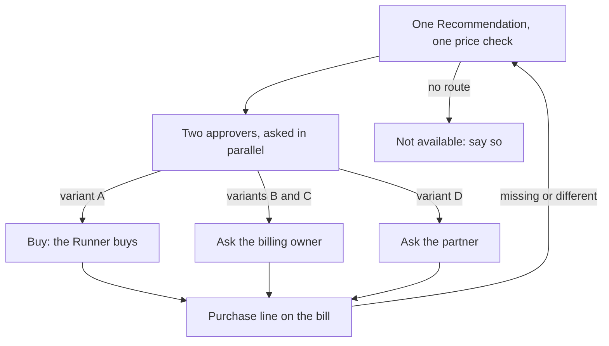
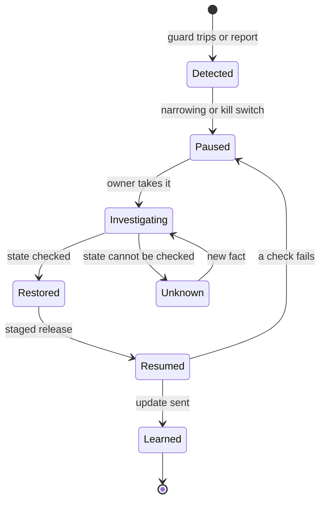

# Journeys of the platform, FinOps, finance, security and audit

**What this document answers.** What the people who run the platform, FinOps, finance, security and audit see, receive and decide, in six journeys (J9 to J14). The "person" column uses the words people see ([README](README.md)); the "system" column, the design's ([glossary](../design/README.md#words-used-in-this-design)).

## J9 Onboarding a scope

**Trigger and who.** The platform team adds a scope: subscriptions to read and, where a billing role exists, their billing scope. Ibrahim (platform owner) and Nadia (FinOps lead) lead. **Surfaces.** The Estate view workbook, the first Monday letter; owners meet Hello (C1; J1 in [owner journeys](02-owner-journeys.md)).

| Step | The person sees or does | The system does |
|---|---|---|
| 1. Probe | Nadia and Ibrahim read "what I can see here", the capability profile: agreement, cost reach, price basis, commitments visible, who may buy, what more access would buy | Makes read-only calls in plain code; explains each error |
| 2. Channel, people | Ibrahim sees who can install the app and which approvers have not yet passed the test sign-in, and names owner groups, billing owner and partner contact | Sets Teams or e-mail only per person. Where authentication contexts or phishing-resistant sign-in are missing, it refuses what needs them (anything above one tap, or a two-person purchase) and says why in the profile |
| 3. Announce, first letter | Nadia and the team leads announce the system. The first Monday letter follows; owners get Hello | Holds first contact until the announcement is recorded; advises only until an action family is opted in |

**If a probe fails, or access changes,** the profile shows what the identity can do today, not what the agreement allows, and names the role to ask for. It re-probes weekly and after any 401 or 403: widened access re-prices open Recommendations, narrowed access marks advice unconfirmed ([people](01-people.md)).

**Rules.** The same care at every level of access; "no" to more access is a complete answer; one push a week for 30 days, then three (starting values).

**Measured by.** The profile matches what the identity sees in the portal; "Not me" taps on Hello signal directory errors, not people.

## J10 A commitment purchase

**Trigger and who.** A Recommendation for a savings plan or a reservation survives the challenge, or a renewal notice calls for one. The AI prepares the purchase; two named people in different roles approve it; then the Runner buys exactly what they approved (variant A), or whoever holds the right to buy does (variants B to D, in [people](01-people.md)). **Surfaces.** Teams cards, the approval page ([wireframe](../img/experience-approval-page.svg)), e-mail.

Look at the four paths, and how the bill closes the loop.

Under variants B to D the approvers approve a request; the quote of Priya (billing owner) or Gerrit (partner contact) settles the number. Gerrit is outside the directory, so he gets plain-text e-mail only ([letters and requests](05-letters-and-requests.md)). Not available means no route: a savings plan under variant E, or approvers without a phishing-resistant sign-in; the page says why. See [all five variants](../img/experience-access-variants.svg).

(An invented example.) **E4, a one-year compute savings plan for the order platform (variant A).** The approval page shows the price checked on Thursday 09:12 CEST: USD 25.00 an hour for one year, USD 219,000 in total, about EUR 205,860 at 0.94 euro to the dollar; paid monthly, about EUR 17,155 a month as invoiced, which follows the exchange rate under a Microsoft Customer Agreement ([Learn](https://learn.microsoft.com/azure/cost-management-billing/savings-plan/savings-plan-overview)). Scope: the management group "Order platform" (three production subscriptions today; a later member on the same billing profile would also benefit), paid by one named subscription under one billing profile; auto-renew off.

Until 30 June the current reservation covers part of the usage, so the plan saves about EUR 700 a month and about USD 4,500 a month of the commitment goes unused. From 1 July it saves about EUR 4,300 a month (range 3,700 to 4,900, amortised), so waiting past 1 July forgoes about EUR 140 a day (all Expected, at your agreement's rates). The approval binds the USD commitment, term, payment frequency, auto-renew and scope; any change needs fresh approvals. The price check expires on 10 June; a later decision gets a fresh one.

| Step | The person sees or does | The system does |
|---|---|---|
| 1. Ask | Tomasz (budget holder) and Lars (finance approver) each get Your OK on a page (C5, [rendering](../img/experience-card-c5-ok-on-page.png)) with plan code K4M8-R6TW. Each signs in with a phishing-resistant method, reads the page, which says "cannot be undone", and chooses alone | Asks both at once; refuses the requester and one person in both roles; hides each answer until both have decided |
| 2. Buy, watch | "Nothing has changed yet", then Done (C6) | Gives a separate identity the purchaser role, buys exactly the price check, removes the role; watches the bill for the purchase line and tells the approvers if monthly utilisation falls below 90 % |

**A renewal notice.** The system writes to the budget holder and the FinOps lead 60 days before a commitment ends (starting value), with the commitment's actual renewal setting. A reservation renews by default: doing nothing buys a replacement, outside our control, so the system can only ask the reservation's owner (the partner, for a partner-sold one) to turn it off. With renewal off, usage returns to pay-as-you-go rates at expiry. Azure shows a reservation's renewal price only 30 days before expiry ([Learn](https://learn.microsoft.com/azure/cost-management-billing/reservations/reservation-renew)), so the 60-day notice carries a scenario, not a price check; the price check and two new approvals come later.

**What cannot be undone** (Learn, 2 November 2026):

- [Savings plan](https://learn.microsoft.com/azure/cost-management-billing/savings-plan/buy-savings-plan#cancellations-exchanges-and-trade-ins): no cancellation, refund or exchange.
- [Reservation](https://learn.microsoft.com/azure/cost-management-billing/reservations/exchange-and-refund-azure-reservations): eligible reservations can be refunded up to USD 50,000 of cancelled commitment in a rolling 12 months per billing scope; Red Hat, SUSE and pre-purchase plans are excluded; the refund method depends on the agreement. Bought before 1 February 2027: one final exchange; from that date none for a service that savings plans cover.

**If an approver declines or asks, the price check expires, or an approval is missing,** nothing is bought and a decline is never chased.

**If the outcome is unknown, or nobody bought,** the Verifier looks up the order and the FinOps lead is paged; a purchase is never retried. A missing or different purchase line reopens the Case.

**Rules.** No approval by e-mail reply, text, voice or free text, and no one-tap purchase. A request is never called a purchase, and the deadline is a fact, never a countdown.

**Measured by.** Time to the second approval; share decided before the price check expires; purchases that match their plan exactly; utilisation and unused commitment (vacancy) (J13).

## J11 Granting a standing permission

**Trigger and who.** Nadia (FinOps lead) and Ibrahim (platform owner) decide that one kind of change, in one place, may run without a fresh OK. A standing permission is their written rule: kind of change, scope, value cap, expiry, conditions such as "never in a change freeze". It never covers a purchase, a small trial or anything irreversible. **Surfaces.** A page of the approvals app, where they write it together; "A standing permission starts" (C17); the owner's side is J5 in [owner journeys](02-owner-journeys.md).

| Step | The person sees or does | The system does |
|---|---|---|
| 1. Write | (Invented.) E6. They write: change storage tiers, in the dev subscriptions, up to about EUR 500 a month in Expected saving per change, at the rates on your bill, until 12 March | Refuses a rule without a cap and an expiry; evaluates it on facts a model cannot set, never on tags, names or Lessons |
| 2. Dry run, evidence | The page shows what the rule would have done over the last 90 days (starting value): changes covered, changes left to a person, covered ones later undone or regretted; then the evidence, the expiry and the step-down | Replays it over the ledger, changing nothing; a change not bill-observed for its meters stays with a person |
| 3. Grant, introduce, run | Both sign. Before the first run, each owner of a covered resource gets "A standing permission starts" (C17, [rendering](../img/experience-card-c17-permission-starts.png)) with Pause changes here and Not mine; each run is then reported within minutes (Told afterwards, C8). The Monday letter asks "renew or let lapse" 21 days before the expiry (starting value) | Holds the first run until every owner of record has been sent C17; a person reviews a sample of runs |

**If there is a regret, a boomerang (a change reversed within weeks, an Undo included), calibration below the level granted or a silent check,** the step-down applies: the standing permission pauses at once until a person has reviewed it, the grantors are told, and the next change asks for the owner's OK.

**Rules.** Narrowing is automatic; widening is human. A wrong rule can run many times inside its cap before a pattern shows.

**Measured by.** Per domain: runs, undo rate, regrets, boomerangs, calibration; runs announced within minutes; sampled reviews done.

## J12 When something goes wrong

**Trigger and who.** A change did not do what it said, a guard trips, someone taps "I did not approve this", or someone reports a message that looks wrong or fake through "Talk to a person", which every card carries. Ibrahim (platform owner) leads; Maya (resource owner) and the approvers are told first, Nadia (FinOps lead) and Sofia (security reviewer) when spend or identity is involved. **Surfaces.** The [kill switch page](06-web-pages.md) (platform owner, FinOps lead or security reviewer); paging by action group, not Teams; Our mistake (C16). The owner's side is J6 in [owner journeys](02-owner-journeys.md).

The kill switch has three levels. One person alone pulls it; two release the purchase switch. It cannot recall what already reached Azure, a purchase included. Look at the two loops: around Unknown, and after a failed resume.

| Step | The person sees or does | The system does |
|---|---|---|
| 1. Detect, narrow, tell | (Invented.) E2, the orders database one size down: its safety check (CPU above 85 % for 10 minutes) trips. Maya, who approved it, gets Our mistake: restored, restoring or unknown, what is paused, who updates by when. She restores the old size in one tap, inside the undo window | Stops, because only a one-tap change rolls back by itself; a page-class change goes to its approver, whose rollback grant (usable once, held for a reversible change) makes restoring one tap. Pauses standing permissions on that database and resource group; sends the card before the investigation ends. "Restored" means it checked |
| 2. Investigate, resume | Ibrahim compares plan and prediction with the result, may pull the kill switch for that Change everywhere, sends the update by the promised time even if it only says what is still unknown, and releases it in stages | A second rollback of the same Change in a day pauses it and pages the platform team. After the fix it records a Lesson and the regret |

(Invented.) **E5: if an assistant uses six times its normal tokens in three hours,** Heads-up (C13) goes to the owner first, privately; the on-call person is paged only where the scope opted in to the [emergency lane](08-attention-and-trust.md).

**If the approval page is down,** where the organisation publishes it through its own front door, a static page says the request stays open and nothing has changed; the platform team is paged.

**Rules.** The card says "our mistake" and never blames an approver.

**Measured by.** Time from detection to the first message to the owner; "update by" promises kept; quarterly kill switch drill times; approval page availability, 99.5 % of probes a month (starting value).

## J13 The Monday letter, the monthly letter and the executive brief

**Trigger and who.** Nadia (FinOps lead) and Ibrahim (platform owner) read on Mondays; Lars (finance approver) and Aisha (executive sponsor) after a billing period closes. **Surfaces.** E-mail only, with no button that acts ([letters and requests](05-letters-and-requests.md), [wireframe](../img/experience-monday-letter.svg)).

| Step | The person sees or does | The system does |
|---|---|---|
| Monday, before 09:00 | Nadia and Ibrahim read at most 400 words in eight parts | Leads with misses; rolls up groups under five; on time on at least 12 of 13 Mondays |
| After the period closes | Lars gets two pages and a small CSV of the same figures: claimed against verified, reconciliation to the invoice and the spending commitment's pace where readable | Waits five days (starting value) because charges can change until then ([Learn](https://learn.microsoft.com/azure/cost-management-billing/costs/understand-cost-mgt-data)); names the FinOps term in a column beside Scenario, Expected or Verified |
| Each quarter | The quarterly commitment review in that month's letter: coverage, utilisation, vacancy and effective savings rate per commitment | Computes them from amortised and contracted cost ([definitions](https://www.finops.org/assets/terminology/)) |
| A closed period misses its forecast | Lars gets a short notice: by how much, what moved, what the system cannot explain | Only when the gap passes the threshold finance sets |
| With the monthly letter | Aisha reads the executive brief: two to three pages, no FinOps knowledge needed ([guidance](https://www.finops.org/framework/capabilities/executive-strategy-alignment/)); what it holds is in [reports and dashboards](07-reports-and-dashboards.md) | Explains each term once |

**If no invoice for the same billing scope and currency is readable (under a partner agreement, the partner's), or a commitment is not visible,** figures stay marked estimate and the status reads "Invoice not available", never "Reconciled"; the review names the commitments it cannot read. A spending commitment's pace is readable only under a direct Enterprise Agreement or Microsoft Customer Agreement ([Learn](https://learn.microsoft.com/azure/cost-management-billing/benefits/macc/track-consumption-commitment)).

**Rules.** Savings are amortised; budgets, invoices and the close are as invoiced. A reduction made while a spending commitment is behind is labelled "freed capacity inside the commitment" ([reports and dashboards](07-reports-and-dashboards.md)).

**Measured by.** Monday letters on time; the monthly letter reconciles to a readable invoice, differences stated; the claimed-versus-verified gap.

## J14 Oversight and audit

**Trigger and who.** Jonas (internal auditor) reviews on a schedule or after an incident; Sofia (security reviewer) runs the quarterly access review. **Surfaces.** The evidence pack, the audit log and the Security and approvals workbook.

| Step | The auditor sees or does | The system does |
|---|---|---|
| 1. Ask | Jonas asks the platform owner for an evidence pack for a period and scope | Assembles it read-only: approval records (plan hash, approvers by id and role, decision, time, sign-in strength), runs and verified outcomes, standing permissions, kill switch changes, access reviews |
| 2. Re-perform | Jonas samples items and follows each, by hash, from approval record to audit entry, run and verification | Keeps the audit log append-only and locked; each use of an approval is its own record |

**What the EU AI Act asks.** Articles 12 and 14 bind high-risk systems, from 2 December 2027 (Annex III uses) and 2 August 2028 (Annex I products) ([Commission](https://digital-strategy.ec.europa.eu/en/news/ai-omnibus-enters-force)). The adopting organisation assesses its own class; the experience treats both articles as a design reference.

| Article | People can | The experience gives |
|---|---|---|
| [12](https://ai-act-service-desk.ec.europa.eu/en/ai-act/article-12) | Rely on automatic event logs | The audit log of approvals, runs, grants and kill switch changes |
| [14(4)(a), (b)](https://ai-act-service-desk.ec.europa.eu/en/ai-act/article-14) | Understand capacities and limits; stay aware of automation bias | Hello, Details, "what I can see here"; the strongest objection shown by default for page and two-person changes, ranges, no bulk approve |
| 14(4)(c) to (e) | Interpret the output; disregard, override or reverse it; stop it | Explain; Decline, Challenge, Undo; the kill switch |

**Rules.** Read access only. No person is ranked or scored. The log holds object ids that resolve to a person only through the directory; its lock stops edits and deletes, not a wrong entry from a compromised writer, so sampling matters.

**Measured by.** Re-performed samples match the log; access reviews held each quarter; drills held, times recorded.

## Where to read next

- [People](01-people.md)
- [Messages and cards](04-messages-and-cards.md)
- [Letters and requests](05-letters-and-requests.md)
- [Web pages](06-web-pages.md)
- [Reports and dashboards](07-reports-and-dashboards.md)
- [Attention and trust](08-attention-and-trust.md)
