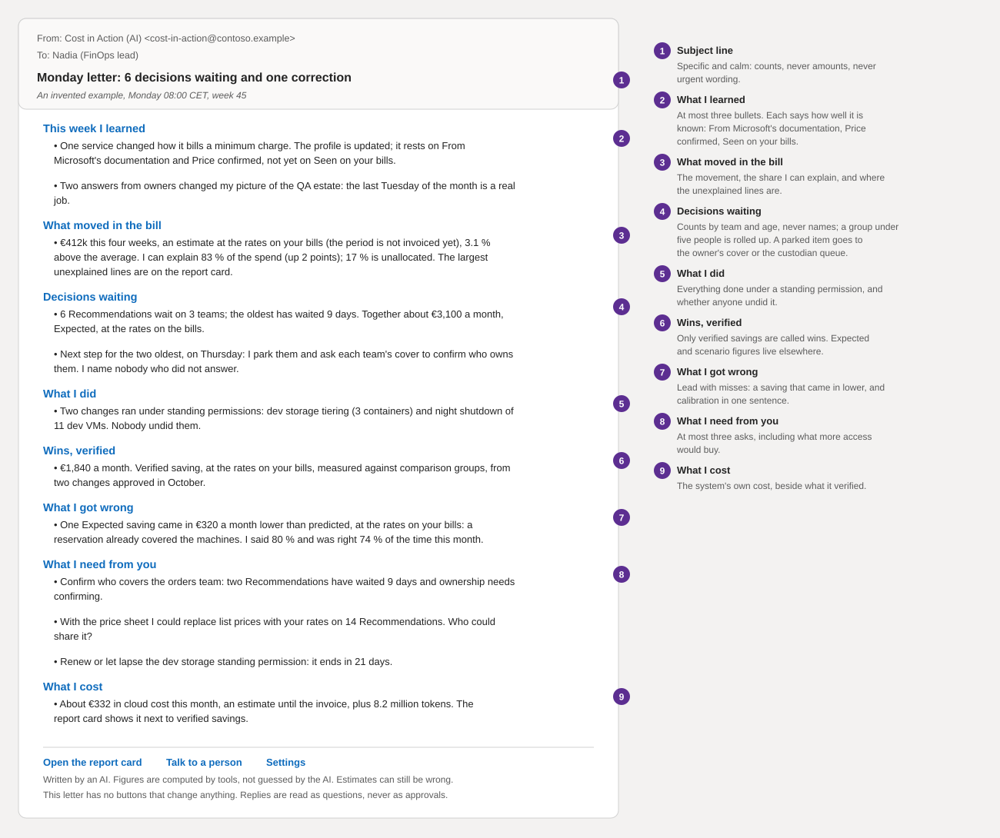
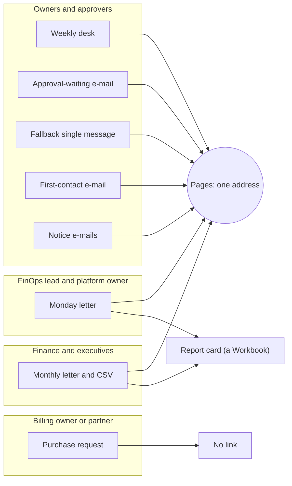

# E-mail: letters, fallbacks and requests to partners

**What this document answers.** Which e-mails the system sends and to whom. What every letter must and must not contain, and why none carries a button that acts. What the Monday letter, the monthly letter and a purchase request say. How the first e-mail introduces the system.

## Rules that hold for every letter

Nothing is ever approved by e-mail. The platform features named here are generally available as read on 2026-11-02 ([platform register](13-platform-register.md)). Exchange [caps a mailbox at 30 messages a minute and 10,000 recipients a day](https://learn.microsoft.com/defender-office-365/outbound-spam-sending-limits-troubleshoot).

| Rule | What it means, and what it does not stop |
|---|---|
| **Link only** | A letter never carries a button that acts. [Actionable Messages (Outlook's in-message buttons) are not supported for shared mailboxes](https://learn.microsoft.com/outlook/actionable-messages/actionable-messages-faq), and every letter leaves from one. A change happens on a page, after sign-in. A forwarded letter approves nothing, but still shows its words to whoever receives it. |
| **Links are built** | The send step ([design](../design/05-data-and-integrations.md)) builds every link from a configured origin and an opaque id, so no link comes from text. A Teams card carries one link, the page. A letter may carry several: the page for each item, and the report card (a Workbook) in the Monday and monthly letters. The purchase request carries none. |
| **Text first, no pictures** | No images, SVG or charts: Outlook for Windows [blocks automatic picture downloads](https://learn.microsoft.com/microsoft-365-apps/outlook/configuration/plan-outlook-deployment#outlook-security-considerations) by default, and a chart belongs on a page or in a workbook. Classic Outlook draws HTML with a [Word-based engine](https://learn.microsoft.com/troubleshoot/dynamics-365/customer-insights/journeys/email/email-troubleshoot-rendering#outlook-classic), so HTML parts use simple tables with a header row, inline styles, no scripts and no web fonts, and each letter is tested there. |
| **Sent as MIME** | Graph's JSON `sendMail` takes one body, so letters go as base64-encoded [MIME messages](https://learn.microsoft.com/graph/api/user-sendmail) with a plain-text part, an HTML part and their own headers. |
| **No tracking** | No pixels, open tracking or read receipts: a client [may or may not send a read notice](https://learn.microsoft.com/graph/outlook-things-to-know-about-send-mail), and blocked pictures hide opens. |
| **Subjects without figures** | A subject shows on lock screens and in previews, so it names the kind and count, never an amount. (An invented example.) "Your weekly desk: 2 decisions and 1 question". In the body, a saving carries its price basis and saving word, and any other money figure its basis ([04](04-messages-and-cards.md)). |
| **One voice, marked** | The sender name ends "(AI)" and the footer says an AI wrote the letter (EU AI Act Article 50(1), interaction); the header `x-ai-generated: true` is the machine-readable mark (Article 50(2), generated content). |
| **No loops** | `X-Auto-Response-Suppress: All` [asks Exchange and Outlook to send no delivery, read or out-of-office notices back](https://learn.microsoft.com/openspecs/exchange_server_protocols/ms-oxcmail/ced68690-498a-4567-9d14-5c01f974d8b1). A message marked automatic, such as an out-of-office reply, is never answered. |
| **One mailbox, an allow-list** | Letters leave from one shared mailbox, "Meternaut (AI)". Exchange RBAC for Applications [scopes mailboxes, not recipients](https://learn.microsoft.com/exchange/permissions-exo/application-rbac), so the send step checks each recipient against the allow-list and a [mail-flow rule](https://learn.microsoft.com/exchange/security-and-compliance/mail-flow-rules/mail-flow-rules) rejects mail to any address not on it. Neither stops a wrong entry on the list or a recipient forwarding a letter. |
| **Replies are data** | A reply is matched by its `In-Reply-To` header and the request id in the subject, screened, length-capped and handed to the system as an excerpt of untrusted text ([security](../design/06-security-and-governance.md)). It is how Explain, Challenge and Teach work by e-mail. No reply approves, confirms a note or changes anything, because screening misses some attacks. |

## The letters at a glance

| Letter | Audience | Arrives | Length | What it holds |
|---|---|---|---|---|
| **Monday letter** | FinOps lead and platform owner | Monday before 09:00 local, after quiet hours end | At most 400 words | What was learned, done and got wrong; where the bill moved; what waits |
| **Weekly desk** | Owners on the e-mail or digest-only profile (Teams users get a card) | Their chosen day and time (default Tuesday 10:00 local) | Five items at most, about ten minutes | Each item in a line: value, price basis, saving word, and a link to its page |
| **Monthly letter** | Finance and executives | After the period closes (starting value: five days after it ends) | Two pages and a CSV | Claimed against verified, the invoice, the commitment's pace |
| **First-contact e-mail** | Someone not yet reachable in Teams | Once, after the announcement | One screen | Who writes, why this person, what is kept, one link |
| **Approval-waiting e-mail** | Every purchase approver, as well as the card; others on e-mail or where a card's link opens in an embedded view | When a plan waits for an OK on a page | A few lines | The change, whether one person or two must approve, plan code (a short reference), expiry with time zone, the network that can open the page, one link; never the other approver's answer |
| **Fallback single message** | An owner, when Teams is unavailable | Once, in place of the card | One screen | The card's words as plain text; the page link replaces the buttons |
| **Purchase request** | A billing owner or a partner contact | After the two approvers approve it | One screen, plain text | All that is needed to act without a call |
| **Notice e-mails** | People an ownership transfer, the kill switch, an incident, an item parked or a new standing permission affects | When it happens; before a permission's first run | A few lines | What happened or starts, what is paused or covered, who writes next, a link to the page; no decision |

In the optional mode (not built), the notice for a standing permission carries the words of the Teams message "A standing permission starts" (C17, [04](04-messages-and-cards.md)) and one link, Pause changes here, to the page. The day-14 notice for a parked item says: "I have parked it and asked your cover to confirm who owns it. I have not said that you did not answer."

## The Monday letter

In this letter the system reports on itself, saying what it got wrong as plainly as what it won. (An invented example.) In the picture, 1 is the subject line and 2 to 9 are the eight sections.



| Section | What it holds |
|---|---|
| What I learned | At most three bullets, each saying how well it is known: From Microsoft's documentation, Price confirmed, or Seen on your bills |
| What moved in the bill | The movement, marked estimate until invoiced; the share of spend the system can explain (allocated or shared by a rule); the unallocated rest, its largest lines on the report card |
| Decisions waiting | Counts per team with ages, never names; groups under five people are rolled up. A parked item goes to the owner's cover or the custodian queue (the team named for unowned estate) |
| What I did | Changes made as an approver, and whether anyone undid them |
| Wins, verified | Only Verified savings are called wins, credited to teams, never to people. Expected and Scenario figures live elsewhere |
| What I got wrong | Misses first: a saving that came in lower, and how often the system was right against what it said |
| What I need from you | At most three asks, including what more access would buy |
| What I cost | The system's own cost, next to what it verified |

The footer links to the report card, Talk to a person and Settings. In phase 1a, before those pages exist, the letter goes to the FinOps lead alone and its footer has no links.

## The monthly letter

Finance and executives get one letter a month, after the period closes: two pages and a CSV. Each quarter it adds the commitment review ([07](07-reports-and-dashboards.md)).

- **Closed figures.** Five days after the period ends, because usage charges [can change until the fifth day](https://learn.microsoft.com/azure/cost-management-billing/costs/understand-cost-mgt-data). Until an invoice is generated, costs are estimates, and each such figure says so.
- **One basis per figure.** Savings and waste are amortised (a commitment's cost spread over its term); budgets and invoices are as invoiced. The letter says which wherever they differ.
- **Claimed against verified.** What each approved change was expected to save, what was measured, and a bridge naming every gap ([07](07-reports-and-dashboards.md) works one through).
- **The invoice.** For a readable invoice of the same billing scope and currency: its total, the Cost Management total and the difference, explained by what Cost Management leaves out ([credits, taxes and support charges](https://learn.microsoft.com/azure/cost-management-billing/costs/understand-cost-mgt-data)). Otherwise "Invoice not available".
- **Commitment pace.** Where readable (direct agreements only: [14](../design/14-agreements-and-access.md)): on track, or at risk of a [shortfall charged at a milestone or the end date](https://learn.microsoft.com/azure/cost-management-billing/benefits/macc/track-consumption-commitment). A reduction made while the commitment is behind is labelled "freed capacity inside the commitment", not a saving.
- **Unit cost.** Optional: cost per business unit, such as per 1,000 orders, when the organisation supplies the volume.
- **Terms.** A column adds the FinOps Foundation's terms beside Scenario, Expected and Verified: run rate reduction, cost avoidance, and savings only against a budget finance set ([glossary](https://www.finops.org/assets/terminology/)).
- **The CSV.** One row per figure: period, amount, currency, basis, estimate or final, saving word, FinOps term. Text from tags and names is escaped so a spreadsheet cannot run it as a formula. It is the only attachment any letter carries.

## The purchase request to a billing owner or a partner

When the system cannot buy a commitment itself, it prepares a request for whoever can: a billing owner or a partner contact ([agreements and access](../design/14-agreements-and-access.md)). Two people approve the request first; the recipient's quote settles the price. It is one plain-text e-mail, complete enough to act on without a call.

```
(An invented example: the E4 purchase as a partner-sold scope, variant D)
From: Meternaut (AI) <meternaut@contoso.example>
To: Gerrit, partner desk <desk@partner.example>
Subject: Purchase request: one-year compute savings plan, order platform [request r_Hn4c7T]

I am an AI that helps Contoso spend less on Azure. Contoso's budget holder and finance approver approved this request on Thursday.

What to buy: a one-year compute savings plan, auto-renew off.
Price check: Thursday 09:12 CEST. It expires on Thursday 10 June, 09:00 CEST; a later decision gets a new price check.
Commitment, at the price I checked: USD 25.00 an hour for one year, USD 219,000 in total and about EUR 205,860 at 0.94 euro to the dollar. Paid monthly, about EUR 17,155 a month as invoiced, which follows the exchange rate.
Scope: management group "Order platform" (mg-order-platform). Today the plan benefits subscriptions a1f0-0001, a1f0-0002 and a1f0-0003 (orders-prod-1 to 3); a later member on billing profile BP-ORD-01 would also benefit.
Deadline: your quote before the price check expires.
Left out on purpose: the saving, the evidence, resource names, owners, tags and other spend.
Approved as written: the commitment, term, payment frequency, auto-renew off and scope. A change to any of them needs new approvals at Contoso.

Please reply to this message, keeping the subject, with your quote or one line on why you cannot buy this. If you have allowed Contoso to buy savings plans itself, say so.
A person at Contoso: platform-team@contoso.example

Written by an AI. Figures are computed by tools, not guessed by the AI. Estimates can still be wrong.
This message approves nothing and changes nothing. A reply is read as a question.
```

**Why plain text, and no link.** A request is read in a mail system or ticket tool the system cannot see. Plain text survives forwarding, can be copied into an order screen and hides nothing. A link would lead to pages the recipient cannot sign in to.

**What leaves the organisation.** Only the management group the purchase applies to and the subscriptions in it are identified, by name and ID: the one piece of estate data the recipient needs. A partner is not in the directory, so the platform team enters each partner address on the allow-list ([15](15-asks-of-the-technical-design.md)). The approval page shows the recipient's address and the exact text to be sent.

**When no answer comes.** The system looks for the purchase itself where the agreement makes it visible; under a partner agreement the bill may not show it, so it asks the partner to confirm ([14](../design/14-agreements-and-access.md)). One reminder goes to the same address before the price check expires, and says why; none follows a "no". If the deadline passes without a purchase, the approvers are told once, without blame, and the item reopens with a new price check and new approvals.

## First contact: the announcement and the first e-mail

Before the system writes to anyone, the platform team or a team lead announces it in the organisation's own channels. The announcement names the app, "Meternaut", its publisher and the one address of the approval page. It says the system never asks for passwords, codes or secrets, and that a sign-in asking you to grant permissions to an app is fraud: stop and tell the platform team.

The first-contact e-mail follows when the person is not yet reachable in Teams, or prefers e-mail. It says that an AI is writing; why this person (the directory evidence); that nothing changes without their OK; that it starts slowly (one message a week for the first 30 days, a starting value); what it keeps and who sees it; and how to use Pause messages or reach a person. Its one link opens a page where the person confirms it is them or says it is not, and sets working days, time zone and desk day once. An opt-out is recorded and honoured.

An announcement cannot stop a convincing fake; it gives people the page address to compare later links with, and an approval still needs a sign-in there.

## How the letters connect



## Where to go next

- [04 Messages and cards](04-messages-and-cards.md)
- [06 Web pages](06-web-pages.md)
- [07 Reports and dashboards](07-reports-and-dashboards.md)
- [08 Attention and trust](08-attention-and-trust.md)
- [13 Platform register](13-platform-register.md)
