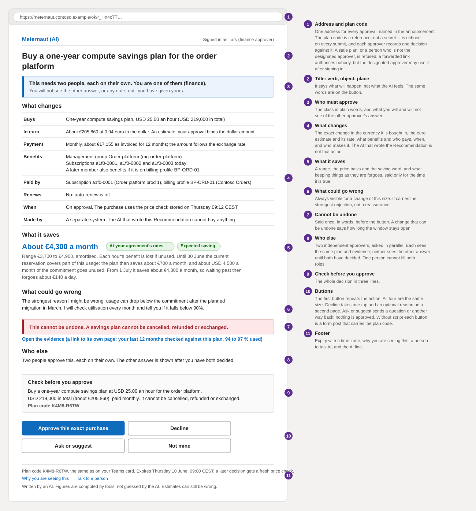
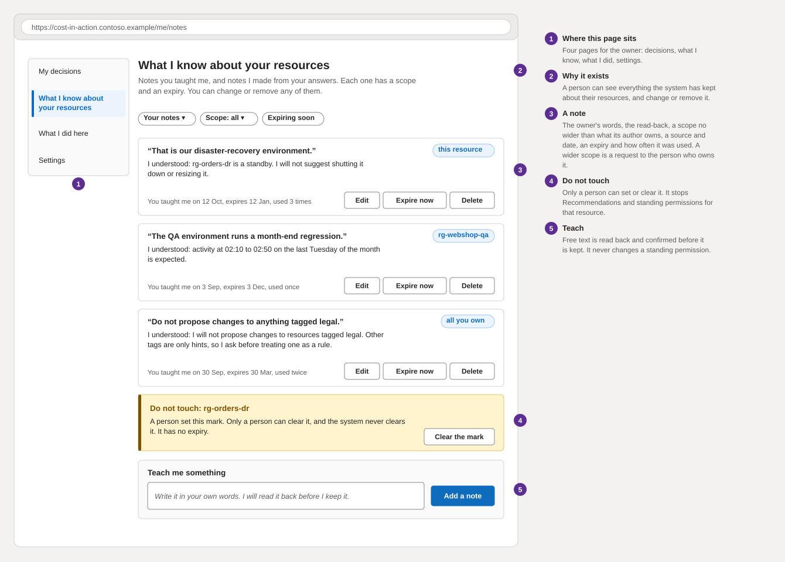
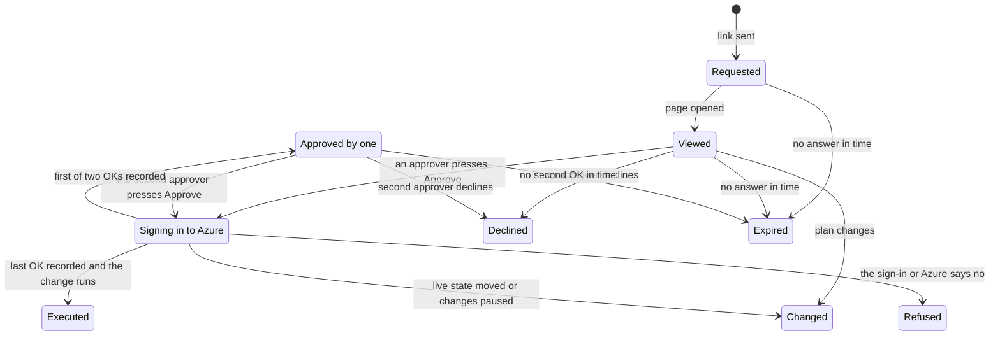

# The owner's pages and the approval page

**What this document answers.** Which pages a person can open and who each is for; how the pages are built to stay trustworthy; what the approval page shows, asks and refuses, and what happens when something goes wrong; and what an owner can read, correct and switch off.

## The pages at a glance

Eight pages share one address: six for owners and team leads, two for the platform team. The send step builds every link from that address and an opaque id, so no name, resource or figure travels in a link. A card carries one link: the page of its request, which records no decision when opened. A letter may carry several, a page per item. Each page filters on the server by the signed-in person's scope.

| Page and route | For | What it is for | What a card hands over |
|---|---|---|---|
| **Approval** `/ok/<requestId>` | The card's recipient | For a decision, the exact plan and the decision; for any other card, its words and answers (Settings opens the Settings page) | The request id; a "Your OK on a page" card also shows the plan code |
| **Notebook** `/why/<id>` | The message's recipient | The full reasoning: receipts, tool outputs, objections | An opaque id, from the Evidence row of the Approval page |
| **My decisions** `/me/decisions` | Each person; team leads for their scope | What I decided, what ran, the outcome, Undo | Nothing: the person signs in and sees their own |
| **What I know about your resources** `/me/notes` | Owners | Read, edit, expire and delete notes; do-not-touch marks | Nothing |
| **What I did here** `/me/activity` | Owners | Every change made, or tried, for a plan that names the person as approver | Nothing |
| **Settings** `/me/settings` | Each person | Channel, language, hours, budget, delegates, mutes, "Pause messages", export, delete | Nothing |
| **Standing permissions** `/ops/permissions` | The platform owner and FinOps lead | What Meternaut can change in Azure: on its own, nothing. Read-only | Never: no message links here |
| **The kill switch** `/ops/pause` | Platform owner, FinOps lead, security reviewers | Stop work at three levels | Never: no message links here |

## How the pages are built

- **Plain pages.** Rendered on the server with no client framework; every page works without scripts. [Fluent 2 design tokens](https://fluent2.microsoft.design/design-tokens) as CSS custom properties give light and dark themes, and a `forced-colors` block gives Windows high contrast ([Learn](https://learn.microsoft.com/fluent-ui/web-components/design-system/high-contrast)).
- **Headers set in code.** The page sets `Content-Security-Policy` with `frame-ancestors 'none'` plus `X-Frame-Options` (no framing, so no stolen clicks; [OWASP](https://cheatsheetseries.owasp.org/cheatsheets/Clickjacking_Defense_Cheat_Sheet.html)), `Cache-Control: no-store` (nothing returns from the cache; [Learn](https://learn.microsoft.com/azure/security/develop/threat-modeling-tool-sensitive-data)) and a Referrer-Policy (the address holds the request id). Every form carries an anti-forgery token ([Learn](https://learn.microsoft.com/aspnet/core/security/anti-request-forgery)). A function app can declare fixed headers for all its HTTP responses in `host.json` ([Learn](https://learn.microsoft.com/azure/azure-functions/functions-bindings-http-webhook)).
- **The system browser.** Embedded web views cannot support browser-dependent sign-in such as FIDO2 security keys and passkeys ([Learn](https://learn.microsoft.com/entra/identity/authentication/concept-passkey-browser-authentication-federated-identity-provider)), so the link must open in the person's own browser. A card cannot force that: `Action.OpenUrl` opens an external or an embedded browser as the host decides ([Learn](https://learn.microsoft.com/adaptive-cards/schema-explorer/action-open-url)).
- **The release gate.** A purchase always gets the approval-waiting e-mail as well as the card, which says "Opens in your browser. If Teams opens it in its own view and your passkey or security key is not accepted, use the link in the e-mail I sent." A one-person page gets it where the client matrix says the link opens in an embedded view. The device test on every Teams client gates the go-live of the cards and the pages ([testing](12-testing-the-experience.md)).
- **Cold start.** The page starts with zero always-ready instances, so hosting cost follows executions ([Learn](https://learn.microsoft.com/azure/azure-functions/flex-consumption-plan#billing)). The platform team adds always-ready instances only if the 95th-percentile first load takes over 5 seconds (a starting value).
- **When the page is down,** the organisation's own front door, where it publishes the page that way, serves a static page; an availability alert reaches the platform team either way. A page on a private endpoint opens only from the organisation's network, which the approval-waiting e-mail names; elsewhere the link fails and the request expires unapproved ([security](../design/06-security-and-governance.md)).

## The approval page

The page shows the exact plan, from the stored plan record and never the AI's prose, and takes the decision. It serves two of the design's [approval classes](../design/06-security-and-governance.md#approval-classes), R2 ("your OK on a page") and R3 ("two people"), and is where an R1 card's button leads.

(An invented example.) Lars, the finance approver, sees a one-year compute savings plan for the management group "Order platform" (three production subscriptions today): USD 25.00 an hour, USD 219,000 in total and about EUR 205,860 at 0.94 euro to the dollar, all at the price checked on Thursday 09:12 CEST, paid monthly (about EUR 17,155 a month as invoiced, [which follows the exchange rate](https://learn.microsoft.com/azure/cost-management-billing/savings-plan/savings-plan-overview)). The saving is about EUR 4,300 a month (range 3,700 to 4,900), amortised, at your agreement's rates, Expected. It cannot be cancelled, refunded or exchanged. Tomasz, the budget holder, is the other approver.

- **Title and class sentence.** The title is a verb, an object and a place; a sentence under it says "needs your OK on this page" or "needs two people, each on their own". The main button names the action, "Approve and sign in to Azure", never a bare OK.
- **Before the buttons:** what changes and who makes it, what it saves, what waiting forgoes each day and from when, what could go wrong, how to undo it, and an Evidence row linking to the notebook page `/why/<id>` (an HTML `details` element may wrap it, with no script). For R2 and R3, "what could go wrong" is always visible: the strongest objection and the guard metric.
- **"Check before you approve"** restates the decision in three lines.
- **Decline matches Approve in size and height;** on a narrow screen the actions stack.
- **Without script,** each action is a form POST with the plan code and the anti-forgery token; Decline and "Ask or suggest" open a second page with a text area.
- **The footer** holds the plan code (eight characters from the plan's hash: a reference, not proof of authenticity), the expiry with its time zone, "Why you are seeing this", "Talk to a person" and the AI line.

### Friction in proportion

- **R2, "your OK on a page":** an Entra sign-in that meets an authentication context (a label an administrator ties to a Conditional Access policy), then the summary and one confirm.
- **R3, "two people":** a phishing-resistant sign-in (security key, passkey, Windows Hello for Business or multifactor certificate; [Learn](https://learn.microsoft.com/entra/identity/authentication/concept-authentication-strengths)), the same summary with the total commitment and what cannot be undone restated, and two approvers, each on their own.

**Step-up (not built yet).** The organisation's Conditional Access decides which sign-in an authentication context needs. The page requests the [context](https://learn.microsoft.com/entra/identity-platform/developer-guide-conditional-access-authentication-context) with a [claims challenge](https://learn.microsoft.com/entra/identity-platform/claims-challenge) and checks the `acrs` claim of the token that returns. Before redirecting, it says which sign-in to expect.

### Binding

Each submit is tied to one plan, one person and one time, as [OWASP advises](https://cheatsheetseries.owasp.org/cheatsheets/Transaction_Authorization_Cheat_Sheet.html) for high-risk confirmations.

- The plan code is a reference, not a secret, echoed in every submit; a wrong code, an expired plan or a paused system is refused. Each approver records one decision against it: a second submit by the same person is refused, and the other approver's still counts. The plan itself runs once.
- Only the designated approver or a named delegate may approve (a delegate fills a purchase seat only if they hold that approver role), checked by directory object id in the sign-in token, never by a name. A forwarded link authorises nobody: the approver or delegate who opens it signs in and answers as themselves.
- The requester is refused, and one directory object never fills both roles of a two-person change.
- The change runs as an approver, re-checks the same facts and fails closed ([approval record](../design/05-data-and-integrations.md#7-the-approval-record)).

### Two approvers, and answers other than yes

Both approvers are asked at once, see the same plan and evidence, and answer on their own. Neither sees the other's answer or note until both have decided; then each sees both.

- **Decline** takes one tap and closes the request; an optional reason follows.
- **Ask or suggest** takes a question or another way to do it. It is length-capped and screened, reaches the system as an excerpt (quoted data) and never as an instruction, and approves nothing. The other approver's page never shows it.
- **Not mine** says the resource is not the person's. Nothing is approved; the request goes back to finding the right owner.
- **After the OK** the page sends the approver to sign in to Azure. The change runs right after the last approver's sign-in, as that person (for two approvers, not designed yet), and cannot be cancelled. The first of two approvers reads "Recorded. Nothing has changed yet."; the second reads "Submitted. A purchase cannot be cancelled." If Azure asks for an extra sign-in check before it makes the change, nothing has changed yet: the page sends the approver to Microsoft Entra once more, and the change is made after that second check, once. A check that is cancelled, refused or not completed closes the request, and the page says "The extra sign-in check was not completed. Nothing was changed. The request is closed."

### When something goes wrong

(An invented example.) Starting copy; the time is invented.

| What happened | What the person sees | What the person can do |
|---|---|---|
| The plan changed | "This plan changed. Nothing is approved. A new message will bring the new plan and code." | Read the new plan; the old code is refused |
| The request expired | "This request expired on Friday 14:00 CET. Nothing has changed." | Nothing; "Talk to a person" if the change is still wanted |
| The kill switch is pulled | "Changes are paused here. Nothing has changed, and your OK cannot be recorded now." | Wait; the page works again when changes resume, unless the request has expired |
| Not your role | "I cannot take your OK on this request." No plan details | "Talk to a person" if it should be yours |
| Step-up failed | "Your sign-in did not meet what this approval needs, for example a security key or passkey. Nothing is approved." | If Teams opened an embedded view, use the link in the approval-waiting e-mail in your own browser. If no required sign-in method is registered, choose "Talk to a person" |
| The session ended | "You were signed out before you answered. Nothing is approved." | Sign in again; the plan and code are unchanged |
| The page is unavailable | Where a front door publishes the page, a static page: "I cannot open approvals right now. Your request stays open until Friday 14:00 CET. Nothing has changed." Otherwise the browser's own error | Wait |

**What the page does not stop:** an approver who misreads a plan, two who collude, and a stolen session while it may still approve (within the approver's own Azure rights). The visible objection, two-person rule and strong sign-in narrow them; [attention and trust](08-attention-and-trust.md) covers sampling.

## What an owner can read and correct

**The notebook** is the full record behind a message: the reasoning, receipts a person can re-run, the tools' numbers with their as-of time, the evidence level in words and the system's own objections to its finding. Text quoted from outside is escaped and set in a labelled quote, never as a link or control.

**My decisions** is the person's History. It lists each decision, "No, leave it as it is" included, with when, what ran, the outcome in one of the three saving words with its price basis, and Undo where Azure offers one. It also lists each approval made in the person's name, so one they did not make is seen, and the Done card's "I did not approve this" reports it. A team lead sees the same page for their scope as counts, never a list of people, with small groups suppressed ([attention and trust](08-attention-and-trust.md)).

**What I did here** lists every change made, or tried, for a plan that names the person as approver: what changed, where, when, the result and what the check afterwards found. Each was made with that person's own rights. A run under a standing permission (optional mode, not built) would be listed too. "Pause changes here" would stop it there, not suggestions.

**The notes page** shows everything the system has kept about the owner's resources.

- **Each note** shows the owner's words, how the system understood them, scope, source, expiry and use count.
- **A note is never wider than what its author owns.** A wider scope is a request to whoever owns it, with the number of resources affected; people inside it can opt a resource out.
- **Every note expires**; the owner can end one early or delete it.
- **Teach** is read back and confirmed first, and never changes a standing permission.
- **A do-not-touch mark** stops Recommendations and standing permissions on a resource. Only a person sets or clears it.

## Settings

The Settings card (C14) carries the first three rows; the page carries all of them.

| Setting | What the person chooses | Starting value |
|---|---|---|
| Channel, language | Teams first, e-mail first or only the weekly desk; the language | Teams first once the app is installed; English at launch |
| Working days, time zone, quiet hours, desk day | Stated by the person (any days of the week), not inferred from calendars, presence or out-of-office | Asked once at first contact; until set, 18:00 to 08:00 and weekends are quiet and the desk comes Tuesday at 10:00 local |
| Weekly budget | How many unsolicited messages a week: lower it or ask for more; 0 means the weekly desk only | 1 for the first 30 days after first contact, then 3; the FinOps lead sets the ceiling |
| Delegates | Who may answer for the person and cover while they are away; named only on this page, after the R2 sign-in, and the person is sent a notice | None; a line manager only if named |
| Mutes | A kind of message or a resource to silence, honoured at once | None |
| Pause messages | A return date: no new asks, reminders or cover routing until then | Off; a returning person gets one catch-up desk |
| Export, delete | A file of the person's preferences and own notes, or their deletion | Always available |

Approval audit records are not erased: they hold only a directory object id and follow the adopting organisation's retention ([security and governance](../design/06-security-and-governance.md)).

## The kill switch page

The kill switch is for the platform owner, the FinOps lead and security reviewers; it is separate from "Pause messages" and "Pause changes here". The page sets one of three levels (everything, one kind of change in every estate, or one estate) and says what will stop before it acts ([stopping the system](../design/07-safeguards-and-drift.md#3-stopping-the-system) gives the effects).

- **Re-authentication each time:** a fresh sign-in, so a borrowed or left-open session cannot stop the system.
- **Any one of them can pull it.** Resuming is staged, and resuming purchases takes two people with the two roles of a two-person approval (an emergency account counts as one).
- **Every pull and resume goes to the audit log** and alerts the platform team and the security reviewer.
- **If the page is down,** the runbook has the commands for the same switch.

The kill switch cannot recall a purchase already submitted.

## Borrowed patterns and accessibility basics

The pages borrow five patterns from the GOV.UK Design System, whose code is MIT-licensed and whose content is under the Open Government Licence v3.0: [check your answers](https://design-system.service.gov.uk/patterns/check-answers/) for "Check before you approve"; the [confirmation page](https://design-system.service.gov.uk/patterns/confirmation-pages/) after the OK; the [error summary](https://design-system.service.gov.uk/components/error-summary/), a focused list at the top of a refused page; the [summary list](https://design-system.service.gov.uk/components/summary-list/) for "What changes"; and [warning text](https://design-system.service.gov.uk/components/warning-text/) for "This cannot be undone", in words and a sign. The design copies neither styling nor wording.

The bar is [WCAG 2.2](https://www.w3.org/TR/WCAG22/) level AA; [access, language and inclusion](11-access-language-inclusion.md) has the full rules. These shape the pages most:

- **Target size (2.5.8):** controls are at least 24 by 24 CSS pixels.
- **Focus not obscured (2.4.11):** no sticky bar covers the focused control.
- **Consistent help (3.2.6):** "Talk to a person" sits in the same place on every page.
- **Redundant entry (3.3.7):** nothing the directory knows is asked again.
- **Accessible authentication (3.3.8):** no CAPTCHA or puzzle; a security key or passkey is an allowed way in.

## The life of an approval request

Look at the four endings that leave Azure untouched (declined, expired, changed, refused): only Executed changes anything.

## Where to read next

- [Messages and cards](04-messages-and-cards.md): cards.
- [Attention and trust](08-attention-and-trust.md): attention rules.
- [Access, language and inclusion](11-access-language-inclusion.md): full rules.
- [Testing the experience](12-testing-the-experience.md): device test.
- [Platform register](13-platform-register.md): platform status and fallbacks.
