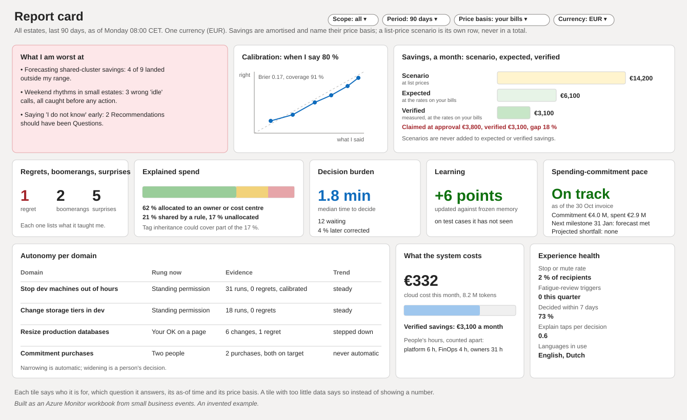
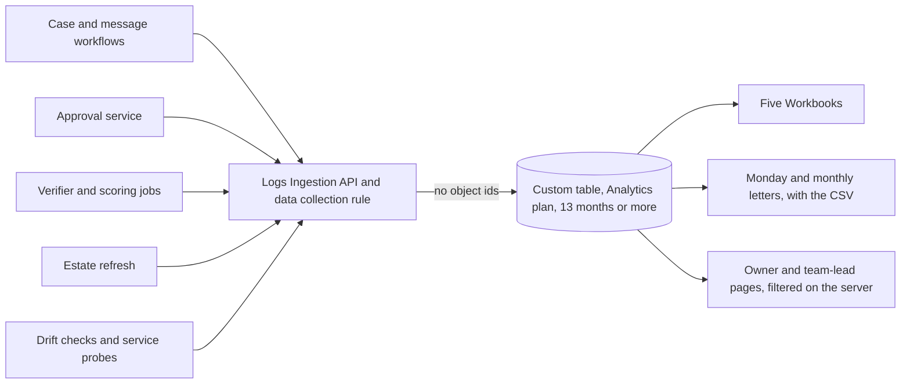

# The report card and the dashboards

**What this document answers.** Who sees which report, and why. What the five workbooks show and cannot show. How the report card scores the system. How a saving is counted. How the data reaches the workbooks without naming anyone.

## Who sees what

Letters carry narrative; dashboards carry exploration. An Azure Monitor Workbook is an interactive report in the Azure portal. Access follows Azure role-based access to the workbook and to the data it queries ([Learn](https://learn.microsoft.com/azure/azure-monitor/visualize/workbooks-manage#share-a-workbook)). There is no per-viewer filtering beyond that and no PDF or scheduled export, and a scope drop-down is a convenience, not a lock ([platform register](13-platform-register.md)). So the audience decides the channel.

| Who | Where | Why |
|---|---|---|
| Owners and team leads | Their own scope, on the [web pages](06-web-pages.md), filtered on the server | A workbook cannot filter by viewer; a page can |
| FinOps lead, platform owner, security reviewer | The five Workbooks | They work in Azure and hold roles there |
| Finance and executives | The monthly letter with a CSV of the same figures; optionally the Workbooks, or the FinOps toolkit's Power BI reports | They work in mail and spreadsheets. The toolkit is a companion, not a dependency; its reports read cost data, not what this system claimed or verified ([Learn](https://learn.microsoft.com/cloud-computing/finops/toolkit/power-bi/reports)) |

The Monday letter goes to the FinOps lead and platform owner; finance and executives get the monthly letter ([letters](05-letters-and-requests.md)). There is no custom portal.

## The five workbooks

Each is a separate workbook, so access can be granted per audience, and all five are code in Git ([Learn](https://learn.microsoft.com/azure/templates/microsoft.insights/workbooks)).

| Workbook, and who it is for | The question | Main tiles | What it cannot show |
|---|---|---|---|
| **Report card**: FinOps lead, executive, finance | How good is the system, and where is it worst? | The tiles below | One team or person against another |
| **Savings ledger**: finance | What was claimed, what was verified, and does it reconcile? | Claimed against verified, the bridge, reconciliation status | The invoice itself, which stays the authority |
| **Estate view**: platform owner; owners and team leads get it for their scope on the pages | Where does the money go, and what waits for a decision? | Explained spend by scope, unit cost where a volume is supplied, open Recommendations, history | Who has not answered: counts for groups under five roll up |
| **Platform health**: platform owner | Is the system itself healthy? | Service goals ([delivery and operations](../design/09-delivery-and-operations.md)), drift controls, kill switches, governance-hub quotas | Message or approval content |
| **Security and approvals**: security reviewer, platform owner | What was approved, and does anything look odd? | Approvals by class and age, anomalies (an approval without its own tap or sign-in), access reviews, standing permissions | Who approved: object ids never reach the table |

## The report card

The Report card is the system's own scored record. People decide from it where autonomy rises or falls; it never grants or widens a standing permission ([agents and workflows](../design/03-agents-and-workflows.md)). It leads with what the system is worst at and counts its own cost ([testing and evaluation](../design/08-testing-and-evaluation.md)).

| Tile | What it shows, and how to read it |
|---|---|
| **What I am worst at** | The three weakest areas, in plain words, first so that a good average cannot hide a weak one |
| **Calibration** | A reliability diagram: when the system says 80 %, how often it was right, per domain, as a scatter against the perfect diagonal. Workbooks have no error-bar chart ([Learn](https://learn.microsoft.com/azure/azure-monitor/visualize/workbooks-chart-visualizations)), so each point's interval is printed in a grid, beside the Brier score (a squared-error score; lower is better) and coverage (the share of Recommendations whose outcome was scored) |
| **Savings funnel** | Scenario, Expected and Verified for the period, then claimed at approval against verified, and the gap |
| **Regrets, boomerangs, surprises** | Counts, each with what it taught: approved changes that proved worse than doing nothing (regrets), changes reversed within weeks (boomerangs), outcomes a stored prediction ruled out (surprises) |
| **Explained spend** | The month's spend in three parts: allocated to an owner or cost centre, shared and split by a rule, and unallocated. Where unallocated spend sits under a subscription or resource group that carries an owner tag, the tile suggests turning on Cost Management's tag inheritance, which exists for Enterprise Agreement, Microsoft Customer Agreement and partner agreements with an Azure plan ([Learn](https://learn.microsoft.com/azure/cost-management-billing/costs/enable-tag-inheritance)) |
| **Decision burden** | Median elapsed minutes from first interaction to decision (starting target: 2 or fewer), decisions waiting, answers later corrected |
| **Autonomy per domain** | For each kind of change, the current rung (standing permission, your OK on a page, two people), its evidence and its trend. Narrowing is automatic; widening is a person's decision |
| **Learning** | The difference between updated memory (what the system has learned since) and memory frozen at a date, on test cases it has never seen |
| **What the system costs** | Cloud cost and tokens beside Verified savings, with people's hours apart. Net savings subtract the system's cost, people's time and the cost of wrong advice that was applied ([cost and FinOps](../design/10-cost-and-finops.md)) |
| **Experience health** | Stop and mute rate, fatigue-review triggers, the share decided within 7 days (declines count), Explain taps per decision, languages in use. An approval rate is never a target |
| **Spending-commitment pace** | Where readable, for a spending commitment (a Microsoft Azure Consumption Commitment): the commitment, eligible spend to date as of the last invoice date, the next milestone and a projected shortfall range, or "Cannot assess" when data are missing. "On track" appears only if the forecast meets every remaining milestone and the final balance by its due date ([Learn](https://learn.microsoft.com/azure/cost-management-billing/benefits/macc/track-consumption-commitment)) |

No number stands alone: savings always sit beside regrets, decision burden and surprises.

## The savings ledger

Each ledger line carries a confidence word and a FinOps term, because the FinOps Foundation's glossary calls "savings" ambiguous and has no scenario, expected or verified ([glossary](https://www.finops.org/assets/terminology/)).

| Label | Kind | Meaning |
|---|---|---|
| Scenario | Confidence | Computed at list prices or for a what-if; never added to the other two |
| Expected | Confidence | Computed before the change, with a range |
| Verified | Confidence | Measured after the change, by the rule below |
| Run rate reduction | FinOps | What a change lowered spend by, once verified |
| Cost avoidance | FinOps | Spend that would have started later but will not; never added to run rate reduction |
| Savings | FinOps | Spend below a budget that finance set |

**Two cost views.** Savings and waste are amortised: a commitment's cost is spread over its term (the technical design's effective cost, [data and integrations](../design/05-data-and-integrations.md)). Budgets, invoices and the close are as invoiced. Beside each total sit one currency, one price basis and one cost view; incompatible entries get separate rows.

**A verified saving** is the measured change in effective cost of the resources a change touched, minus any rise in unused commitment (the FinOps term is vacancy) in the same scope. Reservations and savings plans are use-it-or-lose-it by the hour: when a covered resource stops, its hours pass to another matching resource in scope or are lost, and lost hours are still paid for ([reservations](https://learn.microsoft.com/azure/cost-management-billing/reservations/reservation-discount-application), [savings plans](https://learn.microsoft.com/azure/cost-management-billing/savings-plan/savings-plan-overview)).

**Freed capacity inside a commitment.** A missed spending commitment or milestone is charged as a shortfall, issued as Azure prepayment credit ([Learn](https://learn.microsoft.com/azure/cost-management-billing/benefits/macc/track-consumption-commitment)), so a cut in eligible spend is not money kept. The ledger labels the cut "freed capacity inside the commitment" and forecasts the extra shortfall and the credit it would produce, milestones included. Both stay provisional until settled and are never booked in Verified saving.

**Estimates and closed periods.** A month not yet invoiced is marked estimate: until the invoice, Cost Management uses the highest tier's price, and charges can change until the fifth day after the period ends ([Learn](https://learn.microsoft.com/azure/cost-management-billing/costs/understand-cost-mgt-data)). The ledger reconciles only where an invoice for the same billing scope and currency is readable, after bridging what Cost Management leaves out (credits, taxes, support, pay-as-you-go commitment purchases); a partner agreement needs the partner's invoice. The status reads "Reconciled" or, beyond rounding, "Unreconciled"; otherwise "Invoice not available".

**Price basis on every figure.** Every saving figure carries a price-basis chip and one of the three words; other money figures state their basis. A purchase also shows its price check (when it was made, when it expires). The chip limits the word ([agreements and access](../design/14-agreements-and-access.md)):

| Access | Price-basis chip | Words available | Limit |
|---|---|---|---|
| A. Billing reach | At your agreement's rates | All three | The pace needs a role that may view the commitment |
| B. Subscription with costs | At the rates on your bill | All three | No pace; unused commitment only with tenant-scope reservation roles |
| C. Subscription without costs | At list prices. I cannot see your rates. | Scenario only | No bill, so no ledger line |
| D. Partner-sold | At retail rates. Your partner's rates are not visible. | Scenario, Expected; Verified only with the partner's rates and invoice evidence | No pace; reservation usage shows no charge in the customer's view |
| E. Pay-as-you-go | At the rates on your bill | All three | Billed at list prices; commitment purchases are not in cost data; no spending commitment |

Where the unused part of a commitment cannot be read, a change on a covered resource stays Expected.

## The monthly letter and the executive view

The monthly letter ([05](05-letters-and-requests.md)) goes out five days after the period ends, a starting value. Its centre is the bridge from claimed to verified.

(An invented example.) One month's bridge, in EUR a month, amortised, "At the rates on your bill":

| Step | EUR |
|---|---|
| Claimed at approval (Expected) | 3,800 |
| Baseline: part of the fall would have happened anyway | −200 |
| Verified change in effective cost | 3,600 |
| Commitment effect: unused commitment created | −300 |
| Held back, provisional: freed capacity inside the commitment | −200 |
| **Verified saving** | **3,100** |

The gap of 700 (18 %) measures the system's forecasting, not anyone's work. Where the organisation supplies a volume (orders, tenants, tokens), the letter adds a unit cost beside each total. Once a quarter it adds the commitment review in four FinOps terms: commitment coverage (the share of eligible usage a commitment covers), commitment utilisation (the share of the commitment used), vacancy (unused commitment), and the effective savings rate (contracted cost minus effective cost, divided by contracted cost, the cost at the agreement's rates) ([glossary](https://www.finops.org/assets/terminology/), [FOCUS](https://focus.finops.org/docs/use-cases/v1-4/determine-effective-savings-rate/)).

**The executive view** (also called the executive brief) is two to three pages on the same figures, written so that the trade-offs are clear without prior FinOps knowledge, as the FinOps Foundation advises ([Executive Strategy Alignment](https://www.finops.org/framework/capabilities/executive-strategy-alignment/)). Its pages say what was saved and what was claimed, what it cost and what went wrong, and which decisions wait for an executive. Each decision states what cannot be undone. A letter carries no charts, so it links to the Report card ([03](03-organisation-journeys.md)).

## The data feed

Dashboards, letters and pages read one table. The workflows emit small business events (a Recommendation sent, a decision made, a change verified, a prediction scored) through the Logs Ingestion API and a data collection rule into a custom table on the Analytics plan in Azure Monitor Logs. The events are a sliver of one gigabyte a month.

Look at the table in the middle: five kinds of sender write to it, and three readers start from it.

- **No object ids, no small groups.** An event never carries a person's object id (Microsoft Entra's identifier for an account), and any count over fewer than five people, or total that would reveal one by subtraction, is rolled up before it is written.
- **Retention.** At least 13 months of analytics retention, the period in which ordinary queries work (a starting value: the longest trend, a year-on-year quarterly commitment comparison, needs it). A table allows up to 730 days, at an extra cost ([Learn](https://learn.microsoft.com/azure/azure-monitor/logs/data-retention-configure)).
- **What this does not stop.** These rules keep people out of the table. They do not hide the organisation's own spend from anyone who can open a workbook, which is why each workbook is granted by Azure role.

**Why not a Workbook custom endpoint?** It is called from the viewer's browser, so the service must allow cross-origin calls (CORS). The page describes no sign-in for it, and anything in a query's headers, parameters, body or URL is visible to every user of the workbook ([Learn](https://learn.microsoft.com/azure/azure-monitor/visualize/workbooks-data-sources)). A table queried under the viewer's own role needs none of that.

Grafana is optional: Azure Monitor dashboards with Grafana is generally available (November 2025: [Grafana](https://grafana.com/blog/azure-monitor-offers-grafana-dashboards-natively-for-immediate-real-time-operational-monitoring-now-ga/), [Learn](https://learn.microsoft.com/azure/azure-monitor/fundamentals/whats-new#2025); some Learn pages say preview), as is Azure Managed Grafana ([Learn](https://learn.microsoft.com/azure/managed-grafana/overview)).

## What every dashboard states

Each dashboard opens with who it is for, the question it answers, its as-of time, its price basis or that it shows no money, and what it cannot show.

Every figure is a query result: no model writes a number onto a dashboard. Colour never carries meaning alone ([accessibility](11-access-language-inclusion.md)).

## Where to read next

- [03 Organisation journeys](03-organisation-journeys.md)
- [05 Letters and requests](05-letters-and-requests.md)
- [06 Web pages](06-web-pages.md)
- [08 Attention and trust](08-attention-and-trust.md)
- [13 Platform register](13-platform-register.md)
