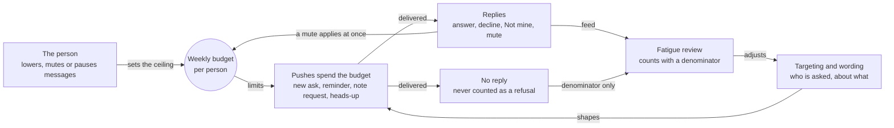
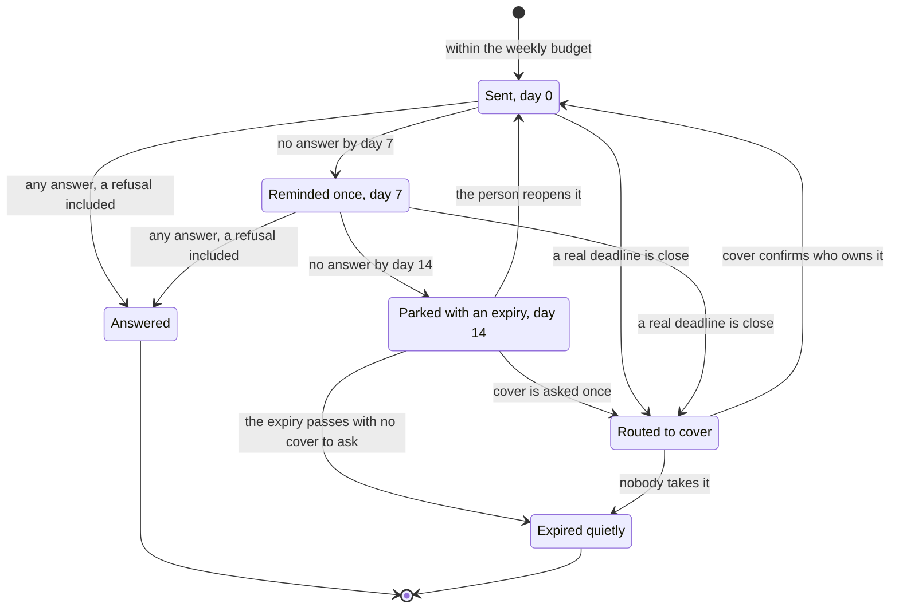

# The attention budget and the trust mechanics

**What this document answers.** How the system spends a person's attention (how many messages it may start, when, and what happens when nobody answers) and earns trust (the AI label, the controls a person always has, protection against forgery and rubber stamps), checked against Microsoft's guidance, the EU AI Act and the evidence on over-trust.

## Attention is a budget

The system treats attention as a budget it spends, not a channel it fills: quiet by default, quieter after an unanswered ask (silence tells it nothing about the person), louder only when waiting costs more than interrupting. Staff paged too often skim or ignore even a real page ([Google's SRE book](https://sre.google/sre-book/monitoring-distributed-systems/)), and interruptions cost stress and effort ([Mark, Gudith and Klocke 2008](https://dl.acm.org/doi/10.1145/1357054.1357072)).

**Every number here is a starting value.** The adopting organisation sets it and a pilot tests it ([12](12-testing-the-experience.md)).

Look at the loop: replies, declines and mutes feed a review, and the review changes who is asked, never anyone's weekly limit.

An **ask** is a Question or a Recommendation; a **push** is any message the system starts unprompted. The table sorts all 17 cards ([04](04-messages-and-cards.md)).

| Counts against the budget | Does not count |
|---|---|
| A new ask (C2, C3); the one reminder (C9); a request about a note (C11); a heads-up (C13) | Hello (C1), sent once; the weekly desk (C12); anything that answers the person's own action (C4, C5, C6, C7, C10, C14, C15); safety notices (C8, C16, C17) |

| Parameter | Starting value |
|---|---|
| Pushes per person per week | **1** for the first 30 days after the person's own first contact (the slow start), then **3**. Range 0 to 10; 0 means the weekly desk only. The FinOps lead sets the ceiling; a person can lower it or ask for more. Asks over the limit wait for the weekly desk |
| Quiet hours | 18:00 to 08:00 local and weekends, until the person states their own |
| Weekly desk | At most five items and about ten minutes of work; default Tuesday 10:00 local, the person's choice. Repeats nothing but a folded-in reminder |
| Monday letter | Arrives before 09:00 local |
| Receipt and answer | Goals: "Received. Nothing has changed yet" within one second where the host allows; an answer to Explain, Challenge or Teach within two minutes in 95 % of cases, else "I will answer in this thread" |
| Fatigue review | At least 20 delivered asks to a group in 28 days, over 40 % deferred or declined |
| Targets | Median time from the first observable interaction to the decision, under two minutes; share decided within seven days, declines included; mute and stop rate; regret and corrections. Never the approval rate, which rewards rubber stamps |

## The ladder when nobody answers

An unanswered ask climbs a short ladder and stops. The arrows back to Sent show a person reopening a parked item and cover confirming its owner.

One reminder goes out at day 7: its own message (C9), or part of that week's desk once the push budget is used up. At day 14 the item is parked; reopening is the person's own action, spends nothing and restarts the ladder. No reminder follows a refusal; a second goes out only for a real deadline (a price check or quote that expires, a price change), and says why.

**Coverage routing:** when an item is parked, or a real deadline is close, the system tells the owner once, first, by notice e-mail ([05](05-letters-and-requests.md)), then asks cover to confirm who owns it: the delegate the owner appointed or, failing that, the custodian queue (the team named for unowned estate). Cover gets a Question (C2), "Is this yours?", which says only "Ownership or cover needs confirming. Nothing is authorised." Three rules hold:

- A line manager is asked only if the owner appointed that manager as delegate.
- No message tells a third person that a named person did not answer: the case comes before the person ([People and conversation](../06-people-and-conversation.md)). (An invented example.) E1's day-7 Reminder (C9) to Maya says: "I will park it, tell you once and ask your cover to confirm who owns it. I will not say that you did not answer."
- Routing authorises nothing. Whoever takes the item sees the same plan and gives their own OK; an item nobody takes expires and nothing changes.

## Hours, Pause messages, the emergency lane and the review

**Working days, time zone and quiet hours** are stated by the person (Hello card C1, Settings C14), never taken from calendars, presence or out-of-office replies. A push due in quiet hours waits.

**Channel profiles:** Teams first (the default), e-mail first, or digest only (everything in the weekly desk).

**Pause messages** is a person's holiday mode: no non-urgent asks, reminders or routing to cover until the return date. It does not pause standing permissions; "Pause changes here" does. The emergency lane still applies. The platform team's kill switch has three levels (everything, one kind of change in every estate, or one estate; [06](06-web-pages.md)).

**The emergency lane** is opt-in per scope and needs absolute impact thresholds (a relative jump alone does not qualify) and an on-call route. A private urgent card and e-mail come first, then the on-call route. Voice or SMS goes only through the organisation's own paging, an [Azure Monitor action group](https://learn.microsoft.com/azure/azure-monitor/alerts/action-groups), never to a private phone or an owner.

**Non-repetition.** A teaching nudge is never repeated, a question a note already answers is not re-asked until the note expires, and an unanswered Question is re-asked at most twice, reworded.

**The fatigue review** asks whether a group is being asked too much; a mute is honoured at once, before any review. When the trigger fires, the FinOps lead sees counts for groups of at least five, with the denominator and no names. Only answers count as deferred or declined, never silence, which may mean unread, delayed or misdirected. The response is to review targeting, never a penalty: no budget, access or score changes because a group declines asks.

**The team-lead view** ([06](06-web-pages.md)) shows open decisions and ownership gaps as counts, age and value, never a list of people who have not answered. Groups under five roll up, a total minus a smaller group is suppressed too, dimensions are restricted and reconstruction is tested across releases; nothing in it is offered for performance review.

## The trust mechanics

### The AI label, in four layers

- **Sender name:** "Meternaut (AI)". The product may be renamed; "(AI)" may not be dropped.
- **Footer line:** "Written by an AI. Figures are computed by tools, not guessed by the AI. Estimates can still be wrong."
- **Teams label:** the AI-generated entity (`addAiGenerated()`) makes Teams show its "AI Generated" label beside the sender ([Learn](https://learn.microsoft.com/microsoftteams/platform/agents-in-teams/integrate-ai/ai-content-labels), read on 2026-11-02).
- **Machine-readable mark:** that entity in Teams; in e-mail the header `x-ai-generated: true`.

Learn documents the label and thumbs per message, not for card messages; the client matrix checks them ([12](12-testing-the-experience.md)). Article 50 of the EU AI Act, applicable from 2 August 2026, asks for an accessible notice (50(1), 50(5)) and a machine-readable mark (50(2)); whether the duties fall on a provider or a deployer is for the adopting organisation to assess ([Article 50](https://ai-act-service-desk.ec.europa.eu/en/ai-act/article-50), [11](11-access-language-inclusion.md)).

### What every message tells the person

- **Why you are getting this:** the evidence that made you the owner of record, on every card but Hello, whose introduction says why it writes ([04](04-messages-and-cards.md)). (An invented example.) "Why you are getting this: you confirmed on Monday that you look after rg-webshop-qa (the directory lists you for 3 of its 14 resources, and you created the other 11)."
- **Chips:** beside every saving figure, in words: the price basis and the saving word (how sure it is). Other money figures state their basis in the sentence. (Invented.) Without cost access, E3 reads "At list prices. I cannot see your rates."; under a partner agreement the chip reads "At retail rates. Your partner's rates are not visible."
- **What I do not know:** the limit of this Recommendation. (An invented example.) E3: "I cannot tell whether anyone keeps these two disks for a restore."
- **Receipt:** every tap gets a visible reply, such as "Received. Nothing has changed yet."
- **History:** My decisions and What I did here ([06](06-web-pages.md)).

### Controls a person always has

- **Pause changes here**, the button on cards C8 and C17 (optional mode, not built), stops standing permissions on those resources at once and can only narrow what the system may do ([06](06-web-pages.md)); suggestions continue. Undo of a change made under a standing permission also pauses that permission until a person has reviewed it.
- **Fewer like this**, on the card and the pages, lowers how often such asks arrive; standing permissions continue.
- **I did not approve this,** on the Done card, starts the incident path whatever the record shows, pauses that person's approvals, alerts the platform team and keeps the record. Undo, not this button, reverses the change.
- **Talk to a person** reaches a human at the adopting organisation: the last button in every card's footer, always visible, and in the same place on every page. It is also how someone reports that a message looks wrong or fake, which feeds the incident path ([03](03-organisation-journeys.md)).

### Resisting forgery

- **A lookalike app or page:** the announcement, sent first, names the app, its publisher and the one address of the approval page; every card carries one link, pinned to it. The system never asks for a password, code or secret.
- **A forwarded or old card:** the plan code, a reference rather than a secret or proof of authenticity, is echoed on every tap and page submit; a stale code, or a second submit by the same person, is refused.
- **A card from elsewhere or from an outsider:** cards that change anything are accepted only through the stored one-to-one conversation with this app, and only directory members get cards; partners get e-mail, which never carries a button that acts.
- **A consent prompt:** the announcement names the app's one permission; a sign-in that asks for any other is fraud, a known attack ([Learn](https://learn.microsoft.com/entra/identity/enterprise-apps/protect-against-consent-phishing)).

None of this helps when a signed-in device is stolen; the approver's own Azure rights limit that damage.

### Dark patterns the experience refuses

- **False urgency and countdowns:** a real deadline is named with its reason, never a timer; the card lint rejects urgency words ([12](12-testing-the-experience.md)).
- **Guilt, confirm-shaming, a hidden or smaller "No":** "No, leave it as it is" and "Not mine" take one tap, look like every other button and need no reason.
- **Penalty framing of waiting ("costs you"):** waiting is stated once, as what keeping things as they are forgoes.
- **Pre-ticked consent, nagging, a reminder after a refusal:** nothing is pre-ticked; one reminder, none after a refusal.
- **League tables of people:** wins are credited to teams; a person is named only with consent.

### Resisting rubber stamps

Friction rises with risk ([approval classes](../design/06-security-and-governance.md#approval-classes)), and the reason to doubt comes before the reason to agree.

- **Verb-plus-object labels on approvals:** "Approve and sign in to Azure", "Open the page to approve", never "Yes".
- **"What could go wrong" is always visible.** (An invented example.) E2: "Month-end peak is 70 to 90 % processor. If it stays above 85 % for ten minutes, my safety check stops and asks you whether to restore the old size. Restoring is a new approval on the page."
- **No bulk approve;** the approval page's Decline takes an optional reason.
- **Two independent approvers for a purchase,** asked in parallel; neither sees the other's answer until both have decided. One directory object never fills both roles. (Invented.) E4: Tomasz and Lars.
- **Alarms:** approving outside stated hours neither alerts nor counts against anyone. Only an approval recorded without the authenticated events of its own route (the page's sign-in and submit, the sign-in to Azure) raises an alarm and pauses that person's approvals; it catches forged requests and proves nothing about who pressed.
- **Sampling afterwards:** the FinOps lead and the platform owner review a confidential monthly sample of executed changes and standing-permission runs to tune the change recipes, never to judge a person.

## Compared with Microsoft's guidance and the EU AI Act

### Guidelines for Human-AI Interaction

Microsoft Research's 18 guidelines (2019) live in the [HAX Toolkit](https://www.microsoft.com/en-us/haxtoolkit/), with an [overview](https://www.microsoft.com/en-us/haxtoolkit/ai-guidelines/), [Design Library](https://www.microsoft.com/en-us/haxtoolkit/library/) and [Workbook](https://www.microsoft.com/en-us/haxtoolkit/workbook/).

| Guideline | Met by |
|---|---|
| G1 What the system can do | Hello card: what it does, does not do and can see |
| G2 How well it does it | Ranges, "what I do not know", the calibration view ([07](07-reports-and-dashboards.md)) |
| G3 Timing by context | Hours, days and desk day the person states; Pause messages |
| G4 Relevant information | One decision about the person's own resources; "why you are getting this" |
| G5 Social norms | Calm templates; tone never guessed from the person |
| G6 Social biases | No model picks a recipient; no emotion inference; no league tables |
| G7 Invocation | Explain, Challenge, Teach; Talk to a person |
| G8 Dismissal | "No, leave it as it is", Not mine, Fewer like this; mutes honoured at once |
| G9 Correction | Challenge; Teach with a read-back; Decline; Undo |
| G10 Scope when in doubt | A Question with "Not sure" first; a note's scope never exceeds its author's |
| G11 Why it did that | Details, Explain, the notebook page, "why you are getting this" |
| G12 Remembering | Notes with scope and expiry; the History pages |
| G13 Learning from behaviour | Taught notes change later Recommendations; nothing learned from presence |
| G14 Cautious updates | The slow start; narrowing automatic, widening human; sent cards keep their wording |
| G15 Granular feedback | Reason chips; the Result card (C7); Teams' thumbs ("was this useful") |
| G16 Consequences of actions | "What happens on yes"; "Note saved; these Recommendations changed" |
| G17 Global controls | Settings; Pause messages; Pause changes here |
| G18 Notifying of changes | "What I learned" in the Monday letter; standing permissions introduced before their first run (C17) |

### Fluent 2 and Microsoft's supervision pattern

[Fluent 2](https://fluent2.microsoft.design/responsible-AI/) names five principles. **Be transparent:** the four-layer label, "why you are getting this". **Set expectations:** the Hello card, ranges with a price basis, a standing permission introduced before its first run (C17). **Prevent overreliance:** the strongest objection by default, no bulk approve, two independent approvers. **Keep users in control:** choose, then give your OK. **Collect feedback:** reason chips, the Result card, Teams' thumbs. Microsoft's supervision pattern for agent requests (Approve, Reject with an optional reason, Suggest an alternative) shapes the approval page: Approve and sign in to Azure, Decline, Ask or suggest ([Learn](https://learn.microsoft.com/security/agentic-security/agentic-security-supervise-work)).

### Article 14(4) of the EU AI Act

Article 14(4) lists what overseers of a high-risk system must be able to do ([text](https://ai-act-service-desk.ec.europa.eu/en/ai-act/article-14)); the experience meets each as follows:

- **(a) Understand capacities and limits:** Hello card, Details, "what I can see here", "what I do not know".
- **(b) Stay aware of automation bias:** the strongest objection by default, ranges, no bulk approve, sampling.
- **(c) Interpret the output:** Explain, in simple, technical or finance terms.
- **(d) Disregard, override or reverse:** Decline, Challenge, Undo.
- **(e) Stop the system:** the kill switch (three levels) for the platform team; "Pause changes here" for an owner.

The design does not claim to be high-risk; the adopting organisation assesses that ([compliance mapping](../design/06-security-and-governance.md#11-compliance-mapping)). The high-risk rules apply from 2 December 2027 (listed uses, Annex III) and 2 August 2028 (regulated products, Annex I) ([Commission](https://digital-strategy.ec.europa.eu/en/news/ai-omnibus-enters-force)), so this is a design reference.

### What the evidence on over-trust shows

- [Parasuraman and Manzey 2010](https://pubmed.ncbi.nlm.nih.gov/21077562/), *Human Factors* 52(3): 381-410. Complacency and automation bias affect novices and experts; instructions and training do not prevent it.
- [Skitka, Mosier and Burdick 1999](https://doi.org/10.1006/ijhc.1999.0252), *International Journal of Human-Computer Studies* 51(5): 991-1006. When an imperfect automated aid erred, people with the aid made more errors than people without it.
- [van der Sijs and colleagues 2006](https://pmc.ncbi.nlm.nih.gov/articles/PMC1447540/), *Journal of the American Medical Informatics Association* 13(2): 138-147. In 17 studies, clinicians overrode drug-safety alerts in 49 to 96 % of cases.
- A vendor's blog about its coding agent ([Anthropic 2026](https://www.anthropic.com/research/claude-code-auto-mode)): users accept 93 % of manual approval prompts anyway, "approval fatigue".

They argue for showing the reason to doubt, limiting volume and refusing bulk approval.

## Privacy and labour

Preferences and counts are kept per directory object id, never names or e-mail addresses ([security and governance](../design/06-security-and-governance.md#7-data-protection-and-privacy)). Three rules follow:

- **Say less:** a message holds only what its decision needs (GDPR Article 5(1)(b) and (c)). Objection and erasure (Articles 21 and 17) are in [11](11-access-language-inclusion.md).
- **Human review for standing:** the system ranks, scores and judges no person. Anything affecting a person's standing needs a reviewer with the authority and competence to change the outcome ([Article 29 Working Party](https://ec.europa.eu/newsroom/article29/items/612053)).
- **Consult early:** some countries require a works council to be consulted before go-live; Germany, for example, gives it co-determination rights over technology that can monitor employees. An example, not legal advice.

## Where to read next

- [02 Owner journeys](02-owner-journeys.md)
- [04 Messages and cards](04-messages-and-cards.md)
- [06 Web pages](06-web-pages.md)
- [11 Access, language, inclusion](11-access-language-inclusion.md)
- [12 Testing the experience](12-testing-the-experience.md)
