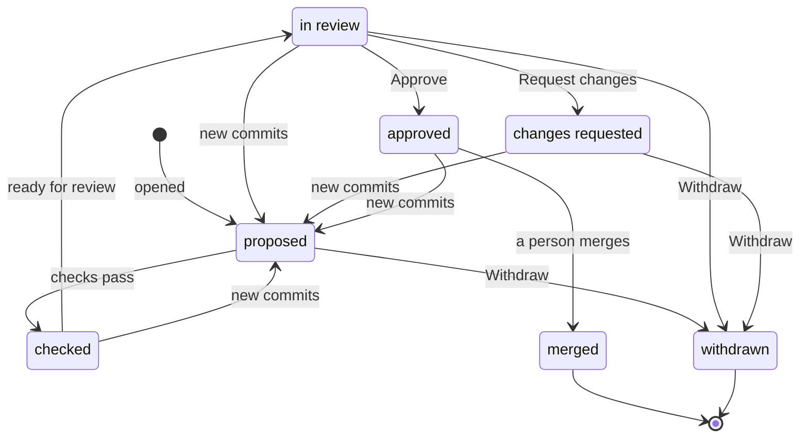

# Pull requests: reviewers, contributors and developers

**What this document answers.** The system proposes changes to its own knowledge, recipes and Detectors as pull requests; people merge them. This page says what a reviewer decides in ten minutes, what an outside contributor meets, what a developer may later see, and what protects the surface.

## Who reviews what

| Person | What they do here |
|---|---|
| Chen, Atlas reviewer | A [code owner](https://docs.github.com/en/repositories/managing-your-repositorys-settings-and-features/customizing-your-repository/about-code-owners) of `atlas/` and `detectors/`. Reads the review card for a knowledge change or a Detector (a compiled check that nominates leads); approves, asks for changes or withdraws; merges |
| Sofia, security reviewer | Code owner of `actions/`, `contracts/` and `.github/`; does the same for a Change recipe (a tested template for one kind of change) |
| Elena, developer | Owns infrastructure code; may see the optional cost comment on her pull request. Nothing is gated |
| An outside contributor | Proposes a claim or a fix from a fork; sees the first response, the card and the comments |

The Atlas is the project's tested knowledge base of how Azure charges. Its unit is the claim ([knowledge and learning](../design/04-knowledge-and-learning.md)).

## J15 Review a knowledge change in ten minutes

**Trigger.** A pull request touching `atlas/` or `detectors/`. **Who.** Chen. **Where.** GitHub: a *check run* (a result a GitHub App posts on a commit) and one comment. Azure DevOps: one comment, a status and the reviewer's vote.

The review card is a check run, which takes Markdown (up to 65,535 characters per text field), images with alt text and at most three buttons ([GitHub](https://docs.github.com/en/rest/checks/runs)). It completes as `action_required`, which blocks the merge, until a person decides. One comment mirrors the card, edited in place, with the long parts inside `<details>`, so the reviewer need not open the Checks tab; it links to the check. Explain, Challenge and Teach work as replies that decide nothing. Limits: [platform register](13-platform-register.md#review-surfaces).

| Part | What Chen reads |
|---|---|
| Claim, scope, level | One statement in plain words; service, region, offer, SKU or version, scale, date; documented or price-confirmed, with the words owners will read |
| Receipts, contradictions | Page, date and quote for each, with an automatic "quote found at the URL" check: public HTTPS addresses only, every redirect and resolved address rechecked, no credentials, size and time capped (not proof that the page is right); receipts or claims that disagree |
| What changes downstream | Profiles (per-service summaries of claims), Detectors and open Recommendations that rest on the claim. Cards already sent keep their wording |
| Tests | Schema, the claim's own re-check, a screen for estate data (subscription ids, resource ids, tenant names) |
| Poisoning signs, dependencies | A domain the Atlas has not cited before; text that reads like an instruction to an AI; provenance and licence of anything new, as GitHub's [guidance on reviewing AI-generated code](https://docs.github.com/en/copilot/tutorials/review-ai-generated-code) stresses |
| Ten-minute checklist, decision | Six boxes (receipts opened, quotes match, scope fits, contradictions read, downstream seen, nothing planted) from the pull-request template, since [issue forms are not supported for pull requests](https://docs.github.com/en/communities/using-templates-to-encourage-useful-issues-and-pull-requests/syntax-for-issue-forms); then one of three buttons. The reason goes in a comment or label, never a fourth button |

```markdown
(An invented example.)
Meternaut (AI), review card prism-scale-down-billing: needs a decision

Claim. Scaling an Azure Prism index down still bills the hour already started. Two pages disagree, so the claim is marked disputed and carries no saving.
Scope. Azure Prism, any region and offer, preview. 2026-11-02. Level: documented ("From Microsoft's documentation").

| Page | Quote | Found at the URL |
|---|---|---|
| docs.example/prism/pricing | "Billing is per started hour." | yes, 10:12 CET |
| docs.example/prism/scale | "Scaling down stops charges at once." | yes, 10:12 CET |

Contradictions. The two quotes disagree about a started hour.
Downstream. One profile gains a line. No Detector rests on it. Two open Recommendations cite it; their next wording says "From Microsoft's documentation" and names the dispute. Cards already sent keep theirs.
Tests. Schema valid. Re-check ran. No estate data found. New domain: no. Instruction-like text: none. New dependencies: none.
Decide on the check: Approve, Request changes or Withdraw. Write the reason as a comment.

Written by an AI. Figures are computed by tools, not guessed by the AI. Estimates can still be wrong.
```

| Step | Chen sees or does | The system does |
|---|---|---|
| 1 | Gets a review request when the pull request leaves draft | Runs the checks, posts the card |
| 2 | Reads the card; opens each receipt's page; ticks six boxes | Escapes contributor text; shows "quote found at the URL" |
| 3 | Presses Approve, Request changes or Withdraw on the check (no bulk approve); writes the reason | Records who decided, and when |
| 4 | Approves in GitHub too, which the ruleset (the branch's merge rules) counts, then merges | Cannot merge. The next release rebuilds the search index |

Look at the back-edges: new commits send a change back to proposed.



**If it goes wrong.** If nobody decides, the change waits: silence is not approval, and nothing merges on a timer. A claim merged in error is reverted by a new pull request.

**Measured by** time from review request to decision, and claims found stale soon after merging; per team, never per reviewer.

## The security of the surface

| Safeguard | What it does | What it does not stop |
|---|---|---|
| Escaping | Contributor text is shown as plain text: Markdown, HTML, links and @-mentions do nothing | A wrong claim that reads well |
| Fork pull requests | A check run on a fork's push does not list the pull request ([GitHub](https://docs.github.com/en/rest/checks/runs)), so the comment is posted when the pull-request event arrives | A first-time contributor's checks may wait for a maintainer to [approve the run](https://docs.github.com/en/actions/how-tos/manage-workflow-runs/approve-runs-from-forks) |
| The App never merges | The App holds Checks and Pull requests write, no Contents write on the base repository ([merging needs it](https://docs.github.com/en/rest/pulls/pulls#merge-a-pull-request)), and proposes from a fork. The ruleset keeps the App off every [bypass list](https://docs.github.com/en/repositories/configuring-branches-and-merges-in-your-repository/managing-rulesets/about-rulesets), requires a code owner's approval from someone other than the last pusher, dismisses stale approvals on new commits, and takes the card's check only [from the App](https://docs.github.com/en/repositories/configuring-branches-and-merges-in-your-repository/managing-protected-branches/about-protected-branches) | An administrator who edits the ruleset or grants Contents write |
| The author cannot decide | GitHub names who pressed a button. The App refuses Approve or Request changes from the author, or from anyone who is not a code owner of the paths, and the card says so. Only the author and the code owners may Withdraw | Two people colluding; a reviewer who approves unread. A ticked box proves nothing, since the author can edit the description: only the button decides |
| Azure DevOps | No CODEOWNERS file: [branch policies](https://learn.microsoft.com/azure/devops/repos/git/branch-policies?view=azure-devops), Required from creation, do the job: automatically included reviewers with a path filter; a minimum of one reviewer, never the author, with votes reset on every change; and a status policy, applied by default, that resets on every change and accepts only the system's [authorized identity](https://learn.microsoft.com/azure/devops/repos/git/pr-status-policy?view=azure-devops), with no [bypass permissions](https://learn.microsoft.com/azure/devops/repos/git/branch-policies?view=azure-devops#allow-policy-bypass-when-needed) | The status carries no card; the comment does |
| Copilot code review | A second opinion on request ([GitHub](https://docs.github.com/en/copilot/concepts/agent-capabilities/agent-powered-workflows-and-operations/code-review)): generally available on GitHub, public preview on Azure DevOps | Never the reviewer: without it, the named human and the checks remain |

## J16 A contributor's first pull request

**Trigger.** Someone outside the adopting organisation wants to add or fix a claim in the shared Atlas ([the Commons](../07-getting-smarter.md)). **Surfaces.** An issue, the guide, a pull request from a fork.

A **good first claim** has one statement, one public page and a scope that fits in a line; maintainers label it `good first issue` ([GitHub's advice](https://docs.github.com/en/communities/setting-up-your-project-for-healthy-contributions/encouraging-helpful-contributions-to-your-project-with-labels)). The **guide**, `CONTRIBUTING.md`, which GitHub [links](https://docs.github.com/en/communities/setting-up-your-project-for-healthy-contributions/setting-guidelines-for-repository-contributors) on every new pull request, is one page: what never goes in (resource ids, subscription ids, tenant names, bill lines) and what to expect.

| Step | The contributor sees or does | The system does |
|---|---|---|
| 1 | Opens a pull request from a fork; the claim template fills the description | Posts the first response (thanks, card and guide links, what to expect) and the card |
| 2 | Waits for a maintainer to approve the checks | Says so on the card |
| 3 | Reads the card, answers a reviewer or pushes a fix | Runs the checks; builds the card again |
| 4 | Sees Approved, then Merged; may ask for credit | A person merges; the claim joins the Atlas at the next release |

A claim with no receipt, or with estate data, fails the checks; the card says what and where.

**Review-load limits** (starting values the Atlas reviewers set): one open pull request per first-time contributor; one claim per pull request, or a few that belong together; new drafts from the system only while open ones are under a ceiling; review requests through a load-balanced [team assignment](https://docs.github.com/en/organizations/organizing-members-into-teams/managing-code-review-settings-for-your-team).

**Measured by** days to a first human reply and the share of first pull requests merged; never per person.

## J17 A developer sees a cost comment (optional, later)

**Trigger.** Elena opens a pull request that changes infrastructure code, in a repository where the comment is switched on. **Surfaces.** One comment, edited in place; advisory, so nothing is blocked.

As read on 2026-11-02, [What-If](https://learn.microsoft.com/azure/azure-resource-manager/bicep/deploy-what-if) lists what a deployment would change and prices nothing, and Microsoft documents no tool that joins the two. The closest open-source estimator, [Infracost](https://github.com/infracost/infracost) (Apache-2.0), reads ARM JSON, and Bicep only once compiled to ARM JSON; it ignores a Bicep expected-load ([documentation](https://www.infracost.io/docs/features/arm/)). So the platform's own tools price what they can, the comment says which figures those are, and it says plainly when no estimate is possible.

```markdown
(An invented example.)
Meternaut (AI), cost note: advisory, it blocks nothing

This change adds a General Purpose Azure SQL database (2 vCores), a zone-redundant storage account and a Cosmos DB account.
Change: about EUR 410 a month more (range 360 to 470). Scenario: priced from the list, with no bill behind it. At list prices. I cannot see your rates.
Priced by the platform's tools: the database and the storage account.
Not priced: the Cosmos DB account. Its cost follows request units, and this change does not say how many.
Shown because the change is above the threshold the adopting organisation set for this repository.
Reply Explain, Challenge or Teach.

Written by an AI. Figures are computed by tools, not guessed by the AI. Estimates can still be wrong.
```

A reply is screened text: it approves nothing and changes nothing in Azure, and a Teach becomes a Note only within what its author owns. **Measured by** replies and how often the first bill lands inside the stated range.

## Other review cards in the same shape

| Card | Reviewed by | What it adds |
|---|---|---|
| Change recipe | Sofia | Approval class in words, what changes and how it is undone, the guard metric, the permissions its role needs, its test on a tiny resource |
| Detector | Chen | Where it applies, blind spots, expiry, the claims it rests on, its back-test against what later investigations showed. Promotion from shadow to active is [a second decision](../design/04-knowledge-and-learning.md#5-detectors-expensive-reasoning-once-cheap-checks-afterwards) |
| Card and letter templates | Code owners of the sending app; a native speaker for a translation | Renders (light, dark, high contrast; letters also in classic Outlook) as images with alt text, accessibility results, the comprehension-check result, language status |

## Where to read next

- [04 Messages and cards](04-messages-and-cards.md): the cards owners receive.
- [08 Attention and trust](08-attention-and-trust.md): one decision per message; silence never approves.
- [12 Testing the experience](12-testing-the-experience.md): the checks template cards report.
