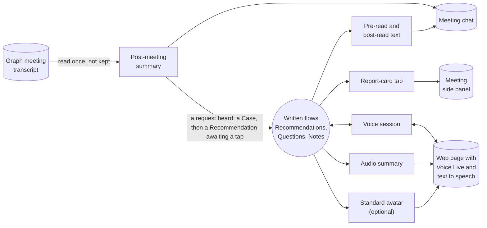

# Meetings, voice and avatars (optional modules)

**What this document answers.** Which meeting, voice and avatar modules the experience offers, in what order, and why only after the written flows are trusted. For each module: what it does, its status and its fallback. Then what is not offered, and the rules for anything captured or spoken.

## Why these modules are optional

The written flows (cards, letters, pages) carry one decision to one person. A meeting or a voice adds captured words and voices. That brings duties (consent, retention, in some countries a works council), usage charges, and a new way to over-trust: a decision spoken in a room feels settled. So every module is optional, follows the written flows and has a text fallback.

The technical design keeps them off until [the adopting organisation's data protection impact assessment and any works-council step are done](../design/06-security-and-governance.md).

## The order

Least capture and cost first. Statuses are as read on 2026-11-02; the [platform register](13-platform-register.md) defines the words.

| Module | What it does | Status | If it is missing |
|---|---|---|---|
| **1 Text in the meeting chat** | Plain text in a meeting's chat from "Meternaut (AI)", with the usual footer. It asks for no decision there | [Generally available](https://learn.microsoft.com/microsoftteams/platform/apps-in-teams-meetings/build-extensible-conversation-for-meeting-chat) | A one-to-one message to the organiser |
| **2 Pre-read and post-read** | Counts only. Before: what moved since last time and what is waiting. After: what is still open | Generally available | The same text, one to one |
| **3 Report-card tab** | A side-panel tab shows the report card; a presenter or the organiser can share it to the stage (permission `MeetingStage.Write.Chat`). No decision is taken in it | [Generally available](https://learn.microsoft.com/microsoftteams/platform/apps-in-teams-meetings/build-apps-for-teams-meeting-stage) | The presenter shares the screen |
| **4 Post-meeting summary** | After a scheduled meeting (not a channel meeting) whose organiser invited the app and switched this on, the app reads the Teams transcript once, under a permission limited to that meeting (`OnlineMeetingTranscript.Read.Chat`), and posts a summary of counts in the chat. The transcript is not kept or mined for anything else; a request about one resource goes privately to its owner | [Generally available](https://learn.microsoft.com/microsoftteams/platform/graph-api/meeting-transcripts/overview-transcripts), but only when a Teams administrator setting, [off by default](https://learn.microsoft.com/microsoftteams/meeting-transcript-api-access), allows it | No summary; the organiser is told why, once |
| **5 Voice session** | On a signed-in page, a person talks through a Question or teaches the system something. What was understood is read back as text and kept only after a tap or click | [Voice Live](https://learn.microsoft.com/azure/ai-services/speech-service/voice-live) is generally available over WebSocket; [WebRTC](https://learn.microsoft.com/azure/ai-services/speech-service/voice-live-api-reference-2026-07-15) is preview, so it stays behind a switch | The same, in text |
| **6 Audio summary** | A short spoken summary of a letter, played on a page. It opens with a spoken and a written disclosure that the voice is synthetic and has no download in the first release | [Standard text to speech](https://learn.microsoft.com/azure/ai-services/speech-service/text-to-speech) is generally available, billed per character | The letter, as text |
| **7 Standard avatar** | Only if it earns a place: a test shows listeners follow a summary better with it than with voice and text alone | [Generally available](https://learn.microsoft.com/azure/ai-services/speech-service/text-to-speech-avatar/standard-avatars) for standard characters, in some regions; some are preview. Billed per second while active, speaking or silent | No avatar |

**Reading the transcript.** Speaker attribution, a second Teams setting, is also off by default. While it is off, the app [asks for unattributed text](https://learn.microsoft.com/graph/api/calltranscript-get?view=graph-rest-1.0), never infers a speaker and reports a refusal of access (`GraphAccessToTranscriptsDisabled`) separately.

**Voice processing.** Recognition, voice and model have separate [processing scopes](https://learn.microsoft.com/azure/ai-services/speech-service/regions?tabs=voice-live#regions), possibly outside the resource's region: for either transport the platform team validates and records all three, and where none fits the approved boundary the session is text.

**Which avatar.** None, unless the vendor confirms a named character's origin: Microsoft Learn says six full-body characters are based on real actors and gives no origin for the rest. Custom avatars and custom or personal voices are [Limited Access](https://learn.microsoft.com/azure/foundry/responsible-ai/speech-service/text-to-speech/limited-access) and are not used.

## What is not offered, and why

- **A place in the live call.** Microsoft's real-time media platform, which gives a bot the raw audio and video of a call, [is in developer preview](https://learn.microsoft.com/microsoftteams/platform/bots/calls-and-meetings/requirements-considerations-application-hosted-media-bots), and Microsoft [does not recommend it for AI agents](https://learn.microsoft.com/microsoftteams/platform/bots/calls-and-meetings/real-time-media-concepts). An agent built in Copilot Studio cannot be invited to a meeting as a participant ([Microsoft Q&A](https://learn.microsoft.com/answers/a/12336240)).
- **A live transcript.** Teams can give an app acting for a signed-in user a transcript [while the meeting runs](https://learn.microsoft.com/microsoftteams/meeting-transcript-api-access#manage-work-iq-access-to-real-time-transcripts) (Work IQ; an administrator setting, off by default, from 14 November 2026). The first release reads transcripts only afterwards.
- **An avatar in the meeting.** No Microsoft page documents streaming an avatar into a Teams meeting, and [a Microsoft Q&A answer](https://learn.microsoft.com/answers/a/12266520) says there is no direct integration. That is unverified, so nothing here relies on it.
- **Live notes and live translation.** Microsoft's own agents do both for licensed users: [Facilitator](https://learn.microsoft.com/microsoftteams/facilitator-teams) and [Interpreter](https://learn.microsoft.com/microsoftteams/interpreter-agent-teams).
- **Azure Communication Services Email, SMS and Chat.** They [retire on 30 September 2028](https://learn.microsoft.com/azure/communication-services/acs-retirement-and-breaking-changes-guide), so none is used; the calling link to Teams meetings survives, as a breaking change, but would only serve a place in the call.
- **Calls or texts to owners.** Voice and SMS reach only the platform team, through the organisation's own paging, never a private phone ([08](08-attention-and-trust.md)).

## The rules

These apply to every module, and say what each Microsoft control does not stop.

(An invented example.) The notice posted when the organiser switches the summary on: what is kept, why, who gets it, for how long.

> **Meternaut (AI):** At the organiser's request I will read this meeting's transcript once, after it ends, and post a summary of counts here, so that requests reach their owners. I do not keep the transcript. The chat keeps the counts, for everyone in it, as long as it keeps its messages. A request about one resource goes only to its owner, and I keep it as long as your organisation's retention setting allows. If anyone says no, I read nothing: mention me here and say no, or tell the organiser.
>
> Written by an AI. Figures are computed by tools, not guessed by the AI. Estimates can still be wrong.

- **Consent comes before capture, and a refusal stops this app's capture.** The voice page says the same four things before the browser asks for the microphone. Anyone can refuse by mentioning the app in the chat. Anonymous participants cannot invoke a bot and phone participants cannot see the chat, so they tell the organiser, who reads the notice aloud. On any refusal the organiser switches the summary off: the transcript is then not read, but Teams still transcribes.
- **Teams' own consent is the organisation's setting.** Teams either tells people that a recording or transcript is running (implicit consent, the default) or asks them to agree ([explicit consent](https://learn.microsoft.com/microsoftteams/participant-agreement-recording-transcription), turned on by the organisation). The module never weakens that setting, starts no recording and reads only a transcript that already exists. Teams' consent covers recording, not what an app does with the text, so the module asks as well.
- **Nothing said aloud changes anything.** Voice is neither a sign-in nor an approval. A request about one resource stays out of the chat: it goes privately to its authorised owner as a Case (a record of one investigation), kept under the configured retention. If it would change something, it becomes a Recommendation awaiting the owner's tap.
- **A voice or an avatar is plainly an AI.** It says so first, aloud and in writing ("This is Meternaut, an AI. My voice is synthetic."), for blind and deaf listeners alike, as Microsoft's [disclosure patterns](https://learn.microsoft.com/azure/foundry/responsible-ai/speech-service/text-to-speech/concepts-disclosure-patterns) advise. It is never a real person's likeness or a cloned voice: no avatar before the vendor confirms its origin. Microsoft [requires](https://learn.microsoft.com/azure/foundry/responsible-ai/speech-service/text-to-speech/transparency-note) this disclosure and watermarks avatar video, but only approved parties can detect the watermark, so the disclosure stays the module's job.
- **The EU adds a duty.** [Article 50 of the AI Act](https://ai-act-service-desk.ec.europa.eu/en/ai-act/article-50) asks that people are told they deal with an AI, in a clear, accessible notice, and that synthetic audio is marked machine-readably where feasible. Microsoft names automatic marks only for avatar video and personal voices, so a download, which would lose its disclosure, is not offered. This is a design reference, not a claim of conformity.
- **Text for everything.** Captions in a session, a transcript beside every audio and a text path in every module: a person who cannot or will not use voice loses nothing. A session has one agreed spoken language, with captions translated into each person's own. The pages meet WCAG 2.2 AA ([11](11-access-language-inclusion.md)).
- **A meeting chat is a shared space.** Everyone in it, guests included, [reads what the module posts](https://learn.microsoft.com/microsoftteams/platform/apps-in-teams-meetings/build-extensible-conversation-for-meeting-chat), so it posts aggregate counts only, with groups under five rolled up ([07](07-reports-and-dashboards.md)). It never ranks, scores or reads the emotion of a person ([design](../design/06-security-and-governance.md)).

## How the modules connect

What each module touches:

## A worked example

(An invented example.) A quarterly FinOps review, Thursday 14:00 CET, organised by Nadia, the FinOps lead; Tomasz, the budget holder, attends.

| When | What people see or do | What the system does |
|---|---|---|
| Wednesday 16:00 CET | Nadia adds the app to the meeting chat and switches the summary on. The notice appears | Posts the notice; reads nothing yet |
| Thursday 14:00 CET | Nadia, the presenter, shares the report-card tab to the stage. Tomasz asks aloud: "Could the web-shop QA environment go off at night?" | Nothing: the system is not in the call |
| Thursday 15:05 CET | The chat gets the summary: "1 request, sent privately to its owner. Nothing has changed." Nobody had refused | Reads the transcript once and keeps none; opens a Case for the request, kept under the configured retention, and sends it to the resource's owner |
| Friday | Maya, who owns that environment, gets a Question first (does anything run on the last Tuesday?), then the Recommendation: about EUR 690 a month at the rates on your bill, an Expected saving | It waits for her tap. Nothing changed in the meeting |

## Read next

- [Messages and cards](04-messages-and-cards.md): the AI label and footer.
- [Attention and trust](08-attention-and-trust.md): the attention budget and the kill switch.
- [Accessibility, language and inclusion](11-access-language-inclusion.md): captions and translation.
- [Platform register](13-platform-register.md): every Microsoft feature's status.
