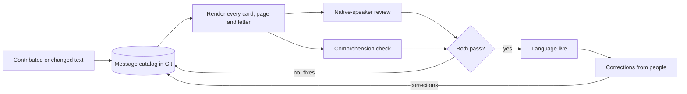

# Accessibility, language and inclusion

**What this document answers.** What "usable by everyone" means here: the accessibility standard for pages, letters and cards; other languages and number formats; whom the design keeps in mind; the privacy and labour rules it respects; and how it is tested.

## The bar

| Rule | Where it stands (as read on 2026-11-02) | What the design does |
|---|---|---|
| **WCAG 2.2, level AA** | A W3C Recommendation since 5 October 2023 ([W3C](https://www.w3.org/WAI/standards-guidelines/wcag/new-in-22/)) | The bar for pages and letters; cards meet what a card can carry |
| **EN 301 549**, the European accessibility standard | Version 3.2.1 (WCAG 2.1) still gives the presumption of conformity; version 4.1.1 (WCAG 2.2) is not yet cited in the EU's Official Journal ([AccessibleEU](https://accessible-eu-centre.ec.europa.eu/content-corner/news/european-accessibility-standard-en-301-549-has-been-updated-2026-09-07_en)) | The reference; the design builds to the higher bar voluntarily |
| **European Accessibility Act** | Covers listed consumer products and services ([Commission](https://commission.europa.eu/strategy-and-policy/policies/justice-and-fundamental-rights/disability/european-accessibility-act-eaa_en)); an employees-only tool is not listed | Not claimed |
| **EU AI Act, Article 50(5)** | The AI notice must be clear, distinguishable, given at the latest at first interaction, and conform to the applicable accessibility requirements ([Commission](https://ai-act-service-desk.ec.europa.eu/en/ai-act/article-50)) | The "(AI)" sender name and footer line are real text, never an image alone |

Azure Monitor Workbooks run in the Azure portal, and Microsoft publishes accessibility conformance reports for Azure ([Learn](https://learn.microsoft.com/compliance/regulatory/offering-en-301-549-eu)); the project claims nothing beyond them ([dashboards](07-reports-and-dashboards.md)).

## What a card can carry, and what moves to a page

- **Reading order.** Tab order follows the template; the headline is the one heading (`style: heading`) ([Learn](https://learn.microsoft.com/microsoft-copilot-studio/adaptive-card-accessibility-tips)).
- **Labels and tooltips.** Every input has a visible `label` and a required one an `errorMessage`; every toggle has a `tooltip` that narration reads; no input hides under a toggle. Actions that take no input set `associatedInputs` to `none`, so a required input never blocks them ([Learn](https://learn.microsoft.com/adaptive-cards/schema-explorer/action-execute)).
- **Text never cut.** `wrap` on every text block ([Learn](https://learn.microsoft.com/microsoftteams/platform/task-modules-and-cards/cards/design-effective-cards)), `fallbackText` on every card, a table's first row marked as header ([Learn](https://learn.microsoft.com/adaptive-cards/schema-explorer/table)).
- **Colour is the host's.** A card names a style, never a colour, so each theme repaints it ([Learn](https://learn.microsoft.com/adaptive-cards/resources/principles)); meaning is in words ("Seen on your bills"), never colour alone.
- **Numbers.** Ranges and time spans use "to" between numbers, so a screen reader never merges two figures.
- **A way to a person.** "Talk to a person" is the last button in every card's footer, always visible and in the same place. Every card says why the person is getting it.

**The page equivalent.** A card has one heading style and no landmarks, so a long plan, the evidence and the notes live on a page: server-rendered HTML without JavaScript, with real headings, landmarks, tables and forms. Every approval can be given there.

## The success criteria that shape the pages

| Criterion | What the page does |
|---|---|
| **2.5.8 Target size, minimum** (AA) | Controls are at least 24 by 24 CSS pixels; Decline is as large as Approve ([W3C](https://www.w3.org/WAI/WCAG22/Understanding/target-size-minimum.html)) |
| **2.4.11 Focus not obscured, minimum** (AA) | No sticky header, footer or banner hides a focused control ([W3C](https://www.w3.org/WAI/WCAG22/Understanding/focus-not-obscured-minimum.html)) |
| **3.2.6 Consistent help** (A) | "Talk to a person" sits in the same place on every page, error pages included ([W3C](https://www.w3.org/WAI/WCAG22/Understanding/consistent-help.html)) |
| **3.3.7 Redundant entry** (A) | Nothing the system already holds is asked again ([W3C](https://www.w3.org/WAI/WCAG22/Understanding/redundant-entry.html)) |
| **3.3.8 Accessible authentication, minimum** (AA) | No puzzle, CAPTCHA or code to retype. Sign-in runs on Microsoft Entra's pages, where a security key, or a passkey unlocked by Windows Hello, Touch ID or Face ID, is not a cognitive function test ([W3C](https://www.w3.org/WAI/WCAG22/Understanding/accessible-authentication-minimum.html)) |
| **1.4.3 Contrast, minimum** and **1.4.11 Non-text contrast** (AA) | Text at least 4.5:1 (3:1 when large); controls, states and focus ring at least 3:1. In a Windows contrast theme, `forced-colors` applies the person's own palette ([W3C](https://www.w3.org/WAI/WCAG22/Understanding/contrast-minimum.html), [Learn](https://learn.microsoft.com/fluent-ui/web-components/design-system/high-contrast)) |
| **2.2.1 Timing adjustable** (A) | The only time limit is the plan's expiry, stated with its time zone and warned about when a real deadline is near. No timer, countdown or auto-refresh ([W3C](https://www.w3.org/WAI/WCAG22/Understanding/timing-adjustable.html)) |

## Letters

Classic Outlook draws HTML with the Word engine ([platform register](13-platform-register.md)), so [letters](05-letters-and-requests.md) are plain by construction:

- **Tables only for tabular data**, with a header row and no merged cells, split cells or nesting. Outlook's Accessibility Checker flags a missing header row as an error and a complex table as a warning ([Microsoft](https://support.microsoft.com/en-us/accessibility/office-accessibility/rules-for-the-accessibility-checker)).
- **No images, SVG or charts**, so the alt-text rule has nothing to flag; a chart lives on a page.
- **A plain-text part** too: letters go as MIME, which carries both ([Learn](https://learn.microsoft.com/graph/api/user-sendmail)).

## Language

**Plain and translatable.** ISO 24495-1 asks for plain language that is relevant, findable, understandable and usable ([ISO](https://www.iso.org/standard/78907.html)). For translated text, the EU's Translation Centre asks writers to avoid culture-bound expressions, use one term per concept and link sentences with connectors ([Translation Centre](https://www.cdt.europa.eu/sites/default/files/documentation/pdf/writing_for_transation_en.pdf)).

**Message catalogs.** One catalog per language lives in Git: whole sentences in ICU message format, with placeholders and plural rules ([ICU](https://unicode-org.github.io/icu/userguide/format_parse/messages/)). Names, numbers, dates and money are placeholders filled at render time, never written by a model.

(An invented example.) E4's Expected saving, about EUR 4,300 a month at your agreement's rates, and a backup vault's charge, EUR 23.50 a day as invoiced, as each locale writes them ([Learn](https://learn.microsoft.com/globalization/locale/number-formatting)):

| Locale | Saving a month | Backup charge a day |
|---|---|---|
| English (United Kingdom) | €4,300 | €23.50 |
| Dutch (Netherlands) | € 4.300 | € 23,50 |
| German (Germany) | 4.300 € | 23,50 € |
| French (France) | 4 300 € | 23,50 € |

Every time is shown in the person's time zone, with its name: "Thursday 19:30 CET".

**Right to left.** Pages set `lang` and `dir` and mirror the layout ([Learn](https://learn.microsoft.com/globalization/fonts-layout/mirroring)). Learn does not say how Teams draws a card's `rtl` property ([Learn](https://learn.microsoft.com/adaptive-cards/schema-explorer/adaptive-card)), so a right-to-left language reaches cards only after the client matrix passes.

**Which languages.** English at launch, then Dutch, German and French, then any language by contribution ([contributors](09-reviewers-and-contributors.md)) after a native review and a comprehension check. The first message uses the directory profile's language if the catalog has it, otherwise English; the Hello and Settings cards change it, and model-written parts follow. A message is never mixed-language, because a card cannot mark one passage's language and a screen reader may read English in the wrong voice ([W3C](https://www.w3.org/WAI/WCAG22/Understanding/language-of-parts.html)): an incomplete catalog stays out of production, and the fallback is the whole message in English with a one-line note.

**Mood and directness.** The system never infers a person's mood or tunes its tone to a guess about them. Directness and form of address (formal or informal "you") are set once per language and confirmed by its native reviewer.

**The four most loaded words.** A native speaker checks each word in the new language; a neutral alternative is held ready for any that fail.

| Screen word | The native speaker checks whether it reads as | Neutral alternative |
|---|---|---|
| **Your OK** | agreement to the plan shown, not a casual yes or consent to more | Your decision |
| **Challenge** | "question this", not a dare or an accusation | Question this |
| **Teach** | "tell me what I should know", not making the person train the AI | Add a note |
| **Not mine** | "I do not own this", not refusing a duty | I am not the owner |

Look at the loop: findings go back into the catalog, and a language goes live only when both checks pass.

## Inclusion

Microsoft's Inclusive Design toolkit describes a persona spectrum: a limit can be permanent (one arm), temporary (a wrist injury) or situational (a new parent holding an infant), so a design for one person works for many ([Microsoft](https://inclusive.microsoft.design/articles/inclusive-101-guidebook)). Spoken modules carry captions and a transcript ([voice and meetings](10-voice-and-meetings.md)).

**Bias-free wording.** The Microsoft Writing Style Guide applies to every text: no "he/she", no slang, no generalisations about people or cultures, no military terms ([Learn](https://learn.microsoft.com/style-guide/bias-free-communication)). People come first ("a person who uses a screen reader"), and a disability is mentioned only when it matters.

**Shifts and time zones.** Hello offers "My hours and language" once and nothing waits on it; Settings asks the same: working days, a time zone (a list the organisation sets, plus "Another time zone: I will ask on the page"), a day for the weekly summary, quiet hours and a language (only languages whose catalogs are live). A choice that says "I will set it on the page" gets a replacement card with the page link. Nothing is taken from a calendar, presence or an out-of-office. Quiet hours may span midnight, a working week need not run Monday to Friday, and "Pause messages" lasts a week, two weeks or a month on Hello, or until a return date set on the Settings page.

**A person who cannot use a security key.** Two-person approvals need a phishing-resistant sign-in, which need not be a physical key. Microsoft Entra's built-in phishing-resistant strength accepts a FIDO2 security key, a platform credential such as Windows Hello for Business, and multifactor certificate-based authentication ([Learn](https://learn.microsoft.com/entra/identity/authentication/concept-authentication-strengths)); a person who signed in with a password is not prompted for Windows Hello in that session and must restart from "Sign-in options". A readiness check, a test sign-in on the approval page, shows any approver who cannot pass it, and a purchase is then refused with the reason explained.

## Privacy and labour rules the experience respects

Lawful basis, impact assessment and any works-council step stay with the adopting organisation.

- **Say no more than a message needs** (GDPR Article 5(1)(b) and (c), [EUR-Lex](https://eur-lex.europa.eu/eli/reg/2016/679/oj)): a message names a resource, not a person's habits, and about a person the system keeps an object id, a role and stated preferences, never a name or address.
- **Let people object and have data erased** (Articles 21 and 17): "Talk to a person" is always in reach, and the Settings page offers "Pause messages", mutes, and export and deletion of preferences and the person's own notes. Approval audit records are not erased: they follow the adopting organisation's retention ([security](../design/06-security-and-governance.md)).
- **Keep a human in charge of what affects a person's standing.** Guidance on GDPR Article 22 says human review counts only when someone with the authority and competence to change the decision does it, not as a token gesture ([Article 29 Working Party](https://ec.europa.eu/newsroom/article29/items/612053)). The system never ranks, scores or judges a person ([security](../design/06-security-and-governance.md)). (An invented example.) Approving outside her stated hours alerts nobody and is not counted against her. Only an approval recorded without the authenticated event of its own route raises an alarm and pauses her approvals. The alarm catches forged requests and proves nothing about who pressed, so a person decides what follows.
- **Consult the works council where one exists.** In Germany it has co-determination over technical systems designed to monitor employees' behaviour or performance (Works Constitution Act, section 87(1) no. 6, [in German](https://www.gesetze-im-internet.de/betrvg/__87.html)). Whether a tool that records who approved what falls under it is for the organisation and its works council to decide before go-live. An example, not legal advice.

## How it is tested

[Testing](12-testing-the-experience.md) holds the layers and the client matrix. Specific here:

- **Real assistive technology in Teams itself**, because Teams differs slightly from the card library ([Learn](https://learn.microsoft.com/microsoft-copilot-studio/adaptive-card-accessibility-tips)): NVDA and Narrator on Windows, VoiceOver on macOS and iOS, TalkBack on Android. Check reading order, labels, tooltips and errors, that the AI label is read first, and that a replaced card is announced. The iOS Simulator has no VoiceOver, so iOS needs a device ([Learn](https://learn.microsoft.com/microsoft-edge/accessibility/build/)).
- **Keyboard, zoom and contrast:** every card and page without a mouse; 400% zoom without two-way scrolling ([W3C](https://www.w3.org/WAI/WCAG22/Understanding/reflow.html)); light, dark and a Windows contrast theme, footer included. Accessibility Insights for Web assesses WCAG 2.1 AA, so the 2.2 criteria are checked by hand ([Accessibility Insights](https://accessibilityinsights.io/docs/web/overview/)).
- **Letters:** the Accessibility Checker's rules in classic Outlook, then a screen reader; the checker misses some problems.
- **Languages and people:** native review and the comprehension check per language, the client matrix for each right-to-left language, and cold readers who include daily users of assistive technology.

## Where to read next

- [Messages and cards](04-messages-and-cards.md): the seventeen cards.
- [Web pages](06-web-pages.md): the approval page and owner pages.
- [Attention and trust](08-attention-and-trust.md): the attention budget and banned dark patterns.
- [Testing the experience](12-testing-the-experience.md): the layers and their limits.
- [Platform register](13-platform-register.md): Microsoft features, status and fallbacks.
