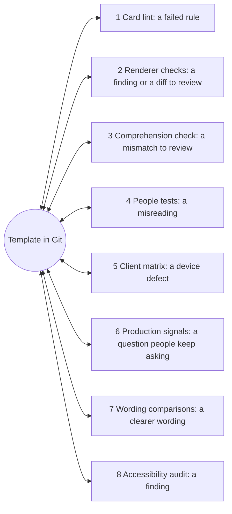

# How the experience is tested and measured

**What this document answers.** How the project knows that a message, page, letter or report does its job: a person can read it, decide from it and trust it, on their device. It sets out eight layers of checking, what each can and cannot prove, the release gates, and what no layer shows.

## What is tested, and what is not

This document tests the **experience layer**: the cards, pages, letters and reports people receive. Whether the Recommendation behind them is *right* is another question, answered by [testing and evaluation](../design/08-testing-and-evaluation.md). The card lint (layer 1) and the JavaScript renderer check (layer 2) exist today as scripts; the rest is the plan the adopting organisation runs. Letters and pages take the same layers, and a letter is also rendered in classic Outlook ([13](13-platform-register.md)).

## The eight layers

| Layer | It proves | It does not prove |
|---|---|---|
| **1. Card lint**, before every commit | Every template obeys the card rules a machine can judge | That the words are clear, calm or true; how Teams draws the card; that live values are clean (the [send step](04-messages-and-cards.md#the-send-step) strips links) |
| **2. Renderer checks**, before every commit | Microsoft's JavaScript libraries accept and expand every template and render it in the light theme | What Teams draws: the script sets its own [host configuration](https://learn.microsoft.com/adaptive-cards/rendering-cards/host-config) |
| **3. Comprehension check**, every template and language: a model that sees only the rendered message, with "Details" and every ShowCard open, answers whichever of six questions apply: What changes? Where? When? What is the saving range, and on what basis? How do I undo it? What happens if I do nothing? A card that only asks is checked on what it asks and why. | The information is there: code compares only the answers that apply with the card's contract; a mismatch is a signal for a person, not proof that a line is missing | That a person understands it or decides well: necessary, not sufficient |
| **4. People tests**, before a card type, page or language goes live: five people read it cold; a ten-second test; a native-speaker review; assistive technology in Teams itself, because Microsoft notes [slight differences](https://learn.microsoft.com/microsoft-copilot-studio/adaptive-card-accessibility-tips) | Real readers can act on it, in their language, with their tools | That five people stand for the organisation, or that it reads well in a busy hour |
| **5. Client matrix**, before go-live | Links, fallbacks, replacements, phone layouts, inputs and notifications work on each client and theme tried | Other builds, or next month's Teams update |
| **6. Production signals**, continuously | How groups of people experience the messages over weeks | Why one person acted, or anything about an individual |
| **7. Wording comparisons**, disclosed, with the prediction written first, judged on clarity and answer quality | Which of two clear wordings is clearer | Anything about clicks. Approval text, in any [class](../design/06-security-and-governance.md), is never compared: a wording tuned for approvals is tuned for yes |
| **8. Accessibility audit**, yearly and after a page redesign | Where pages, letters and cards fall short of the bar in [11](11-access-language-inclusion.md) | Legal conformity, which the project does not claim; that the next change keeps the result |

## The card lint (layer 1)

`tools/cardlint.py` runs inside `python tools/check-docs.py --strict` on the 17 templates in `docs/experience/cards/` with their sample data and manifest. It walks every element, input and action at every depth, ShowCards included, and counts an action inside a ShowCard as carrying its parent card's inputs. It is a floor, not the standard.

| Rule | The check fails when |
|---|---|
| Schema and size | `version` above 1.5 or missing; no official `$schema`; an element or action outside the allowed set ([13](13-platform-register.md)); a template over 20 KB |
| Actions | Any `Action.Submit` or `Action.Http`; an `Action.Execute` without an `Action.OpenUrl` fallback to the page; more than 8 visible buttons, 4 behind a toggle or 6 in one action set |
| Button titles | Over 24 characters, or no letter of any script; no verb; data beyond request id, option, scope, reason and plan code |
| Manifest | A card's verbs and its manifest entry disagree (each verb's inputs, plan flag and return); `associatedInputs` not `none` or `auto`; `auto` with nothing to send or an input the manifest omits; a decision verb (`cancel`, `not-me`, or the reserved `ok` and `undo`) without `planCode`, or a plan flag that disagrees with it; an answer link that is not listed or not on the card once; a question that is not hidden or has "No, go back" second; a `displayTitle` different from the card's title; no `contract` for every verb |
| Inputs | A root-level input where the manifest does not allow one; no label; a required input without an error message |
| Accessibility | A TextBlock without `wrap`, an image without alt text, a toggle without a tooltip; a dash between two numbers or a middot in card text or sample data |
| AI, reason and person | No `ai-label` showing "(AI)"; a footer not starting "Written by an AI", or a `fallbackText` without it; a footer that is not the last element, breaks across lines or lacks the reason or "Talk to a person" with its contact; a `talk-to-a-person` or `why-you-get-this` element; no "Ask or tell" (verb `ask`), or an Explain, Challenge or human verb |
| Money cards | A card showing money without `value`, `price-basis` and `saving-word` |
| One link | A URL, markdown link or e-mail address in a template; an `Action.OpenUrl` that is not `${pageUrl}`; a `fallbackText` without `${pageUrl}` |
| No urgency | Wording such as "act now", "last chance" or "!!" |
| Sample data | No `"_invented": true`; a sender name not ending "(AI)"; no `contact` (a name and an address in brackets, as plain text); a recipient, address or link key; a link, markdown link or e-mail address in a value other than the contact; no `notificationText`, or one over 120 characters; two scenarios sharing a request id |

## Renderer checks (layer 2)

```text
cd tools/render-cards
npm install --ignore-scripts
node validate-cards.cjs
```

It needs Node 20 or later and three MIT-licensed packages, among them Microsoft's `adaptivecards` and `adaptivecards-templating`, pinned to exact versions; `--ignore-scripts` keeps what they depend on from running install scripts (no lock file is committed: one made on the maintainer's machine would name its package feed). Each template is expanded with its sample data, parsed as schema 1.5, validated and saved as light-theme HTML renderings at desktop and 360 px width, with ticked boxes and chosen options written in so they show the defaults. It fails on any finding or unexpanded `${...}`. A clean run ends `all 17 cards parse, validate and expand`. `node screenshot-cards.cjs` then redraws the pictures in `docs/img` from those renderings (Node 22 or later and an installed Microsoft Edge or Chrome, no further package).

The plan adds dark and high-contrast snapshots, so a change in look shows in the pull request, and a C# check that `AdaptiveCards.Templating` ([Learn](https://learn.microsoft.com/adaptive-cards/templating/sdk)) expands every template to identical output.

## The client matrix (layer 5)

Before go-live each card type is walked through every Teams client: desktop and web in light, dark and high contrast; iOS and Android in light and dark, because [Teams mobile supports light and dark themes](https://learn.microsoft.com/microsoftteams/platform/concepts/design/design-teams-app-color). A right-to-left language adds a pass ([11](11-access-language-inclusion.md)).

| Check | Look at | Why |
|---|---|---|
| **The approval link** | What `Action.OpenUrl` opens: the system browser or an [embedded view](https://learn.microsoft.com/adaptive-cards/schema-explorer/action-open-url) | An embedded view may lack what [security keys and passkeys need](https://learn.microsoft.com/entra/identity/authentication/concept-passkey-browser-authentication-federated-identity-provider). A purchase always gets the approval-waiting e-mail ([05](05-letters-and-requests.md)); a one-person approval gets it where the link opens in an embedded view. The e-mail link is tested on the same device |
| **Show and hide** | "Approve" on a delete shows "This cannot be undone", and "No, go back" hides it, on desktop, web and mobile | Not proven for a card that the Flow bot posts. If it fails, "Approve" is a link and the page asks |
| **C3 and C4 at 360 px** | The plan blocks (C4) and Details (C3) stay readable, with no sideways scrolling and no cut-off button title | Teams mobile has no horizontal scrolling ([Learn](https://learn.microsoft.com/microsoftteams/platform/task-modules-and-cards/cards/design-effective-cards)). The reference renderings, [C3](../img/experience-card-c3-recommendation-phone.png) and [C4](../img/experience-card-c4-your-ok-phone.png), wrap buttons; a client may not |
| **A ShowCard input** | Text typed under "Ask or tell", and days ticked in the multi-select list under "My hours and language" on Hello, arrive intact | An action in a ShowCard also [sends its parent card's inputs](https://learn.microsoft.com/adaptive-cards/authoring-cards/input-validation#fields-to-be-validated-and-submitted) |
| **Notification and labels** | What the toast and chat list show for a card message (`text`, `summary` or a generic line), and whether the "AI Generated" label and Teams thumbs appear | A one-sentence `text` (`notificationText`) travels with the card; which one Teams shows is settled here. Label ([Learn](https://learn.microsoft.com/microsoftteams/platform/agents-in-teams/integrate-ai/ai-content-labels)) and thumbs ([Learn](https://learn.microsoft.com/microsoftteams/platform/agents-in-teams/integrate-ai/user-feedback-controls)) are documented per message, not for card messages |
| **Below schema 1.5** | A client that cannot draw the card shows `fallbackText`; its page link opens | Below the card's version only `fallbackText` renders ([Learn](https://learn.microsoft.com/adaptive-cards/schema-explorer/adaptive-card)), so it carries the page link |
| **Read receipts** | Whether one arrives in a one-to-one chat | The app has no such permission. Nothing in the design relies on one |

## Production signals (layer 6)

Signals cover groups of at least five people, with denominators; smaller groups roll up. Managers see counts only: a total minus a smaller group is suppressed, dimensions are restricted and reconstruction across releases is tested. Nothing is offered for performance review, and silence is "no answer yet", never "ignored". Signals feed the report card ([07](07-reports-and-dashboards.md)) and, in a pilot, test the starting values of [08](08-attention-and-trust.md).

| Signal | It counts | Read with care |
|---|---|---|
| **Decision burden** | Elapsed minutes from the first observable interaction (a tap or page view) to the decision | Starting target: median at most 2 minutes. Elapsed time is not attention, which only consented studies estimate. Very short on large changes can mean a rubber stamp |
| **Time to decision** | Send to decision, a decline included | Starting target: most within 7 days |
| **Explain-to-decision ratio** | Explain requests per decision, per card type | High: the message lacks something, so the question people keep asking becomes a line in the template. Low is not proof of trust |
| **Challenge outcomes** | A Challenge led to a revised or dropped Recommendation, a better reason, or nothing | If challenges never change anything, they are decoration |
| **Answers later corrected** | Answers and Lessons an owner later edits, deletes or answers differently | A rise points at an unclear Question |
| **Mute and stop rates** | Mutes, lowered weekly budgets, "Pause messages" or "Fewer like this" | A trigger to review targeting ([08](08-attention-and-trust.md)), never a penalty |
| **Approval regret** | Approved changes whose verified outcome was worse than doing nothing ([design 08](../design/08-testing-and-evaluation.md#4-measures-and-the-report-card)) | Arrives weeks later; read with the sampled review of approvals |
| **Usefulness** | Teams' thumbs, which mean only "was this useful" (not recorded for a card that the flow posts) | Never changes a Case; the card's own buttons mean something else |

**Why compliance and approval rate are never targets.** They rise when people stop checking: over-trust affects novices and experts alike ([08](08-attention-and-trust.md#what-the-evidence-on-over-trust-shows)).

## Release gates

- [ ] **Merge:** layers 1 and 2 pass, the snapshot difference is reviewed, and layer 3 answers every question that applies.
- [ ] **A new card type, page or language:** layer 4 is done.
- [ ] **Go-live:** layer 5 is complete, no button title is cut off at 360 px, and every supported client opens the approval link in the system browser or gets the e-mail.
- [ ] **Each year:** layer 8, with findings resolved or dated.
- [ ] **While live:** a signal outside its target opens a review of the message or its targeting, never of a person.

## The layers as a hub



## What the layers cannot tell you

- **Approval regret.** Many Recommendations are never acted on, and counts cannot tell a careful approval that went wrong from a rubber stamp; only the confidential sample review can.
- **Trust over time.** Trust is right-sized when people rely on the system where it is right and check it where it is not. No single count shows it; signals read together over months come nearest.
- **A person's reading under stress.** Every layer runs in calm conditions. A message misread at 16:50 on a Friday shows up later as a corrected answer, a regret or a mute, never as a failed test.

## Open next

- [04 Messages and cards](04-messages-and-cards.md)
- [06 Web pages](06-web-pages.md)
- [08 Attention and trust](08-attention-and-trust.md)
- [11 Access, language, inclusion](11-access-language-inclusion.md)
- [13 Platform register](13-platform-register.md)
