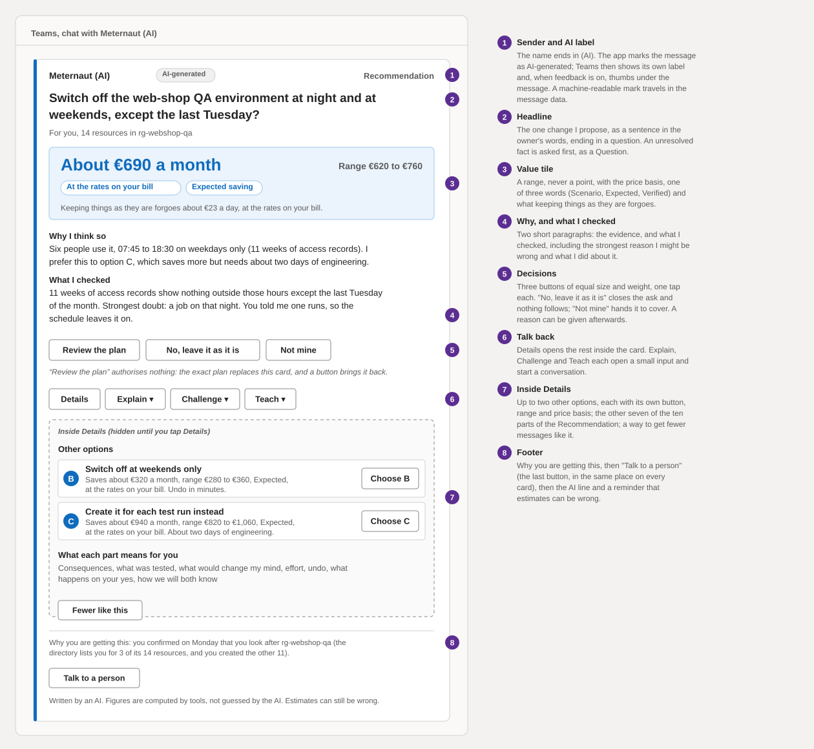

# Experience design: what people see, receive and decide

**What this document answers.** Cost in Action is an AI system that finds savings in Azure and asks the people who own the resources to decide, in Teams and e-mail. It changes Azure only after a person's OK on the exact plan. This folder says what each person sees, receives and decides, in which channel, in what words, and how the system spends and protects people's attention; [the technical design](../design/README.md) says what the system does. It is the front door to fifteen documents, seventeen message templates and six wireframes. Nothing here is built; every example is invented.

The card carries one decision for one person, with its evidence one tap away, and asks for nothing the person has not yet seen in full.

## Where this sits

The [technical design](../design/README.md) fixes what the experience may rely on: three approval classes ([security](../design/06-security-and-governance.md)), a send step that no model can steer ([data and integrations](../design/05-data-and-integrations.md)), and a ten-part Recommendation with Explain, Challenge and Teach ([agents and workflows](../design/03-agents-and-workflows.md)). The [idea](../06-people-and-conversation.md) says why a conversation, not a dashboard, is the right way to get people to act. This folder turns both into screens, letters and rules. Where the experience needs something the technical design does not yet say, it is listed in [15-asks-of-the-technical-design.md](15-asks-of-the-technical-design.md).

## Ten principles

| # | Principle | In practice |
|---|---|---|
| 1 | One decision, one person, about two minutes | Every card carries one decision for the person who can take it |
| 2 | Evidence one tap away | Details in the message, Explain answered in the thread, the notebook page (full reasoning and receipts), a person behind that |
| 3 | Honest numbers | Every saving you may act on has a range, its price basis and one of Scenario, Expected or Verified |
| 4 | What changes, how to undo it, what waiting forgoes | Stated before anyone is asked to decide |
| 5 | Disagreement is welcome | Challenge and Teach are as easy as yes, and the answer visibly changes what happens next |
| 6 | Attention is a budget | Quiet by default, quieter when ignored, louder only when waiting costs more than interrupting |
| 7 | No silent yes, no surprise | Silence is never consent; free text never approves |
| 8 | The same care at every level of access | What the system cannot see changes the words and the buttons, never the standard |
| 9 | One labelled voice | Always an AI, never a person's likeness; a person is always reachable |
| 10 | Usable by everyone | Accessible, translatable and in plain words by construction |

## The words people see

People never see the system's internal names. The table is the bridge between the technical design's words and the screen's words. In running text this folder uses the design word; inside quoted screen text it uses the screen word.

| In the design | On the screen |
|---|---|
| Recommendation, Question | **Recommendation**, **Question** |
| Lesson | **Note**: "what I know about your resources", with a scope, an expiry, and edit and delete |
| Evidence levels | **From Microsoft's documentation**, **Price confirmed**, **Seen on your bills**, **Proven by a change here** |
| Price basis | **At your agreement's rates**, **At the rates on your bill**, **At list prices. I cannot see your rates.**, **At retail rates. Your partner's rates are not visible.**: beside every saving figure |
| Scenario, expected, verified saving | **Scenario saving** (no rate or bill line behind it), **Expected saving** (a bill line confirms the meter), **Verified saving** (measured after the change) |
| Stored quote | **Price check**; "quote" means only an offer from a partner or a billing owner |
| Credential | **Standing permission** |
| Approval, Action | **Your OK**, **Change** |
| Approval classes R1, R2, R3 | **One tap** (one OK in the card; opening the plan approves nothing), **your OK on a page**, **two people** |
| Ledger | **History** |
| Three pauses | **Pause messages** (a person's holiday), **Pause changes here** (an owner stops standing permissions), **the kill switch** (the platform team) |
| Hub, Runner, Detective, Skeptic, Agenda | Never shown; Atlas appears only to reviewers and contributors |

The sender is always **Cost in Action (AI)**: an organisation may rename the product, never drop "(AI)". Every message ends with "Written by an AI. Figures are computed by tools, not guessed by the AI. Estimates can still be wrong."

## The surfaces

| Surface | For whom | Carries | Read |
|---|---|---|---|
| Teams cards | Owners, budget holders, approvers | One decision at a time: Questions, Recommendations, the plan, the result, a mistake | [04](04-messages-and-cards.md) |
| E-mail letters | The FinOps lead, finance, executives; partners and billing owners | Narrative and requests; never a button that acts | [05](05-letters-and-requests.md) |
| Owner pages | Owners, team leads, approvers | Notes, history, settings, and the one place an OK on a page is given | [06](06-web-pages.md) |
| Workbooks | The FinOps lead, platform, security | The report card and the other dashboards | [07](07-reports-and-dashboards.md) |
| Pull-request cards | Reviewers, contributors, developers | A knowledge change reviewed in ten minutes | [09](09-reviewers-and-contributors.md) |
| Meetings and voice | Anyone, after the written flows are trusted | Optional modules, text first | [10](10-voice-and-meetings.md) |

## How to read this folder

| Document | Answers |
|---|---|
| [01 The people](01-people.md) | Who the experience is for, and what changes with their access |
| [02 Owner journeys](02-owner-journeys.md) | Eight journeys of a resource owner |
| [03 Organisation journeys](03-organisation-journeys.md) | Onboarding, commitments, standing permissions, incidents, the letters, audit |
| [04 Messages and cards](04-messages-and-cards.md) | The anatomy of a message and all seventeen Teams cards |
| [05 Letters and requests](05-letters-and-requests.md) | E-mail: letters, fallbacks and requests to partners |
| [06 Web pages](06-web-pages.md) | The owner's pages and the approval page |
| [07 Reports and dashboards](07-reports-and-dashboards.md) | The report card, the savings ledger and who sees what |
| [08 Attention and trust](08-attention-and-trust.md) | The attention budget, coverage routing, trust mechanics |
| [09 Reviewers and contributors](09-reviewers-and-contributors.md) | Pull requests as an experience |
| [10 Voice and meetings](10-voice-and-meetings.md) | Optional modules and their limits |
| [11 Access, language, inclusion](11-access-language-inclusion.md) | WCAG 2.2 AA, plain language, translation, privacy and labour rules |
| [12 Testing the experience](12-testing-the-experience.md) | What is tested, what each layer cannot prove |
| [13 Platform register](13-platform-register.md) | Which Microsoft features are relied on, their status and fallbacks |
| [14 Decisions](14-decisions.md) | Each decision with alternatives, cost, security impact and reversibility |
| [15 Asks of the technical design](15-asks-of-the-technical-design.md) | What the experience needs added to the technical design |

The cards are Adaptive Card templates in [cards/](cards/manifest.json) with invented sample data; a reference rendering of each is in [04](04-messages-and-cards.md).

## The running examples

Examples are invented and labelled in every document, and their numbers stay the same everywhere.

| Example | In one line |
|---|---|
| E1 A web-shop QA environment | A Question first about a month-end job, then a one-tap schedule worth about €690 a month |
| E2 An orders database one size down | A change on a page, with a safety check that stops and asks the approver whether to restore if the processor stays high |
| E3 Two unattached disks | A small saving seen only at list prices, so a Scenario |
| E4 A one-year compute savings plan | A purchase by two independent approvers, USD 219,000 (about €205,860) over the year, never undone |
| E5 An AI token spike | A Heads-up that asks first, privately |
| E6 Dev storage tiering | A change under a standing permission, introduced first, announced afterwards, with Undo |

## How the experience is kept honest

Three tools check the work; run them before each commit. `tools/check-docs.py` guards these documents (vocabulary, size, links, diagrams). `tools/cardlint.py` guards the templates: schema, the AI label, why the person got the message, "Talk to a person" as the last button, price basis beside every saving figure, one link, no urgency, a cap on buttons, an action contract for every verb. `tools/render-cards` runs every template through Microsoft's own Adaptive Cards libraries, at desktop and phone width. [12](12-testing-the-experience.md) says what each proves and what none of them can.
