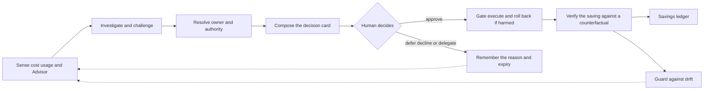

# Azure Cost in Action — the one-page overview

> **Status:** Ideation **v3** · **Date:** 2026-10-30 · The picture first. The whole idea is in the [north-star vision](01-north-star-vision.md); the safety model that governs everything below is in [06](06-closed-loop-actions-and-autonomy.md). Numbers are illustrative unless a source is cited. *This page was added after rubber-duck round 2, which asked for one compact visual that joins the loop, the first plays, the authority boundary and the outcome.*

> **The sentence on the wall.** *Every euro spent on Azure has an owner and a reason. Every euro that doesn't becomes a decision — put to the right human, with evidence and a safe one-tap fix — then executed, proven, and kept from drifting back.*

## 1. The gap we close

| Azure already gives you | What nobody does today |
|---|---|
| **Cost Management** — what you spent | Ask *who owns it* and *whether it is still needed* |
| **Advisor** — what you could save | Get that recommendation to the **right person**, with evidence they trust and a button that works |
| *(neither)* | Look at what the estate is actually **used** for — logs nobody queries, gateways nobody connects to — and then **verify** the saving afterwards |

## 2. The loop — a workflow, not a chatbot

**AI does the judgement-heavy work at every step** — noticing, investigating, challenging its own case, finding the owner, writing the card, planning, verifying. **Humans hold the keys** at three points only: the *decision*, the *signature* on anything that spends or commits money, and the *guardrails themselves*. Every figure on a card is computed by deterministic code with lineage; the AI composes the words.

## 3. What an owner receives

| The card says | Example (illustrative) |
|---|---|
| **The ask, in one line** | "Scale the shared point-to-site gateway down — it is sized far beyond its peak." |
| **Why we think so — and what would change our mind** | Metrics over the evidence horizon; the counter-evidence we looked for |
| **What it is worth** | About €23k a month at list price for 100 scale units (West Europe, Retail Prices API, 2026-10-30) — recomputed from *your* price sheet at execution |
| **What could go wrong, and who else is affected** | Microsoft says to **plan for downtime** when scaling; every business unit using it must acknowledge |
| **What can and cannot be undone** | Stated by class, up front — never an undo that does not exist |
| **Buttons** | **Approve** · **Not now** · **Not mine** · **Explain** — and a way to reach a human |

## 4. Release 1 — five plays on one skeleton

| Play | What the owner gets | Mode | Why it is in |
|---|---|---|---|
| **Owner Graph** and the Estate Interview | The right human found from tags, directory, history and a short conversation — or a named custodian when nobody owns it | Foundation | Every other play fails if the card goes to the wrong person |
| **Log usefulness** | "No observable consumer queries these tables; this noise could be filtered" — shadow-measured, with the audit-coverage caveat | **Advise** only, non-Sentinel workspaces | Seed example 1. Filtering is an information-loss action and needs the data owner and security — later |
| **P2S gateway right-sizing** | A banded-capacity lookup, a window, a rollback and a verified saving | **Assist** after every affected business unit consents; advise-only until the scale-operation spike is Green | Seed example 2 — hidden capacity with a concrete price |
| **Orphans and Advisor closure** | Existing Advisor and orphan findings routed to the right owner; one-tap closure with snapshot and rollback — **never deletion on silence** | **Assist** | The brief's own problem: recommendations nobody acts on. It proves the whole loop |
| **Provisioned-throughput utilisation** *(conditional)* | "You reserve capacity you do not use" | **Advise** | Granular AI-spend monitoring is the top unmet need in the State of FinOps survey |

**Advise** = an evidence-backed recommendation; the human acts. **Assist** = the crew executes a previewed plan after explicit one-tap approval. **Release 1 proves AI-assisted closure only (levels L1–L2).** Enrolled autonomy (L3/L4) is a separate, later hypothesis with its own pre-registered test.

## 5. Who may decide what

| Class | What it is | Example | Candidate ceiling *(to be ratified)* | Approvers |
|---|---|---|---|---|
| **R0** | Metadata only | Advisory tags, alert routing | Policy autopilot, later | The owner who opted in |
| **R1** | Restorable configuration | Resize within a family, stop with state retained | Assist in prod; a veto window in non-prod *only for enrolled owners* | The owner |
| **R2** | Recoverable inside a window | Snapshot, then delete | Assist in prod; a veto window in non-prod *only for enrolled owners* | The owner, plus every affected party if shared |
| **R3** | Irreversible loss — **and every transaction** | Permanent deletion; a reservation purchase | **Advise or Assist, two keys** — transactions are signed individually by the authorised buyer, never automatic | Owner **+** FinOps lead (**+** the data owner, **+** security where flagged) |
| **R3-Data** | Loss of observability or evidence data | An ingestion filter; shorter log retention | **Advise or Assist only — never a veto window or autopilot** | Owner **+** data owner **+** security |

The class is **derived** from an operation's typed effects and checked by deterministic code — never declared by an agent or a playbook ([06 §2](06-closed-loop-actions-and-autonomy.md#2-the-action-vocabulary-the-verbs)).

## 6. Five rules that never bend

1. **Silence is never consent.** No answer ends in a human decision, a parked case or an expiry — never an automatic approval. A veto window runs only against a matching, authenticated enrolment.
2. **A human with authority over the target decides** — checked at approval *and again at execution* — and the approval is bound to the exact plan that runs.
3. **Purchases are signed, never automatic.** Every commitment is individually signed by the legally authorised buyer against a finite manifest; the preparer cannot be the signer.
4. **What cannot be undone says so.** Irreversible and information-losing actions need more than one human and state the residual loss. Locks and legal holds are never bypassed.
5. **Agents never change their own rules, and anything can be stopped.** Guardrails ship only as governed releases; the kill switch is tested; when in doubt the system degrades to *advise*.

## 7. What "it worked" means

Savings are counted only when **Verified** (and **Sustained** after the hold period) — against a counterfactual, reconciled to the invoice, with **regret** (rollbacks, incidents, boomerangs) reported next to them ([06 §7](06-closed-loop-actions-and-autonomy.md#7-verification--savings-you-can-take-to-finance)). The pilot is **pre-registered** against a comparison condition ([10 §8](10-value-metrics-and-economics.md#8-pilot-design-and-success-criteria-strawman--to-be-pre-registered)), and seven **kill criteria** let us stop cheaply — for example if owners do not act even when asked well, if a harmful action occurs, or if the platform costs more than it saves ([plan/01 §4](../plan/01-assumptions-risks-decisions.md)).

## 8. Where to go next

| If you want… | Read |
|---|---|
| The whole idea | [01 — North-star vision](01-north-star-vision.md) |
| Every opportunity, with evidence and status | [02 — Opportunity catalog](02-opportunity-catalog.md) |
| The two seed examples in depth | [03 — Deep dives](03-deep-dives-seed-examples.md) |
| How humans are reached | [05 — Human interaction](05-human-interaction-concepts.md) |
| The safety model | [06 — The closed loop](06-closed-loop-actions-and-autonomy.md) · [08 — Guardrail territory](08-trust-safety-and-guardrail-topics.md) |
| What exists already, inside and outside Microsoft | [research/06](../research/06-first-party-teardown.md) · [research/02](../research/02-third-party-and-oss-landscape.md) |
| What happens next, and what we need from you | [Follow-up plan](../plan/00-follow-up-plan.md) · [Decisions](../plan/01-assumptions-risks-decisions.md) |
