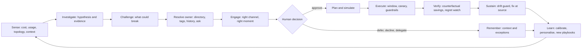
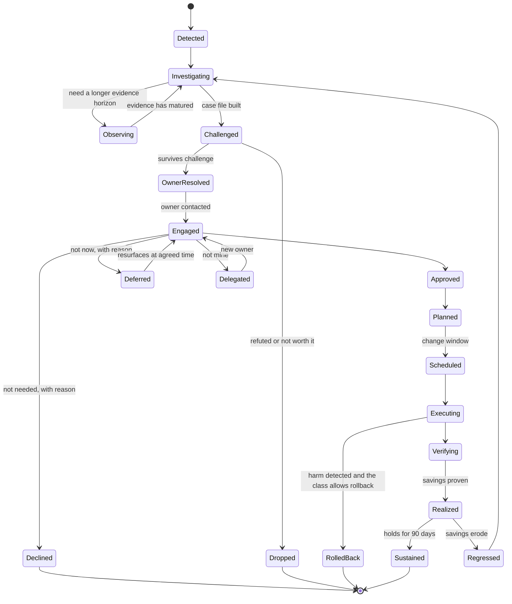

# Azure Cost in Action — North-Star Vision

> **Status:** Ideation **v3** (revised after rubber-duck round 2; v2 is preserved in [the archive](../_archive/round-2-v2/ideation/01-north-star-vision.md), v1 [here](../_archive/round-1-v1/ideation/01-north-star-vision.md)) · **Date:** 2026-10-30 · **Owner:** Tino Donderwinkel · **Drafted with:** GitHub Copilot · **What changed:** [round-2 disposition](../reviews/round-2/disposition.md) and [round-1 disposition](../reviews/round-1/disposition.md) · **The picture first:** [one-page overview](00-one-page-overview.md)
> **Working title:** *Azure Cost in Action* (the name is a placeholder, see [open decisions](../plan/01-assumptions-risks-decisions.md)).
> **Scope guard:** this is **ideation**. Technology, feasibility and the *content* of guardrails are deliberately out of scope here. They are scheduled in [the follow-up plan](../plan/00-follow-up-plan.md). Numbers in examples are **illustrative** unless a source is cited.

---

## 0. The one-minute version

**The sentence on the wall**

> **Every euro spent on Azure has an owner and a reason. Every euro that doesn't becomes a decision — put to the right human, in the place they already work, with evidence and a safe one-tap fix — and then it is executed, proven, and kept from drifting back.**

**The idea in five sentences**

1. Azure already tells you *what you spend* (Cost Management) and *what you could save* (Advisor). Almost nobody closes the loop.
2. We build a **crew of AI agents** that studies how the estate is *actually used* (not only what it costs), builds an evidence-backed **case** for every opportunity, and works out **who owns it** (and asks when it can't tell).
3. The crew then meets the owner **where they already work** — a Teams card, an email, if it is truly urgent a call — with a one-tap action whose **reversibility is stated up front**, instead of hoping someone opens a portal blade.
4. When a human says *yes*, the crew **executes** the change safely (window, canary, rollback), **verifies** the realized savings against a counterfactual, and **keeps the saving from eroding**.
5. Humans stay in control by construction: every action has either a human decision behind it or a human-authored policy that allows it.

**What it is not:** another dashboard. A chatbot. A rules engine with a Teams webhook. It is a **long-running, multi-party workflow** — detection → investigation → ownership → conversation → decision → action → proof → learning — in which AI does the heavy thinking at *every* step and humans hold the keys.

---

## 1. The problem we are really solving

> *Commodity detection exists. Two things do not: **usage intelligence** (knowing what is actually used and useful) and **owner-centred closure** (getting the right human to decide, safely, and proving the result).*

A mature Azure customer typically has Cost Management reports, Advisor recommendations, maybe a FinOps toolkit deployment. And yet the same waste keeps appearing. We make **two separate bets** ([§10](#10-key-bets-each-needs-a-cheap-test)): **closure** — the waste we *can* already see is not acted on because of eight gaps between an insight and an outcome — and **usage intelligence** — the most interesting waste hides in *use*, which billing data cannot show (both seed examples).

| # | The gap | What it looks like in real life | What closes it (capability) |
|---|---|---|---|
| 1 | **Ownership** | Recommendations are addressed to a subscription, a mailbox, or an employee who left. Many resources carry no reliable owner. | **Owner Graph** + owner interviews ([07](07-ownership-and-organization.md)) |
| 2 | **Attention** | Owners never open the portal's Advisor blade. Cost is not in their flow of work. | Engagement in Teams/Outlook; **attention budgets** ([05](05-human-interaction-concepts.md)) |
| 3 | **Context** | "Idle" by a rule is not idle for the business: quarter-end batch, DR standby, compliance retention. | Investigation, **Estate Memory**, conversation ([04](04-agent-crew.md)) |
| 4 | **Trust** | "If I resize it and prod breaks I'm blamed; if I do nothing nobody notices." The risk is asymmetric. | Case file, **Challenger** review, dry-run, reversibility, track record ([06](06-closed-loop-actions-and-autonomy.md)) |
| 5 | **Effort** | Even with the right answer, executing takes a ticket, a change window, a pull request. | One-tap execution; IaC pull requests; scheduled windows |
| 6 | **Incentive** | Savings accrue to central Finance, risk accrues to the team. | Team-level recognition; a **savings dividend** as an option (parked until a Finance-reconciled saving exists — [09 M-26](09-outer-rims-moonshots.md)) and [07](07-ownership-and-organization.md) |
| 7 | **Verification** | Nobody checks whether the saving materialised; savings are double-counted across tools. | **Savings Ledger** with counterfactuals ([10](10-value-metrics-and-economics.md)) |
| 8 | **Sustainment** | Infrastructure-as-code redeploys the old size; new waste appears next week. | Drift guard; fix-at-source PRs; regression watch |

These are **hypotheses**, and the evidence is honest but thin: **no credible, verifiable "percentage of recommendations acted upon" exists** ([research/03](../research/03-finops-framework-and-evidence.md)). The verified proxies are that cloud waste estimates *rose* to 29% (Flexera 2026) despite 63% of organisations having a FinOps team and 71% a cloud centre of excellence, and that the State of FinOps 2026 lists **"Automated Remediation 'Easy Buttons'"** among its *additional* unmet-need themes (its top three are granular AI-spend monitoring, shift-left costing and a single pane of glass). We will therefore **produce our own number**: first a one-hour "what are your top-10 known-but-unfixed items, and why?" interview with a FinOps/CoE lead (information, owner, effort, incentive or risk?), then an owner-resolution test, then a pre-registered Wizard-of-Oz pilot ([plan](../plan/00-follow-up-plan.md), Phases 0.5 and 2).

### What the primary sources confirm — and what they don't (as of 2026-10-30)

Desk research and a dated first-party tear-down ([research/06](../research/06-first-party-teardown.md), [research/01](../research/01-azure-native-landscape.md), [research/04](../research/04-seed-example-facts.md)) show that **individual plumbing capabilities now exist somewhere in Microsoft's stack**. What we could *not* find is the **combination for cost** and the **usage-truth detectors**:

| Capability | What exists (verified) | What was not found |
|---|---|---|
| **Owner → manager routing** | Defender for Cloud **governance rules**: owner from a resource tag, due dates, weekly owner emails, and a weekly overdue summary to the owner's manager — for **security** recommendations (Defender CSPM plan; the rules also cover other clouds) | The same for **cost** recommendations; an *approver* resolved from the directory |
| **Delivery where people work** | SRE Agent has Teams/Outlook connectors (operations); cost anomaly alerts are **email only** | A cost case with evidence delivered in Teams |
| **Approve, then execute** | **SRE Agent Review mode** executes approved Azure CLI/ARM operations — **only SRE Agent Administrators approve**; the Optimization Agent (preview, VM/VMSS) generates scripts; the MCP `advisor` tool edits infrastructure-as-code | **Owner-as-approver** for cost changes with an authority check; IaC-pull-request-first execution for cost |
| **Realised-savings check** | Advisor re-scans ("up to a day"); FinOps hubs report cost | Verification against a counterfactual; a ledger |
| **Commitment awareness** | Advisor's VM resize savings use retail rates and **ignore existing reservation coverage** (Microsoft's own doc warns a resize can raise effective cost) | A sequencing-aware *right-size → commit* workflow |
| **Log usefulness** | **Sentinel SOC optimization** flags unused tables/columns — **Sentinel workspaces, 30-day window, security-scoped**; Advisor and Copilot do not | The equivalent for **Azure Monitor-only workspaces**, longer horizons and template-level noise, with replay safety. Query audit is off by default and its coverage of the Sentinel and Defender hunting surfaces is **unreconciled in Microsoft's documentation** (measure it) |
| **Hidden capacity** | FinOps alerts cover idle **Application Gateways** and idle public IPs (nothing for P2S scale units); Microsoft says to **plan for downtime** when scaling a P2S gateway | Right-sizing of P2S scale units from usage; their **connection capacity is banded, not linear**, which makes it non-trivial |

**Outside Microsoft** ([research/02](../research/02-third-party-and-oss-landscape.md)): a survey of 22 commercial products found owner notification by **tag** nearly everywhere, a few real approval gates (Datadog's in-channel approval, Turbonomic's ServiceNow-anchored mode, Sedai and Edge Delta's graduated trust ladders), strong commitment automation, and exactly one usage-driven log-filtering engine (Grafana Adaptive Logs). The agent **did not find** directory- or manager-chain owner resolution, replay-based safety testing of a filter, or counterfactual savings verification in any of them (stated narrowly — see the note's search limits). The state of the art in safe autonomy is the **graduated trust ladder**, which is what the Autonomy Ladder below is.

**Consequence:** we do not claim a plumbing monopoly. Our defensible content is *validated usage-truth playbooks with ground truth, owner-as-approver methodology, savings-counting rules and an open evaluation harness* — and we position as **ride / copy-the-pattern / build / contribute** ([research/06 §3](../research/06-first-party-teardown.md)).

### Why this is a *consumption* problem, not just a *cost* problem

Cost tools see **billing**: meters, SKUs, hours. The most interesting waste hides in **use**:

- Logs that are ingested, paid for, retained — and never queried or alerted on.
- Gateways, capacity units and clusters that were scaled up for an event and never scaled down.
- Resources the platform created on the customer's behalf, so nobody remembers choosing them ("**dark spend**").
- Commitments (reservations, savings plans) that no longer match what actually runs.
- Environments that outlived the pull request, the project, or the person that created them.

You cannot see any of this by looking at the invoice. You see it by asking, for each billed thing: **"Is it used? Is it useful? Is it the right size for how it is used? Does anyone own it?"** That question — asked continuously, across everything, with AI judgement — is the core of the product. See [03 — deep dives](03-deep-dives-seed-examples.md) for the two seed examples worked end-to-end.

---

## 2. The idea

### 2.1 The Insight-to-Outcome loop

Every arrow is a place where today's tools stop and a human has to carry the baton. We carry it — and hand it to the human only where judgement, accountability or consent is required.

### 2.2 The Case — the unit of work

Everything in the system revolves around one object, the **Case** (a.k.a. *Opportunity Case File*): evidence, hypothesis, counter-evidence, savings estimate with a confidence band, risk assessment, proposed options, owner(s), the conversation, the decision, the execution record, the verification result. Nothing is "a notification" — it is always a Case with a life.

**Rollback exists only for the classes that allow it (R0–R2).** For R3 and R3-Data, harm goes to the incident process and the regret report — never to a promised undo ([06 §9](06-closed-loop-actions-and-autonomy.md)).

A *Declined* or *Deferred* case is **not a failure**: it produces **context** (a reason, an expiry) that makes the next case smarter and the next message rarer.

### 2.3 Eight shifts

| From | To |
|---|---|
| Dashboards of data | **Decisions** put to named people |
| Recommendations (a list) | **Investigations** (a case file with evidence and counter-evidence) |
| Generic alerts | **Addressed** messages: right person, language, channel, moment |
| Notify | **Negotiate** (two-way; "not now", "not mine", "why?" are first-class) |
| Advice | **Action** (one-tap execution, IaC pull request, scheduled window, rollback) |
| One-off clean-ups | **Continuous** sustainment (drift guard, regression watch) |
| Reactive | **Preventive** (cost is reviewed at design, pull-request and deploy time) |
| Static rules | **Learning** (judges usefulness, learns what is normal per workload, writes new playbooks) |

### 2.4 Entry modes — how a customer climbs in

| Mode | What happens | Value | Risk |
|---|---|---|---|
| **Assess** | One-off, read-only, a day or two. Produces a Waste X-ray, an ownership map, a Top-20 savings list and a CAF/WAF-aligned report. | Earns trust fast; a perfect CSA engagement accelerator. | None (read-only). |
| **Advise** | Continuous; cases are delivered to owners; no actions. | Closes the *attention* and *context* gaps. | Low. |
| **Assist** | One-tap approvals; the crew executes approved plans. | Closes the *effort* gap. | Moderate; HITL. |
| **Automate** | Human-authored **policy envelopes** let the crew act on narrow, proven action classes. | Closes the *scale* gap. | Governed by [guardrails](08-trust-safety-and-guardrail-topics.md). |

---

## 3. What "FULL AI" means here

The brief is **FULL AI-infused — not a chatbot**. We interpret that as: *AI performs the judgement-heavy job at every stage of the loop; the interface is the workflow, not a chat window.*

| # | AI's job | What it does (examples) |
|---|---|---|
| 1 | **Perceive** | Mine patterns across metrics, logs, cost lines, topology, repos, documents; cluster log messages into templates; notice what nobody asked about. |
| 2 | **Reason** | Form hypotheses ("this is idle"), gather evidence *and counter-evidence*, weigh seasonality, find alternative explanations. |
| 3 | **Propose** | Choose among options (delete / schedule / downsize / re-tier / commit), rank by value × confidence × risk × the owner's capacity to act. |
| 4 | **Communicate** | Write the message for *this* person (language, tone, detail, channel), hold the conversation, negotiate dates and scope, summarise for executives, speak in a call or meeting. |
| 5 | **Act** | Turn an approved decision into a precise plan with its reversibility stated; operate typed tools; watch SLOs; roll back where the class allows. |
| 6 | **Verify** | Construct counterfactuals, separate signal from seasonality, detect regret (harm), reconcile with the invoice. |
| 7 | **Learn** | Per-owner preferences, per-workload memory, calibration of confidence, **authoring new playbooks** for human review. |
| 8 | **Govern** | Compile natural-language policy into enforceable policy, explain every action, red-team itself, watch its own cost and quality. |

### Deterministic where it matters

"Full AI" does **not** mean "the model computes the numbers and presses the buttons freely". Three design stances (candidate principles, ratified in the guardrails phase):

1. **Every number a human sees is computed by a deterministic, testable tool** and carries lineage. The language model *interprets and explains*; it never invents a figure.
2. **Actions only go through narrow, typed, permissioned tools** with preconditions and rollback — never free-form shell access.
3. **Estate-derived text (tags, resource names, log lines, replies) is untrusted data**, never instructions to the agents.

AI is the brain of the loop. A deterministic spine keeps the brain honest.

---

## 4. Human-in-the-loop by design — the Autonomy Ladder

HITL is a founding constraint, so autonomy is **explicitly granted by humans, per owner × tenant × scope × environment × action class, and revocable at any moment** (the exact enrolment key is normative in [06 §3 item 6](06-closed-loop-actions-and-autonomy.md)). The agents can never raise their own autonomy.

| Level | Name | What the crew may do | Human role |
|---|---|---|---|
| **L0** | **Observe** | Read-only. Build cases silently; *shadow mode* predicts what it would do, scored against what humans do. | Reviewers audit predictions |
| **L1** | **Advise** | Send evidence-backed recommendations. No changes. | Decides and acts themselves |
| **L2** | **Assist** | Execute a specific, previewed plan **after explicit one-tap approval**. | **In the loop** — approves each action |
| **L3** | **Veto window** | Schedule a plan; proceed unless a human vetoes within the window — **only against an authenticated enrolment record that matches the action on every field (owner or named delegate, tenant, scope, environment, action class, reversibility class, expiry, policy-envelope version), with proof that the notice was delivered. Silence is never consent for anything else.** | **On the loop** — supervises, can veto |
| **L4** | **Policy autopilot** | Act inside a human-authored, versioned **policy envelope** (scope, action class, value cap, reversibility, windows) and report. | **Over the loop** — authors and reviews policy |
| **L5** | **Portfolio intelligence** *(reserved)* | **Monitor, simulate and advise** on portfolio-level questions (e.g. commitment coverage and benefit scope) within a finance-approved risk budget. **No write action is assigned to L5 in this package.** Every *transaction* is individually signed by the legally authorised buyer ([06 §6](06-closed-loop-actions-and-autonomy.md)) and is never L3–L5. L5 has **no write actions** in this package; a future write capability would need its own, newly ratified level — it cannot be added to L5 by a playbook or a policy envelope. | Sets risk budget, signs transactions, reviews ledger |

**Default = L2** for anything that changes the estate. **L4/L5 are earned**: only for narrow action classes with a clean track record (no regret events), and only after a named human (or role) ratifies the policy envelope. Every level has **downgrade triggers** (a regret event, an SLO breach, an owner complaint, a model change) and a **kill switch** reachable by the FinOps lead and security. See [06](06-closed-loop-actions-and-autonomy.md).

**What "HITL" means here.** *In the loop* (L2): a human approves each action. *On the loop* (L3): a human who **opted in** can veto. *Over the loop* (L4): a human authors, ratifies and reviews a policy envelope. All three keep a human's authority upstream of every action, but **only L2 is per-action** — and we say so plainly in public-facing language. **Observability-and-evidence data reduction (log filters, shorter retention — R3-Data) and anything classed R3, including every transaction, never run at L3 or L4.**

**What Release 1 proves — and what it does not.** Release 1 ([catalog](02-opportunity-catalog.md#selection-and-status-v2)) is mostly Advise with narrow Assist paths. It can prove **AI-assisted closure**: owners act on well-evidenced cases, the savings are real and reconciled, and nothing is harmed. It does **not** prove that *enrolled autonomy* (L3/L4) is usable, trusted and economical at scale — that is a **separate, later hypothesis** with its own pre-registered criteria (enrolment rate, approval fatigue, regret), to be tested on a bounded non-destructive class such as dev sleep schedules, which are parked until the loop is proven. We say this plainly so the product is never marketed as having shown more than it has.

---

## 5. The cast

### 5.1 Humans (summary — formal personas come in Phase 2)

| Human | Role in the loop | What they get |
|---|---|---|
| **Resource owner / engineer** | Decides on cases about *their* resources | Few, high-value, well-evidenced asks; one-tap safe actions; credit for savings |
| **Engineering / product manager** | Accountable for team budget | Weekly team brief; "decisions needed"; forecast conversations |
| **FinOps lead / Cloud CoE** | Holds the dial: policy, autonomy, approvals, ledger | Mission control; the agents' weekly *regret report*; an auditable ledger |
| **Finance partner / controller** | Approves commitments; trusts the numbers | Savings that reconcile to the invoice; forecast narrative |
| **Security & compliance** | Sets the red lines | Proof nothing happens outside policy; audit trail; kill switch |
| **Executive (CTO/CIO/CFO)** | Sponsors; consumes the narrative | A 90-second brief, not a 40-page deck |
| **SRE / on-call** | Receives cost incidents | Cost incidents handled like reliability incidents (severity, runbook, post-incident review) |
| **Procurement / vendor mgmt** | Commercial decisions | Evidence packs for renewals and commitments |
| **MSP / partner** (optional) | Operates for several customers | Multi-customer view with strict isolation |
| **Change / ITSM owner (CAB)** | Owns freeze calendars, the standard-change catalogue and change records | Cost changes arrive as properly classified changes; freezes are honoured |
| **Billing-account / chargeback owner** | Owns allocation rules and financial authority | A ledger and allocation that match the billing structure |
| **Shared-platform service owner** | Owns shared gateways, workspaces and firewalls used by many teams | One coordinated decision with every consumer heard |
| **SOC / incident commander** | Owns incident state and security posture | No cost action during incidents; security-sensitive sources protected |

### 5.2 Agents (summary — detail in [04](04-agent-crew.md))

A **crew** with separation of duties, mirroring good internal controls: those who *find* (Scout, Archaeologist), *understand* (Analyst, Economist, Cartographer), *challenge* (Challenger), *remember* (Historian), *talk* (Herald, Diplomat, Coach, Narrator), *plan and act* (Planner, Gatekeeper, Operator, Buyer), *prove and guard* (Auditor, Sentinel), *learn* (Alchemist) and *govern the agents themselves* (Warden, Conductor). **No agent can both propose and approve its own action**, and only a few may speak to humans (to protect tone and attention).

### 5.3 Our promises

| To | We promise |
|---|---|
| **Resource owners** | We will not waste your attention or surprise you. We state up front whether an action can be undone — and for the ones that cannot, we say so, ask at least two humans, and show what would be lost. |
| **FinOps / Cloud CoE** | Every saving is proven, every action is auditable, and *you* hold the dial and the kill switch. |
| **Finance** | The numbers reconcile to the invoice; projections are labelled as projections; regret is reported next to savings. |
| **Security & compliance** | Nothing happens outside policy; every action is attributable; no covert hand on the wheel. |
| **Executives** | Savings, forecast and risk in plain language — with honest regret. |
| **The community** | The playbooks, evaluations and reasoning are open to read, test and improve. |

---

## 6. How it feels — a week in the life (illustrative)

**Tuesday 09:12 — Sanne, platform engineer.** A Teams card: *"Your User-VPN gateway `hub-weu-p2s` has never needed more than a fraction of its 100 scale units in 90 days. Scaling to 12 saves ~€X/month. It can be scaled back up, but Microsoft advises planning for downtime — connected users may be disconnected — so I suggest an evening window, and the three business units that use this gateway need to confirm."* She taps **Preview**, sees the 90-day heat map and the Challenger's pre-mortem ("the all-hands peaked at about 3 Gbps; 12 units keeps twice that; event days get a scheduled scale-up"). Two of the three business-unit IT teams confirm in the card; the third has not answered, so the card tells her it **cannot run yet** — *an unanswered party is not a yes* — and offers to ask them again or to record her own named risk acceptance. The next morning the third team confirms. She taps **Approve — Thursday 22:00 window**. Thursday night: *"Done. Scaling back up is one tap until the 14th."* Monday: *"Verified: €X/month saved so far. Your team has saved €Y this quarter"* — and, if the organisation has adopted a savings dividend, a share of it is the team's to spend.

**Monday 07:30 — Dirk, engineering manager.** His weekly brief: three decisions needed, one celebration, one risk. He taps **Enrol in policy: dev environments sleep 20:00–07:00** — a template a FinOps lead and security have ratified, which is reversible and runs only for subscriptions that *opted in*. He never sees those cases again — only the monthly summary.

**Wednesday 14:00 — Fatima, FinOps lead.** In *Mission Control* she reviews the agents' **regret report** (two rolled-back actions, both explained), approves a **new playbook the Alchemist authored** ("SFTP-enabled storage accounts with no SFTP logins in 90 days"), and nudges one action class from L2 to L3 for non-production.

**Monthly — Jan, CFO.** A 90-second audio brief in Outlook: spend vs forecast, savings *verified* (not projected), commitments coverage, the three biggest risks. In the quarterly review an **AI participant, clearly labelled as AI**, answers questions with evidence and records decisions as Cases — it cannot execute anything without a confirmation from an authorised human.

**02:07 — a cost incident.** GPU nodes are burning money after a runaway job. The on-call engineer gets a Teams card and, with no response, a **call** — because a spend rate forty times normal *might* be a planned launch, a recovery or an attack, **and a cost anomaly alone never pauses anything.** The call asks one thing: *"Is this expected? A confirmation prompt is on your phone."* A **cost brake** can fire automatically only for resource classes that the **service owner pre-certified as safe to pause** (a recorded contract), with live incident and SLO checks, rate limits and a mandatory review afterwards; otherwise the system keeps paging humans and records what it knew. A Cost Incident channel is created; next day a post-incident review is drafted. (Voice never carries authority: confirmation completes in an authenticated channel.)

(Interaction concepts in detail: [05](05-human-interaction-concepts.md).)

---

## 7. What we optimize — the Opportunity Universe

Seventeen families, from the obvious to the outer rim. Full catalog (with IDs, signals and actions): [02](02-opportunity-catalog.md).

| Family | Example |
|---|---|
| Idle & zero-use | Gateways with no tunnels; empty plans; unattached disks; unused private endpoints |
| Over-provisioned | VMs, databases, **capacity units** (the vWAN P2S example), caches, search |
| Scheduling & elasticity | Dev/test sleep; scale-by-calendar; follow-the-sun |
| Rate & commitment | Reservations, savings plans, Hybrid Benefit, spot, commitment scope fixes |
| **Telemetry & data hygiene** | **Log Analytics ingestion nobody uses** (the first seed example) |
| Storage & data lifecycle | Tiering, versions/snapshots, duplicates, retention |
| Network | Egress, cross-region chatter, double processing, idle gateways |
| Platform & architecture | Consolidation, modernisation, ARM/newer-generation SKUs |
| Security-tool economics | Defender plan fit, Sentinel ingestion tiers — without ever trading away required security |
| Developer platform | Preview environments, build agents, registries, test fleets |
| **AI workloads** | Idle model hosting, under-used provisioned throughput, GPU waste, runaway agent loops |
| Anomaly & incident | Spikes with root cause; spend spikes as a *security* signal |
| Forecast & budget | Burn-rate conversations; commitment burn-down; what-if |
| Contracts & commercial | MACC, renewals, price-sheet anomalies |
| Governance hygiene | Tags, ownership, subscription sprawl, exception expiry |
| Sustainability crossover | Savings that also cut emissions |
| Adjacent spend (horizon 3+) | SaaS/GitHub/M365/Power Platform licences and capacity |

---

## 8. Design principles (the commandments)

1. **Humans decide; agents prepare.** HITL is structural, not decorative.
2. **Every number is computed, never generated.** Every claim has evidence one click away.
3. **Ask less, do more — safely.** The best notification is the one you never needed to send: trivial, reversible items belong in a human-authored policy envelope, not in someone's inbox.
4. **Usage over billing.** Ask *"is it used and useful?"*, not just *"is it expensive?"*.
5. **Owners first.** No cost action without a confirmed owner — or, for genuinely orphaned resources, a **named custodian** with policy authority who accepts the case. Ownership is a product, not a tag.
6. **Meet people where they work; treat attention like money.** Every message spends it.
7. **Honest about reversibility.** Every action carries a stated reversibility class. Reversible by default; **irreversible (R3) and information-losing (R3-Data — for example dropping log data) actions require the approvers their class names (at least two humans), a stated residual loss and, where possible, a safety net.** We never promise an undo we cannot deliver.
8. **Context is king.** Remember *why*. Never ask twice for the same reason.
9. **Prove it.** A saving is claimed only when measured against a counterfactual.
10. **Fix it at the source.** If infrastructure-as-code would revert the change, the pull request *is* the fix.
11. **Spend AI wisely.** Never spend €10 of AI to save €5. The platform's own cost is a first-class metric.
12. **Explain, don't pressure.** No dark patterns, no shaming, honest uncertainty, always disclose that it is AI.
13. **Secure by design.** Agents are principals with least privilege; the *approver's* authority is checked; estate data is untrusted input.
14. **Show the trade-off.** Cost never silently trades away reliability, security, performance or compliance — the WAF pillar impact is on every case.
15. **Open logic and evidence.** Playbooks, evaluations and documentation are open source, and every recommendation can be traced to its evidence. The foundation model is a **replaceable, evaluated component** (models retire on a vendor timetable), not a claim of full transparency.
16. **Be the reference architecture.** The platform itself follows CAF and WAF — we dogfood what we advise.
17. **Silence is never consent.** Non-response is not approval, ownership or evidence that something is safe to change. Only affirmative, authenticated enrolment makes a veto window legitimate.

---

## 9. Non-goals (for now) and horizons

**Non-goals (v1):** a chatbot-first product · replacing Cost Management/Advisor (we *consume* them) · a billing or chargeback system of record · a security product · a general AIOps/SRE agent · autonomous purchasing of any kind (commitment transactions are always individually signed by authorised humans) · multi-cloud · employee monitoring.

| Horizon | Theme | Notes |
|---|---|---|
| **H1** | **Close the last mile on known waste** | Advisor recommendations, orphans, schedules, ownership, verification |
| **H2** | **Consumption intelligence** | Log usefulness, capacity-unit right-sizing, data lifecycle, commitment portfolio |
| **H3** | **Preventive & predictive** | Shift-left cost review, cost SLOs, forecasting conversations, unit economics |
| **H4** | **Governed autonomy** | Policy autopilot across the estate, agent-to-agent negotiation, adjacent spend (SaaS/GitHub/M365/AI) |

The outer-rim ideas that sit beyond H2 are collected in [09](09-outer-rims-moonshots.md).

---

## 10. Key bets (each needs a cheap test)

| # | Bet | Cheapest test (see plan) |
|---|---|---|
| **A2** (precondition) | Owners can be **resolved** with useful accuracy from tags, directory, history and conversation. | Resolve owners for ~200 resources with known owners and measure accuracy — *before* B1a, because "owners act" is untestable if owner resolution fails. |
| **B1a** | **Closure:** owners **act** when asked well (right person, channel, evidence, one tap) on waste we can already see. | A one-hour CoE interview ("top-10 known-but-unfixed items, and why?"), then a **pre-registered** Wizard-of-Oz pilot with a comparison condition ([plan](../plan/00-follow-up-plan.md), Phase 2). |
| **B1b** | **Usage intelligence:** AI-built usage-truth cases (log usefulness, capacity right-sizing) are **accurate and safe** enough to put in front of owners. | Ground-truth replay on a consenting workspace and the Waste Lab; measure precision, false-drop rate, evidence completeness. |
| B2 | AI-built **case files** are trusted by engineers. | Blind review: engineers rate AI case files vs. their own analysis. |
| B4 | Log-usefulness analysis is accurate **and safe** (calibrated audit coverage, replay, protected sources). | As B1b, advisory only. |
| B6 | HITL at scale doesn't drown humans: **attention budgets** suffice. | Simulate message load on a real estate; survey fatigue. |
| B8 | Customers will grant **write** permissions with proper guardrails — through **least-privilege roles** and an **infrastructure-as-code pull-request path** (IaC-managed estates revert direct changes). | Concrete role definitions reviewed by a real security reviewer; test the pull-request path first. |
| B5 | **Verified savings** convince Finance (exact where the meter is exact, counterfactual where usage drives cost). | Reconcile three real savings against invoices with a Finance partner. |
| B3 | **Teams cards** can carry authenticated, user-bound approvals. | A two-day spike; the real question is B8. |
| B7 | The community will contribute **playbooks** (declarative and read-only). | Deferred — not a release-1 bet; the largest attack surface. |

---

## 11. Founding constraints (verbatim) and how this vision honours them

> *"needs to run in azure or powerplatform or m365 or other microsoft platform, use microsoft technology only, be compliant with cloud adoption framework and well architected framework, be open source, FULL AI, HITL!"* — Tino Donderwinkel, 2026-10-30
> *"Before you start coding, we need to define a lot of guardrails, which we have to do later."*

| Constraint | How the vision honours it | Tension to resolve in the guardrails phase |
|---|---|---|
| Microsoft platforms / technology only | Channels are Teams/Outlook/Teams-calling; agents are Foundry agents; data stays in the customer's tenant | Third-party channels (e.g. a non-Microsoft SMS provider) are out; model choice within Foundry; interop with non-Microsoft FinOps data (FOCUS) |
| CAF + WAF compliant | The platform is a WAF-reviewed reference architecture; every case shows WAF-pillar impact | Which CAF/WAF controls are *testable gates* vs. guidance |
| Open source | Playbooks, evals, docs and reference implementation are open | A closed foundation model is a dependency (and models retire); **community playbooks must be declarative and read-only, able only to reference actions from a small maintainer-owned typed catalogue**; licence, governance, trademark ("Azure" in the name), employer approval |
| FULL AI | Eight AI jobs across the loop ([§3](#3-what-full-ai-means-here)) | AI everywhere ≠ AI unconstrained; a deterministic spine is mandatory |
| HITL | Autonomy Ladder; default L2; humans author any higher-autonomy policy; **L3 needs affirmative enrolment; purchases are never L3–L5** | L3/L4 are *on/over-the-loop*, not per-action — say so plainly; HITL at scale needs attention budgets and policy envelopes or it collapses under its own weight |
| Guardrails first | [08](08-trust-safety-and-guardrail-topics.md) maps the territory and the questions; [plan](../plan/02-guardrails-workplan.md) schedules the work | — |

---

## 12. Where to go next

- The seed examples worked end-to-end → [03 — deep dives](03-deep-dives-seed-examples.md)
- The catalog of ideas → [02 — opportunity catalog](02-opportunity-catalog.md)
- The crew → [04](04-agent-crew.md) · The conversation → [05](05-human-interaction-concepts.md) · The loop → [06](06-closed-loop-actions-and-autonomy.md)
- Ownership & organisation → [07](07-ownership-and-organization.md) · Guardrail territory → [08](08-trust-safety-and-guardrail-topics.md)
- The outer rim → [09](09-outer-rims-moonshots.md) · Value & metrics → [10](10-value-metrics-and-economics.md) · Press release from the future → [11](11-working-backwards-pr-faq.md)
- The plan → [plan/00](../plan/00-follow-up-plan.md) · The first-party picture → [research/06](../research/06-first-party-teardown.md) · The third-party picture → [research/02](../research/02-third-party-and-oss-landscape.md)
- A three-minute orientation with one picture → [00 — one-page overview](00-one-page-overview.md)

## Glossary

| Term | Meaning |
|---|---|
| **Case** | The unit of work: evidence → decision → execution → verification |
| **Owner Graph** | Living graph of people, teams, cost centres, services and resources, with confidence and evidence on every edge |
| **Estate Memory** | Remembered context: why a resource exists, exceptions with expiry, past decisions, owner preferences |
| **Savings Ledger** | The single, deduplicated, audit-grade record of projected → verified → sustained savings |
| **Policy envelope** | A human-authored, versioned boundary within which agents may act without per-action approval |
| **Dark spend** | Cost of things nobody consciously chose, uses, or owns (including platform-created/hidden resources) |
| **Regret** | A harm attributable to an action the crew took (rollback, incident, perf regression, owner complaint) |
| **Challenger** | The agent whose only job is to refute a case before humans see it |
| **Attention budget** | A cap on asks per human per period; each ask must clear a value-density threshold |
| **Orphan custodian** | A named role with policy authority who may *triage, park or restrict* a genuinely unowned resource and — with a second authority — retire it; silence never substitutes for one |
| **Control-plane tag** | A tag that influences scope, autonomy, protection, criticality or ownership; a signed, versioned claim changed only with independent authority and audit |
| **R3-Data** | Information loss in observability and evidence data — anything that reduces what is collected or how long it is kept, future or existing (log filters, shorter retention, sampling) — never L3/L4 |
| **Transaction** | An action that creates, changes the terms of, renews, exchanges or cancels a financial commitment or paid plan; never above L2, always individually signed ([06 §6](06-closed-loop-actions-and-autonomy.md)) |
| **Enrolment** | An authenticated, revocable record by which an owner opts a precise (owner, tenant, scope, environment, action class) into a veto window; silence is never enrolment |
| **Evidence horizon** | How far back we can actually see; absence of evidence counts only if we could have seen it |
