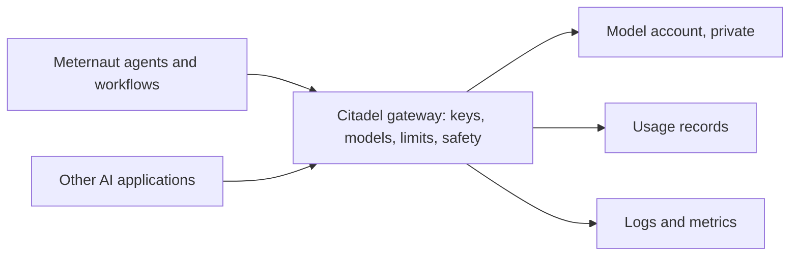

# The first environment — a proposal

**Status: proposed. Nothing is deployed.** This page says what would be set up first, in what order, and what has to be approved before each step. It follows [decision 4 of the design](../design/12-decisions.md) (the Citadel hub is the only door for model calls) and slice 0.2 of the [build plan](../build-plan/01-the-slices.md).

## Why there is a gateway at all

Every model call that Meternaut's agents make goes through one gateway, so that access, limits and usage are decided and seen in one place. Without it, each agent would call the models directly, and nobody could set one limit, or read one record, for all of them. The gateway is not a search or retrieval service, and no person uses it: only the agents and the workflows call it. The models sit in an account with no public access, so the gateway is the only way in.

The gateway is **Citadel**: Microsoft's open-source governance hub for AI, published as the reference implementation of the first layer of the [AI Citadel Blueprint](https://aka.ms/foundry-citadel). It is built once for an organisation, not once per project. Each project is onboarded with its own key, its own list of models and its own limits ([the kit's onboarding guide](https://github.com/Azure-Samples/ai-hub-gateway-solution-accelerator/blob/citadel-v1/bicep/infra/citadel-access-contracts/README.md)).

## What the kit contains

| Part | What it does |
|---|---|
| API Management | The gateway: one entry for every model, with token limits and routing |
| Microsoft Foundry | The models, content safety and personal-data detection |
| Event Hub, Cosmos DB, Logic App | The usage records: who called which model, and how many tokens |
| Monitoring workspace, Application Insights | Logs, metrics and dashboards |
| Virtual network, managed identities, Key Vault | Private access and no passwords |
| Onboarding of a project | One per project: its key, its models, its limits |

The usage records are the main fixed cost ([cost and FinOps](../design/10-cost-and-finops.md)). Sources: the kit's [README](https://github.com/Azure-Samples/ai-hub-gateway-solution-accelerator/blob/citadel-v1/README.md) and [sizing guide](https://github.com/Azure-Samples/ai-hub-gateway-solution-accelerator/blob/citadel-v1/guides/citadel-sizing-guide.md), version 1.0.3.

## Three ways to get one

| | What it means | What it costs and risks |
|---|---|---|
| **A. Add Citadel to the existing gateway** (proposed) | The organisation already runs an API Management instance. The kit's gateway-upgrade module (preview) applies Citadel's gateway configuration to it, and a companion module adds the services around it. Neither creates a gateway or changes the network | No second gateway. Other teams already use that instance, so a read-only study comes first and lists everything that would be added |
| **B. Deploy the full kit** | The kit's main deployment builds its own gateway and everything around it | The cleanest separation, a second gateway, the highest fixed cost |
| **C. Onboard Meternaut on a gateway without Citadel** | Only a product, a key and a policy | Not proposed: no usage records, no shared policies, no content safety |

For the first environment the kit's smallest size applies: development only, no service level agreement, full network isolation supported.

## The order

| Step | What happens | What is approved first |
|---|---|---|
| 0. Study | Read-only. List what the gateway-upgrade module would add to the existing instance (APIs, policy fragments, named values, backends), which supporting services it needs, which of them already exist (network, DNS, workspace), what they cost each month, and which landing-zone policies apply | Nothing changes, so nothing |
| 1. Supporting services | Event Hub, Cosmos DB, Logic App with storage, Key Vault, managed identities, and the primary Foundry account with one model behind a private endpoint, placed where the study says (the module expects its managed identity in the gateway's resource group) | The study's list |
| 2. Gateway configuration | The kit's gateway-upgrade module on the existing instance | The study's list again, as a diff |
| 3. Meternaut's first onboarding | One key for the first agent, the listed models, token limits per minute and per month. More follow, one per hosted agent ([decision 4](../design/12-decisions.md)) | The limits |
| 4. Proof | A call passes; an unlisted model is refused; a call over the limit is refused; the call appears in the usage records ([check C1](../build-plan/03-first-checks.md)) | The result |

Only after step 4 does the first agent exist.

## What holds at every step

- Nothing is deployed or deleted until the platform lead has approved that step's list.
- No private DNS zone, no link to one and no peering is created by hand: in an Azure landing zone, a policy registers every private endpoint in the central zones and the network manager connects new networks. The study confirms this for the organisation.
- Each step records what it created, so it can be removed by that list and nothing else.
- How changes reach Azure (the kit's own deployment command from a machine, or a pipeline) is decided before step 1.

## What the platform lead decides

- Which of the three ways: A is proposed.
- How changes reach Azure: a pipeline that shows its list before it runs and waits for approval, or the kit's own command run by a person.
- Where it goes: the region and the names.

## What is not known yet

Whether the gateway-upgrade module (preview) fits an instance that other teams already use is the first thing step 0 finds out, and the reason that step is read-only. The module's README has a section for a gateway that the kit did not create. It also says what the instance must have: a user-assigned managed identity in its resource group, an Application Insights logger named `appinsights-logger`, and no API already served at `/openai` or `/models` (or a path prefix for the new ones). It advises a first run on a non-production instance ([the module's README](https://github.com/Azure-Samples/ai-hub-gateway-solution-accelerator/blob/citadel-v1/bicep/infra/apim-gateway-upgrade/README.md)).
