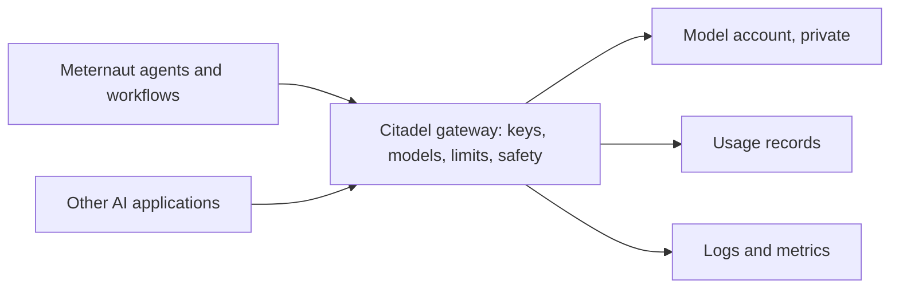

# The first environment — a proposal

**Status: approved on 2026-11-03 (the owner: "deploy it"), in progress; the changelog says what is deployed.** This page says what is set up first, in what order, and what is checked at each step. It follows [decision 4 of the design](../design/12-decisions.md) (the Citadel hub is the only door for model calls) and slice 0.2 of the [build plan](../build-plan/01-the-slices.md).

## Why there is a gateway at all

Every model call that Meternaut's agents make goes through one gateway, so that access, limits and usage are decided and seen in one place. Without it, each agent would call the models directly, and nobody could set one limit, or read one record, for all of them. The gateway is not a search or retrieval service, and no person uses it: only the agents and the workflows call it. The models sit in an account with no public access, so the gateway is the only way in.

The gateway is **Citadel**: Microsoft's open-source governance hub for AI, published as the reference implementation of the first layer of the [AI Citadel Blueprint](https://aka.ms/foundry-citadel). It is built once for an organisation, not once per project. Each project is onboarded with its own key, its own list of models and its own limits ([the kit's onboarding guide](https://github.com/Azure-Samples/ai-hub-gateway-solution-accelerator/blob/citadel-v1/bicep/infra/citadel-access-contracts/README.md)).

## What the kit contains

| Part | What it does |
|---|---|
| API Management | The gateway: one entry for every model, with token limits and routing |
| Microsoft Foundry | The models, content safety and personal-data detection |
| Event Hub, Cosmos DB, Logic App | The usage records: who called which model, and how many tokens |
| Monitoring workspace, Application Insights | Logs, metrics and dashboards |
| Virtual network, managed identities, Key Vault | Private access and no passwords |
| Onboarding of a project | One per project: its key, its models, its limits |

The usage records are the main fixed cost ([cost and FinOps](../design/10-cost-and-finops.md)). Sources: the kit's [README](https://github.com/Azure-Samples/ai-hub-gateway-solution-accelerator/blob/citadel-v1/README.md) and [sizing guide](https://github.com/Azure-Samples/ai-hub-gateway-solution-accelerator/blob/citadel-v1/guides/citadel-sizing-guide.md), version 1.0.3.

## Three ways to get one

| | What it means | What it costs and risks |
|---|---|---|
| **A. Add Citadel to the existing gateway** (proposed) | The organisation already runs an API Management instance. The kit's gateway-upgrade module (preview) applies Citadel's gateway configuration to it, and a companion module adds the services around it. Neither creates a gateway or changes the network | No second gateway. Other teams may already use that instance, so a read-only study comes first and lists everything that would be added |
| **B. Deploy the full kit** | The kit's main deployment builds its own gateway and everything around it | The cleanest separation, a second gateway, the highest fixed cost |
| **C. Onboard Meternaut on a gateway without Citadel** | Only a product, a key and a policy | Not proposed: no usage records, no shared policies, no content safety |

For the first environment the kit's smallest size applies: development only, no service level agreement, full network isolation supported.

## Lean first, full later

The gateway-upgrade module needs none of the supporting services. They are what make Citadel expensive to leave idle: the usage pipeline (Event Hub, Cosmos DB, and a Logic App on a Standard plan, each with private endpoints) costs on the order of 250 to 270 euros a month at list prices of 2026-11 (the Logic App about 160, nine private endpoints about 60, Cosmos DB at 400 request units about 21, Event Hub about 20). The first environment therefore takes the **lean** variant:

| Lean (first) | Full (later, on a stated need) |
|---|---|
| The gateway rules from the module, one managed identity for the gateway, one private model account with the first models, a budget | Adds the usage pipeline: a record of every call, by caller, for billing and audit |
| Token use is seen as custom metrics in the Application Insights that the gateway already writes to; no prompt or answer is logged | Adds Event Hub, Logic App, Cosmos DB, Key Vault and their private endpoints |
| About 7 to 10 euros a month idle (almost all of it the model account's private endpoint), plus tokens | About 250 to 270 euros a month more |

The full pipeline is added when a real need for per-call records appears. That is a decision with its own cost, its own list and its own approval.

## The order

| Step | What happens | What is approved first |
|---|---|---|
| 0. Study | Read-only. List what the gateway-upgrade module would add to the existing instance (APIs, policy fragments, named values, backends), which supporting services it needs, which of them already exist (network, DNS, workspace), what they cost each month, and which landing-zone policies apply | Nothing changes, so nothing |
| 1. Model side (lean) | A resource group of the project's own with a small network, the primary Foundry account with the first models behind a private endpoint (no private DNS zone: the landing zone's policy registers the name), and a budget. The usage pipeline is not part of this step | The study's list, and the identity that runs the workflow with what each of its roles may change |
| 2. Gateway configuration | One user-assigned managed identity in the gateway's resource group, attached to the instance; a second Application Insights logger with the name the module expects, on the same Application Insights; then the module on the existing instance (the inference APIs, policy fragments, backends and pools, named values), without the two fragments that need the usage recording's Event Hub (see "What the first deployment found"). The instance's service-level logging setting is replaced by an equivalent one | The study's list again, as a diff (what-if) |
| 3. Meternaut's first onboarding | One key for the first agent, the listed models, token limits per minute and per month. More follow, one per hosted agent ([decision 4](../design/12-decisions.md)) | The limits |
| 4. Proof | A call passes; an unlisted model is refused; a call over the limit is refused; the call appears in the usage records ([check C1](../build-plan/03-first-checks.md)) | The result |

Only after step 4 does the first agent exist.

## What holds at every step

- Nothing is deployed or deleted until the platform lead has approved that step's list.
- No private DNS zone, no link to one and no peering is created by hand: in an Azure landing zone, a policy registers every private endpoint in the central zones and the network manager connects new networks. The study confirms this for the organisation.
- Each step records what it created, so it can be removed by that list and nothing else.
- How changes reach Azure (the kit's own deployment command from a machine, or a pipeline) is decided before step 1.

## What the platform lead decides

- Which of the three ways: A is proposed.
- How changes reach Azure: a pipeline that shows its list before it runs and waits for approval, or the kit's own command run by a person.
- Where it goes: the region and the names.

## What the study found (2026-11-03), in general terms

- **What an instance the kit did not create lacks.** A user-assigned managed identity attached to the instance; an Application Insights logger named `appinsights-logger` (an instance usually has a logger under another name, so a second one is added on the same Application Insights); and an `ai-foundry-compatibility` policy fragment, which the module creates only when its personal-data flag is on, although the inference APIs' policies include it unconditionally, so the flag stays on and the Language and Content Safety addresses must be real (a named value may not be empty).
- **What the module replaces.** The instance's service-level Application Insights diagnostic: its logger link, and it turns custom metrics on. Everything else is added beside what is there.
- **What the landing zone does by itself.** A policy joins every new virtual network of the region to the network manager's group (hub peering and default routes); another registers a private endpoint in the central private DNS zones; and public access to new platform services is denied. Nothing in the first environment creates a DNS zone, a peering or a route.
- **What stays unknown until a call is made.** The path from a workload network to the gateway's public address through the hub firewall (the other direction, from the gateway to a model account behind a private endpoint, has been seen to work).

## What the first deployment found (2026-11-03), in general terms

- **Two fragments that need the usage recording.** Two of the module's policy fragments (the usage record and the saving of the personal-data state) send records to an Event Hub through loggers of given names, and the service refuses to save a fragment whose logger is missing ("Logger not found"). The kit's own deployment makes those loggers together with the Event Hub; the module does not, and says so in its README. The service also refuses a logger whose address does not resolve, so an empty placeholder does not work (tried). A real Event Hub with its private endpoint (about 26 euros a month) would have worked, but nothing reads it without the rest of the usage recording (about 265 euros a month in all). So the first environment leaves the two fragments out, with a small patch to the kit's checkout ([`environment/kit-patches/`](../../environment/kit-patches/no-usage-recording-fragments.patch)) that makes them conditional on a parameter that is off. No API of the first environment, and not the policy of its first consumer's product, includes them, and a test holds that for the policy. When the usage recording is added, the patch goes.
- **A key that is not a consumer's.** The kit lets through a call that is made with the instance's own all-access key (its security handler calls that caller "Portal-Admin"). Such a call never runs a consumer's product policy, so it would have no model list and no token limit. The first environment refuses it on the two inference APIs (403) with another patch to the kit's checkout (in [`environment/kit-patches/`](../../environment/kit-patches/)), and the gateway run reads the rule back from the instance. The all-access key keeps working on the instance's other APIs.
- **Things only the real service says.** A what-if does not check policies, so three problems showed only when the APIs were written. The policies of both inference APIs include a fragment (`set-response-headers`) that the module creates only when its Unified AI flag is on, so that flag is on while the Unified AI API itself stays off. The service refuses the value `none` for the LLM log settings of an API, so a third patch leaves those settings out when the parameter says `none`, which is how "log no prompts and no answers" is said. And two APIs imported at the same moment create the same tags, so one import can meet a tag that the other has just made; a second run finds the tags.

## What is not known yet

Whether the gateway-upgrade module (preview) fits an instance that other teams already use is the first thing step 0 finds out, and the reason that step is read-only. The module's README has a section for a gateway that the kit did not create. It also says what the instance must have: a user-assigned managed identity in its resource group, an Application Insights logger named `appinsights-logger`, and no API already served at `/openai` or `/models` (or a path prefix for the new ones). It advises a first run on a non-production instance ([the module's README](https://github.com/Azure-Samples/ai-hub-gateway-solution-accelerator/blob/citadel-v1/bicep/infra/apim-gateway-upgrade/README.md)).
