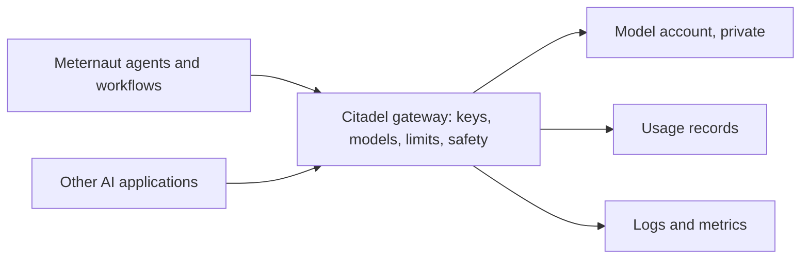

# The first environment — a proposal

**Status: approved on 2026-11-03 (the owner: "deploy it"); steps 1 to 5 are deployed and checked. On 2026-11-04 the owner ordered the usage recording built ("build the whole thing, with the 265 storage ... build it now"): it is step 5 below. It was first built as the kit ships it, with a Logic App and a policy opt-out tag; the same day the owner ordered every key out, and it was rebuilt without a key (a function app on the Flex Consumption plan with a managed identity: see "What the first deploy found, and what replaced the Logic App"). The changelog says what is deployed.** This page says what is set up first, in what order, and what is checked at each step. It follows [decision 4 of the design](../design/12-decisions.md) (the Citadel hub is the only door for model calls) and slice 0.2 of the [build plan](../build-plan/01-the-slices.md).

**Changed on 2026-11-07: Meternaut no longer touches the owner's API Management instance.** The owner ordered, in capitals, "UNDO CHANGES TO API MANAGEMENT". Everything on this page that adds objects to that instance (steps 2 and 3, the patches to the kit, the Event Hub loggers and the two policy fragments of step 5, the access product and its key) is undone: the Hub's three actions that made objects there (the one that attached an identity and a logger, the one that applied the Citadel module and the one that made the access product), their templates, the patches and the product's file are deleted from the repository, and a person removes the objects from the instance by hand ([the changelog](../../CHANGELOG.md), [rule 15 (c)](../../AGENTS.md)). What stays of this plan is the model account with its private endpoint and budget (step 1; nothing calls it now) and the usage recording (step 5), which is idle; the owner decides about both later. Every model call of Meternaut goes through the AI Gateway of Azure, a separate service that was deployed on 2026-11-07 at the owner's written request, with a public front door and no key; the agents are the one exception that is left, and call the models of their own Foundry project directly, privately and with no key, until step 2 is switched on ([the Foundry agents](06-foundry-agents.md#the-model-path-the-one-exception-to-the-gateway-rule) and [the record](08-ai-gateway.md)). What follows is the plan as it was approved and built; every line that says that the calls go through the gateway describes that plan, and not what runs now.

## Why there is a gateway at all

Every model call that Meternaut's agents make goes through one gateway, so that access, limits and usage are decided and seen in one place. Without it, each agent would call the models directly, and nobody could set one limit, or read one record, for all of them. The gateway is not a search or retrieval service, and no person uses it: only the agents and the workflows call it. The models sit in an account with no public access, so the gateway is the only way in.

The gateway is **Citadel**: Microsoft's open-source governance hub for AI, published as the reference implementation of the first layer of the [AI Citadel Blueprint](https://aka.ms/foundry-citadel). It is built once for an organisation, not once per project. Each project is onboarded with its own key, its own list of models and its own limits ([the kit's onboarding guide](https://github.com/Azure-Samples/ai-hub-gateway-solution-accelerator/blob/citadel-v1/bicep/infra/citadel-access-contracts/README.md)).

## What the kit contains

| Part | What it does |
|---|---|
| API Management | The gateway: one entry for every model, with token limits and routing |
| Microsoft Foundry | The models, content safety and personal-data detection |
| Event Hub, Cosmos DB, Logic App | The usage records: who called which model, and how many tokens |
| Monitoring workspace, Application Insights | Logs, metrics and dashboards |
| Virtual network, managed identities, Key Vault | Private access and no passwords |
| Onboarding of a project | One per project: its key, its models, its limits |

The usage records are the main fixed cost ([cost and FinOps](../design/10-cost-and-finops.md)). Sources: the kit's [README](https://github.com/Azure-Samples/ai-hub-gateway-solution-accelerator/blob/citadel-v1/README.md) and [sizing guide](https://github.com/Azure-Samples/ai-hub-gateway-solution-accelerator/blob/citadel-v1/guides/citadel-sizing-guide.md), version 1.0.3.

## Three ways to get one

| | What it means | What it costs and risks |
|---|---|---|
| **A. Add Citadel to the existing gateway** (proposed) | The organisation already runs an API Management instance. The kit's gateway-upgrade module (preview) applies Citadel's gateway configuration to it, and a companion module adds the services around it. Neither creates a gateway or changes the network | No second gateway. Other teams may already use that instance, so a read-only study comes first and lists everything that would be added |
| **B. Deploy the full kit** | The kit's main deployment builds its own gateway and everything around it | The cleanest separation, a second gateway, the highest fixed cost |
| **C. Onboard Meternaut on a gateway without Citadel** | Only a product, a key and a policy | Not proposed: no usage records, no shared policies, no content safety |

For the first environment the kit's smallest size applies: development only, no service level agreement, full network isolation supported.

## Lean first, full later

The gateway-upgrade module needs none of the supporting services. They are what make Citadel expensive to leave idle: the usage pipeline (Event Hub, Cosmos DB, and a Logic App on a Standard plan, each with private endpoints) costs on the order of 250 to 270 euros a month at list prices of 2026-11 (the Logic App about 160, nine private endpoints about 60, Cosmos DB at 400 request units about 21, Event Hub about 20). The first environment therefore takes the **lean** variant:

| Lean (first) | Full (later, on a stated need) |
|---|---|
| The gateway rules from the module, one managed identity for the gateway, one private model account with the first models, a budget | Adds the usage pipeline: a record of every call, by caller, for billing and audit |
| Token use is seen as custom metrics in the Application Insights that the gateway already writes to; no prompt or answer is logged | Adds Event Hub, Logic App, Cosmos DB, Key Vault and their private endpoints |
| About 7 to 10 euros a month idle (almost all of it the model account's private endpoint), plus tokens | About 250 to 270 euros a month more |

The full pipeline is added when a real need for per-call records appears. That is a decision with its own cost, its own list and its own approval.

**Built on 2026-11-04, on the owner's order.** The owner named the price himself and ordered the whole pipeline built. Two corrections to the figures above came with it. The kit's template does not give Cosmos DB one account at 400 request units: it gives each of its seven containers 400 request units of its own, 2,800 a second, about 147 euros a month, so the kit as shipped costs about 330 euros with public access and about 390 with private endpoints, not 205 and 265. And the Logic App's plan is the one price that has no cheaper form that keeps the kit's workflows (about 162 euros for 1 vCPU and 3.5 GB). What is built keeps every part and changes the settings that do not change what the owner sees: Cosmos DB is serverless, Event Hubs has no auto-inflate and no local authentication. The first version ran the kit's Logic App (about 190 euros a month for one instance, the plan being a ceiling because the Logic App cannot scale out); the keyless version that replaced it the same day is described below, at about 55. The template was `environment/recording/main.bicep` (since 2026-11-07 `environment/base/main.bicep` holds only what stayed) and its header listed each difference from the kit's own templates.

**What the first deploy found, and what replaced the Logic App (2026-11-04).** The tenant's policies (the initiative `GovInitiative`) change a storage account and a Cosmos DB account while they are made: Shared Key off, local authentication off, public access off. They do not refuse; the waivers that the owner's subscription has cover the policies that deny public access, not these. The first version put the policies' own opt-out, the tag `SecurityControl = Ignore`, on those two accounts, because a Logic App Standard mounts its content share (Azure Files) with the account key, which no managed identity replaces, and the kit's workflows reach Cosmos DB with its connection string. The owner then said that the tag works for a limited time, and ordered every key out ([AGENTS.md](../../AGENTS.md) rule 23). Microsoft's documentation is plain that a Standard logic app on the Workflow Service Plan cannot run with storage account key access disabled, so the Logic App was removed and replaced by the third way out that this page had listed: a **Python function app on the Flex Consumption plan**, with a user-assigned managed identity (since replaced by the app's own system-assigned identity: [access and onboarding](03-access-and-onboarding.md#the-apps-run-as-system-assigned-identities)), that does the same five jobs and writes the same documents into the same containers (so the kit's Power BI report fits them): `src/usage-functions` (removed on 2026-11-07). Storage and Cosmos DB have no public endpoint and no key; the function app is integrated with a subnet of its own and reaches storage (blob, queue and table), Cosmos DB and Event Hubs through private endpoints; Event Hubs, Application Insights and the workspace take no key either; every caller has one role on the one resource it uses. There is no tag, no exemption and no deviation left. The price falls from about 190 to about 55 euros a month: Event Hubs Standard about 19.6 (0.0269 euros an hour at list price), five more private endpoints about 33, and a few euros for storage, Cosmos DB (serverless) and the workspace; the function app stays inside Flex Consumption's monthly free grant. What it costs in use: the usage store can no longer be opened from the portal, or by Power BI, from outside the virtual network, because it has no public endpoint, and the check reads the copy jobs' own telemetry instead of the documents. Two keys remain, and rule 23 names them: the API Management subscription key that a caller of the gateway uses, and the instrumentation key that API Management's own Application Insights logger holds.

**Re-checked on 2026-11-04.** The owner asked why that pipeline needs a Logic App on a dedicated plan and a Cosmos DB account, and said that the price sounded far too high. The pipeline is a copy job: the guide that ships with the kit says that model-call numbers come from the token metrics in Application Insights, that a Logic App reads them eight times a day and writes them into Cosmos DB, and that a Power BI report prices them for charge-back. The Event Hub carries only non-model calls, which are off by default. The numbers are already in Application Insights (verified: per minute, split by product, key and model, plus one line per call), so the price above is the price of a second copy for Power BI, not of recording. Cheaper and sufficient ways, in the order of what they give:

| | What it gives | Euros a month |
|---|---|---|
| A. What exists | Token counts per minute by product, key and model; one line per call | 0 |
| B. The gateway's own language-model log into a small log workspace of Azure Monitor | Per-call tokens, model and key, and the portal's Analytics view of language models; the first 5 GB a month are free, then 2.68 a GB | about 0 |
| C. The kit's Cosmos DB and Power BI ledger, built cheaply (a Consumption logic app or a small function, a free-tier Cosmos DB account, public access where the landing zone allows it) | A priced charge-back report | 0 to 2 (about 26 with private endpoints) |
| D. The kit as shipped | The same as C | about 205 with public access, 265 with private endpoints |

B is the lean variant's missing half: the gateway already has the per-API setting that produces the log, and what is missing is one diagnostic setting on the gateway that routes it to a workspace (a landing zone usually sets up the audit category only). C and D wait for a stated need for charge-back. Free tiers that make C cheap: Cosmos DB free tier (the first 1,000 request units a second and 25 GB, one account for each subscription, chosen when the account is made; the kit's template does not choose it) and the Azure SQL Database free offer (100,000 vCore seconds and 32 GB a month for each of up to ten databases).

**Why the kit copies the numbers at all.** A monitoring store is built for troubleshooting: it keeps data for a limited time (in the pilot's landing zone the tables that hold the gateway's numbers keep 90 days) and holds no prices. The kit's authors wanted a finance ledger: what a team spent on a model over a year, in euros. So a copy job moves the usage into a database that keeps it as long as wanted, a price list is added, and a Power BI report multiplies tokens by price. It is a design choice for an organisation that bills many teams, not a necessity: a query over the monitoring store plus a price list does the same sum.

**What each option gives up.** A: no token count for a single call, no euros, no ready-made charts, 90 days of history. B: no euros (tokens are multiplied by prices in a query), 30 days of history by default (31 are included; keeping data longer costs about 0.12 euros a GB a month), and one setting on the gateway with one extra permission for the deployment identity. C: the copy job is ours to write and keep (the kit's own job is built for the dedicated plan), it needs Power BI, and it holds a second copy of data that exists already. D: most of the price is an always-on server (the Logic App on a Workflow Standard plan, about 162 euros) for a job that runs eight times a day, next to Cosmos DB, storage, Key Vault, an optional Event Hub and, with private endpoints, nine of them; in return nothing has to be built, the Power BI report is the one other users of the kit have, and tool and agent calls can be recorded as well. D is justified when many teams each need a monthly bill; a pilot with one consumer has no such need, and the design prices a case from the hub's own logs.

**Private endpoints and network security perimeters.** A private endpoint costs about 6.57 euros a month. A network security perimeter is free (no price meter) and generally available in every public region for Event Hubs, Storage, Key Vault, Azure Monitor, Foundry, AI Search and Service Bus (Cosmos DB and SQL Database are in preview). It limits public access and lets callers in by IP address or subscription; it is not private connectivity, SAS tokens do not work with some of its rule types, Azure Files is not covered, and service endpoints are not supported. The policies that deny public access to platform services usually test for `Disabled` only, so a protected service needs a narrow exemption (a recommended landing-zone rule for Storage already accepts `SecuredByPerimeter`). It is a way to remove some of the Operate profile's private endpoints, and it needs a trial first: an API Management instance as the caller of a protected service has not been tried.

## The order

| Step | What happens | What is approved first |
|---|---|---|
| 0. Study | Read-only. List what the gateway-upgrade module would add to the existing instance (APIs, policy fragments, named values, backends), which supporting services it needs, which of them already exist (network, DNS, workspace), what they cost each month, and which landing-zone policies apply | Nothing changes, so nothing |
| 1. Model side (lean) | A resource group of the project's own with a small network, the primary Foundry account with the first models behind a private endpoint (no private DNS zone: the landing zone's policy registers the name), and a budget. The usage pipeline is not part of this step | The study's list, and the identity that runs the workflow with what each of its roles may change |
| 2. Gateway configuration | One user-assigned managed identity in the gateway's resource group, attached to the instance; a second Application Insights logger with the name the module expects, on the same Application Insights; then the module on the existing instance (the inference APIs, policy fragments, backends and pools, named values), without the two fragments that need the usage recording's Event Hub (see "What the first deployment found"). The instance's service-level logging setting is replaced by an equivalent one | The study's list again, as a diff (what-if) |
| 3. Meternaut's first onboarding | One key for the first agent, the listed models, token limits per minute and per month. More follow, one per hosted agent ([decision 4](../design/12-decisions.md)) | The limits |
| 4. Proof | A call passes; an unlisted model is refused; a call over the limit is refused; the call appears in the usage records ([check C1](../build-plan/03-first-checks.md)) | The result |
| 5. Usage recording (ordered 2026-11-04) | The stores, the identity, the private endpoints and the function app with the five copy jobs, no key anywhere (action `recording`, which first removes the key-based Logic App version); two roles for the function app's identity outside the project's group, by hand; then the copy jobs started once through the control hub and what they said read back from the function app's telemetry (action `recording-check`); last, the two Event Hub loggers in the gateway and the two policy fragments that use them | The owner's order, and the bootstrap changes listed in [`environment/BOOTSTRAP.md`](../../environment/BOOTSTRAP.md) |

Only after step 4 does the first agent exist.

## What holds at every step

- Nothing is deployed or deleted until the platform lead has approved that step's list.
- No private DNS zone, no link to one and no peering is created by hand: in an Azure landing zone, a policy registers every private endpoint in the central zones and the network manager connects new networks. The study confirms this for the organisation.
- Each step records what it created, so it can be removed by that list and nothing else.
- How changes reach Azure (the kit's own deployment command from a machine, or a pipeline) is decided before step 1.

## What the platform lead decides

- Which of the three ways: A is proposed.
- How changes reach Azure: a pipeline that shows its list before it runs and waits for approval, or the kit's own command run by a person.
- Where it goes: the region and the names.

## What the study found (2026-11-03), in general terms

- **What an instance the kit did not create lacks.** A user-assigned managed identity attached to the instance; an Application Insights logger named `appinsights-logger` (an instance usually has a logger under another name, so a second one is added on the same Application Insights); and an `ai-foundry-compatibility` policy fragment, which the module creates only when its personal-data flag is on, although the inference APIs' policies include it unconditionally, so the flag stays on and the Language and Content Safety addresses must be real (a named value may not be empty).
- **What the module replaces.** The instance's service-level Application Insights diagnostic: its logger link, and it turns custom metrics on. Everything else is added beside what is there.
- **What the landing zone does by itself.** A policy joins every new virtual network of the region to the network manager's group (hub peering and default routes); another registers a private endpoint in the central private DNS zones; and public access to new platform services is denied, unless an exemption waives it (the study of 2026-11-03 read the policies and not the exemptions; in the pilot's own subscription the policy had been waived for the whole subscription, so private endpoints there are a choice, not a requirement, and the first environment's private endpoint is the design's choice). Nothing in the first environment creates a DNS zone, a peering or a route.
- **What stays unknown until a call is made.** The path from a workload network to the gateway's public address through the hub firewall (the other direction, from the gateway to a model account behind a private endpoint, has been seen to work).

## What the first deployment found (2026-11-03), in general terms

- **Two fragments that need the usage recording.** Two of the module's policy fragments (the usage record and the saving of the personal-data state) send records to an Event Hub through loggers of given names, and the service refuses to save a fragment whose logger is missing ("Logger not found"). The kit's own deployment makes those loggers together with the Event Hub; the module does not, and says so in its README. The service also refuses a logger whose address does not resolve, so an empty placeholder does not work (tried). A real Event Hub with its private endpoint (about 26 euros a month) would have worked, but nothing reads it without the rest of the usage recording (about 265 euros a month in all). So the first environment leaves the two fragments out, with a small patch to the kit's checkout (the patch lived in `environment/kit-patches/`, which was deleted on 2026-11-07 with the rest of what touched the instance) that makes them conditional on a parameter that is off. No API of the first environment, and not the policy of its first consumer's product, includes them, and a test holds that for the policy. The usage recording is step 5: the patch stays, and its parameter is turned on once the two loggers exist in the gateway.
- **A key that is not a consumer's.** The kit lets through a call that is made with the instance's own all-access key (its security handler calls that caller "Portal-Admin"). Such a call never runs a consumer's product policy, so it would have no model list and no token limit. The first environment refuses it on the two inference APIs (403) with another patch to the kit's checkout (also in `environment/kit-patches/`, deleted on 2026-11-07), and the gateway run reads the rule back from the instance. The all-access key keeps working on the instance's other APIs.
- **Things only the real service says.** A what-if does not check policies, so three problems showed only when the APIs were written. The policies of both inference APIs include a fragment (`set-response-headers`) that the module creates only when its Unified AI flag is on, so that flag is on while the Unified AI API itself stays off. The service refuses the value `none` for the LLM log settings of an API, so a third patch leaves those settings out when the parameter says `none`, which is how "log no prompts and no answers" is said. And two APIs imported at the same moment create the same tags, so one import can meet a tag that the other has just made; a second run finds the tags.
- **A second key that the service makes.** Creating a product also makes one subscription of the built-in administrator user to it, as the service did for its two default products. It runs the same product policy, so the same models and limits apply to it, and it was left alone.

## What is not known yet

Whether the gateway-upgrade module (preview) fits an instance that other teams already use is the first thing step 0 finds out, and the reason that step is read-only. The module's README has a section for a gateway that the kit did not create. It also says what the instance must have: a user-assigned managed identity in its resource group, an Application Insights logger named `appinsights-logger`, and no API already served at `/openai` or `/models` (or a path prefix for the new ones). It advises a first run on a non-production instance ([the module's README](https://github.com/Azure-Samples/ai-hub-gateway-solution-accelerator/blob/citadel-v1/bicep/infra/apim-gateway-upgrade/README.md)).
