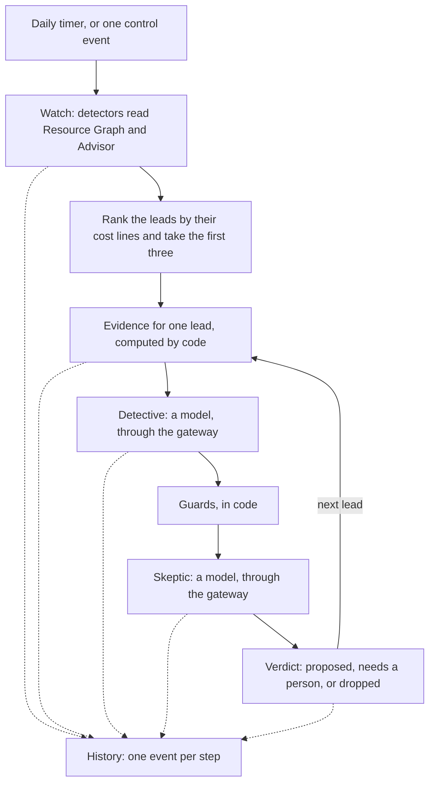

# The first cases — a proposal

**Status: approved on 2026-11-04 (the owner: "GO"), built and deployed the same day, and run on the real estate on 2026-11-05, after the owner gave the rights listed under "Hand steps". The changelog says what has been checked and what has not.** This page says what the first piece of Meternaut's own work is, what it reads, what it writes, who may do what, and what is checked. It follows slice 0.4 and 1a.5 of the [build plan](../build-plan/01-the-slices.md), cut down to the smallest part that shows the whole idea on real data, and it builds on the [first environment](01-first-environment.md): the gateway, the private model account and the usage recording (the account and the recording were removed on 2026-11-07, and the base that this app shares stays). A review by a second model family read it on 2026-11-04 and its findings changed the design: a model sees no name from the estate, the blob rights are per container, and the limits are written down at the end of this page.

**Changed on 2026-11-07.** The owner ordered the undo of what Meternaut added to his API Management instance, so the model path below is no longer the built one. For a few hours the Detective and the Skeptic called the model deployments of the agents' own Foundry project directly. Since the owner ordered that every model call goes through the AI Gateway, with no direct path ([rule 15 (c)](../../AGENTS.md)), they call the AI Gateway of Azure with the app's own identity and no key, and the app reads no key at the start of a run ([the Foundry agents](06-foundry-agents.md#the-model-path-the-one-exception-to-the-gateway-rule) and [the AI Gateway](08-ai-gateway.md) say how; built, and not yet run in Azure). Every line of this page that says that the two roles go "through the gateway" means the gateway of that instance, and every line that says that the app reads the access product's key, that a custom role allows that read, or that the gateway's own limits (a rate per minute and an allowance per month) apply to the roles, describes what was built on 2026-11-04 and run on 2026-11-05; the custom role is retired ([access and onboarding](03-access-and-onboarding.md#what-earlier-versions-granted-and-is-retired)). The limits of the AI Gateway are per caller identity (60 requests and 50,000 tokens a minute, 5 US dollars a day, 25 a month).

**Changed on 2026-11-07, a second time.** The owner ordered: "Watch is what checks for cost savings? That must be on the root management group; watch the entire estate." So the Watch reads every subscription that the app's own identity can read, not one that is listed in a setting: at the start of each run it asks Azure Resource Manager for the list, and a person widens or narrows it by giving the two read-only roles at the tenant root management group or at each subscription ([access and onboarding](03-access-and-onboarding.md#the-watch-reads-every-subscription-that-its-identity-can-read)). Every line of this page that says "the pilot estate" or "the pilot subscription" describes the subscription that the Watch was first given, and which it still reads. Watching more changes nothing of what may be changed: the approval loop and its guards stay keyed on the one resource group of `CHANGE_RESOURCE_GROUP`. It is deployed and has run so: on 2026-11-07 a person gave the two roles at the tenant root management group, and a run read 10 subscriptions ([the changelog](../../CHANGELOG.md)).

**Changed on 2026-11-06.** This page describes the first Watch: seven detectors, a Detective and a Skeptic. The owner ordered that the Watch find waste by itself, with agents in Foundry, and [the Foundry agents](06-foundry-agents.md) record that decision. When the investigation is on, an Investigator and a Skeptic in a Foundry project look through the estate with generic read-only tools, and the detectors and the two roles below judge only the waste that Meternaut planted itself; when it is off or cannot run, they judge every lead as before. The investigation is built and tested with fakes; what has run on the real estate is what this page describes.

## What it is for

Meternaut's job is to find waste in an Azure estate, explain it to the person who owns it, and, after that person's OK, remove it. Nothing of that exists yet except the gateway that every model call passes through. The first cases build the first half of the loop, and only read:

1. Look at the estate that the app's identity can read (the pilot subscription first, and every other subscription once a person has given the identity its read-only roles above it) and list **leads**: resources that look like waste.
2. For the leads that cost most, let two model roles work on each one through the gateway: a **Detective** that states what the lead is, why it looks like waste and what to do, and a **Skeptic** that tries to break that claim.
3. Apply **guards** written in code (a lock, a keep tag, a resource that is too new) that a model cannot argue with.
4. Write every step to a **History**: what ran, what was found, what each model said, what it cost in tokens, and what was decided.

No Azure resource is changed, and nobody is messaged: the owner reads the History. (The investigation of 2026-11-06 writes its own agents and conversations into its own Foundry project: data of that project, not resources of the estate.) The messages, the approval and the change come in the next slice, and they need what this slice proves first: that the readers, the gateway path, the roles and the History work on the real estate.

## What the pilot estate offers

The first estate is the subscription that already holds Meternaut. What was read from it on 2026-11-04 decides the design.

| Fact | Consequence |
|---|---|
| The subscriptions are internal offers: no invoice exists. Cost Management still returns cost lines in US dollars for every subscription, per resource | The price basis of every figure is written as "Cost Management cost lines, not an invoice". A saving is checked against later cost lines, not against a bill |
| Cost Management limits the Query API by processing units: about one unit for each month of data queried | One query per subscription and day, for 30 days |
| Azure Advisor shows no cost recommendation in the pilot subscription, and a few in two platform subscriptions | Advisor is one source of leads, not the only one. Resource Graph finds more |
| Resource Graph finds four private endpoints in the pilot subscription whose connection is not approved. They belong to another project | The first real leads exist already. Meternaut reads them and never changes them: only resources that Meternaut itself made may be changed, in a later slice |
| The tenant has Exchange Online and Teams, and the owner is its administrator | The e-mail and Teams paths of the design are possible. Each needs an administrator's steps, so they are the next slice |
| The gateway always requires the access product's key; a token is an extra layer, not a replacement | The Watch reads the key from the gateway with its own identity at the start of a run, keeps it in memory and never logs it. It is the one remaining key, as in [rule 23 of AGENTS.md](../../AGENTS.md) |

## What is built

| Part | What it is | Identity and rights |
|---|---|---|
| A second function app, on a Flex Consumption plan or a Basic plan | Python 3.13 on Linux. The only library is the Functions host library; every call is a plain HTTPS call. It shares the storage account and the Event Hubs namespace of the usage recording. On **Flex Consumption** (since 2026-11-07, the constant `CASES_APP_PLAN`) it has a plan of its own, the function subnet `snet-func` (delegated to `Microsoft.App/environments`, which the usage recording's app used before it was retired), a package container of its own in the storage account and one instance at most, and it scales to zero. On a **Basic plan** (the way back: B1, always on) it has a plan and a subnet of its own (`snet-cases`: a Basic plan's integration subnet is delegated to `Microsoft.Web/serverFarms`, and a subnet takes one delegation; it is made once and then left alone, because a template that made it again would take away the route table that the landing zone's network manager puts on it), and it runs from a package that the deployment site holds on the plan's own storage. The app was first made on Flex Consumption, moved to a Basic plan on 2026-11-05 because that plan's front end held requests to the console for 15 to 60 seconds (the [changelog](../../CHANGELOG.md) has the measurements), and is back on Flex Consumption with a measurement and a way back ([the web page on Flex Consumption](07-private-by-default.md#the-web-page-on-flex-consumption)) | Its own system-assigned identity ([access and onboarding](03-access-and-onboarding.md#the-apps-run-as-system-assigned-identities)) |
| `watch-daily` | A timer function, every day at 05:30 UTC | Runs the Watch |
| `cases-control` | An Event Hubs trigger on a new hub, `cases-control`. One event starts one Watch now; the deployment workflow starts it, through the Operator, which sends the event from inside the network and reads the result from the telemetry ([private by default](07-private-by-default.md)). The event carries only the job name `watch` and a request id: it cannot choose a scope, a model, a budget or a detector | The Operator may send to that hub (the deployment workflow's identity held that right until the action `cases` retired it on 2026-11-06); the function reads it |
| The detectors | Resource Graph queries, one per kind of lead: private endpoint with no approved connection, unattached managed disk, public IP address attached to nothing, Standard load balancer with no backend addresses (a lead from its configuration; nothing says that it carries no traffic), App Service plan with no app, stopped virtual machine that is not deallocated, and each Azure Advisor cost recommendation | **Reader** and **Cost Management Reader** on the pilot subscription, or at the tenant root management group (then on every subscription below it). Neither reads a secret or changes anything |
| The History | One structured line per step in the function app's telemetry, kept for a year, and a workbook in the Azure portal that lists the runs, the findings and the steps, for all runs or for one | Read access to the Application Insights component |
| The model path | The Detective and the Skeptic call the chat route of the AI Gateway (the first plan was the gateway of the owner's API Management instance and an access product). They use two different models, so that the Skeptic is more independent of the Detective. The two agents of the investigation (2026-11-06) go through the gateway by step 2 of the AI Gateway, whose switch is on in code and has not run in Azure; until its real run has been made they call the models of their own Foundry resource directly: [the Foundry agents](06-foundry-agents.md) says why and what that costs in control | The role *AI Gateway Models User* on the AI Gateway (the custom role that read a product's key is retired); for the agents, *Foundry User* on the project |

## What a model sees

A model never receives a name from the estate. The security design says it plainly: [prompts get ids, not names](../design/06-security-and-governance.md#7-data-protection-and-privacy), and a name, a tag or a description is the text that an attacker can write. So the prompt of the Detective and of the Skeptic holds only what code has built from fixed values:

- an opaque case id (`c1`, `c2`) and the name of the detector;
- the resource type, only when it is on the closed list of the types that the detectors and Advisor look for (otherwise `other`);
- typed facts, each a word from a closed list, a number, a flag or a list of those: a connection state, a SKU only when it is on a list of known values (otherwise `other`), a disk state, a size bucket, an age in whole days, a power state, and for a virtual machine the size family (`d`, `e`, `nc` and so on) from a list of known families (otherwise `other`) with the number in the size name, which is the number of vCPUs for most families. A fact that is anything else stops the case before a prompt is built;
- the guard flags: locked, keep tag, too new, in a managed group, and unverified (a guard could not be read);
- the 30-day cost, rounded, computed by code from the cost lines.

For an Advisor lead the prompt holds Advisor's category, its impact and its recommendation type id, and no free text. A model's answer is checked against a fixed schema; each string is cut to 300 characters, stripped of control characters and links. A test plants a hostile name and a hostile tag in the estate data and fails if either one appears in any prompt. The History is written by code and does carry the resource id, name and group, for the person who reads it: they are never sent back to a model.

## The History

Each line of the telemetry is `meternaut_event ` and one compact JSON object. The workbook parses it. A line never holds a secret, a key, a token or an e-mail address, and the text that comes from a model is shortened and stripped of control characters.

| `type` | When | Fields besides `v`, `ts`, `runId` and `requestId` |
|---|---|---|
| `run.started` | A run begins | `trigger` (timer or control), `subscriptions` (how many the run reads), `scopes` (the first five of them, eight characters of each id, never all), `scopeFrom` (`estate`: the list that the identity can read; `setting` or `setting-fallback`: the explicit list; `none`), `detectors` |
| `run.note` | Something did not work but the run goes on: a detector or a subscription that could not be read, cost lines that were not available, the subscriptions that were not read because the time for reading was used up, a list that was cut at 1000 | `note` |
| `lead.found` | A detector returns a lead | `leadId`, `detector`, `resourceId`, `resourceType`, `resourceName`, `resourceGroup`, `costUsd30d`, `rank` |
| `case.started` | A lead is taken up | `caseId`, `leadId` |
| `case.step` | One step of a case ends | `caseId`, `step` (evidence, detective, guards, skeptic), `model`, `promptTokens`, `completionTokens`, `ms`, `ok`, `note` |
| `case.result` | A case ends | `caseId`, `leadId`, `detector`, `resourceName`, `resourceType`, `resourceGroup`, `costUsd30d`, `status` (proposed, needs_human, dropped, error), `recommendation`, `confidence`, `monthlySavingUsd`, `summary`, `objections`, `guards` |
| `run.finished` | The run ends | `ok`, `leads`, `cases`, `proposed`, `needsHuman`, `dropped`, `errors`, `tokens`, `seconds`, `investigation` (`ran`, `failed` or `off`), `investigationLines` (how many `investigation.*` lines the run wrote, so that a reader knows when all have arrived) |
| `run.failed` | The run cannot continue | `reason` |

A figure that a person could read as money (`costUsd30d`, `monthlySavingUsd`) is computed by code from the cost lines. A model never supplies one: its output is checked against a fixed schema, and a number that it adds is dropped.

The investigation adds three lines of its own, `investigation.started`, `investigation.finding` and `investigation.finished`, and the cases that it opens end in `case.result` like every other case; [the Foundry agents](06-foundry-agents.md) lists their fields.

## Safety

- **Read only.** The identity has Reader and Cost Management Reader and nothing that writes. The function app has no write call to Azure in its code, and a test fails the build if one appears. Its HTTP client holds a list of the calls that the app may make (the reads, among them the list of the subscriptions that its identity can read, the metrics and the pricing settings that the investigation's tools read, two queries and the one chat route of the AI Gateway) and refuses any other method or address before the call leaves the app; a test tries writes, deletions, lock changes and calls to other hosts. The calls to the Foundry project of the investigation are the one exception: they write only its own agents and conversations, and a test pins their paths.
- **Text from the estate never reaches a model** (see "What a model sees"). A hostile name or tag can therefore not steer a model, and the History, which does show names, is written by code.
- **The model does not decide alone.** A guard in code turns any result into "needs a person" when the resource has a lock, a tag that says to keep it, is younger than seven days, or sits in a group that a platform manages. The model's output cannot lift a guard. A lock is looked for twice: in the list of all locks of the subscription (which returns the locks at, above and below its scope), and, for each case, in the lists of the case's own scopes, the resource and its group, with the filter that returns the locks at or above a scope. A list that cannot be read makes the case `unverified`, and that is a guard too.
- **A budget per run.** The limits are ceilings in the code: at most three cases per run, 2,000 completion tokens for each call, at most 6,000 characters of case in a prompt, at most 40,000 tokens for the whole run, and 15 minutes. A setting of the app can lower a ceiling and never raise it, and the template caps the number of cases at three. Before every case and every call the run adds the tokens already used, the cap of the call and a reserve for its prompt, and when that is more than the budget it stops and says so in a note. The 15 minutes hold for the whole run, calls included: no call starts after the deadline, no timeout reaches past it and no pause is taken that would end after it. The limits of the AI Gateway (a rate per minute and an allowance per day and per month, for each caller identity) apply on top. The investigation has a budget of its own (tool calls, seconds, findings and cases: [the Foundry agents](06-foundry-agents.md)) and runs before the cases, and the time that it takes is not taken from their 15 minutes.
- **Retries only where they are safe.** A model call is repeated, at most twice, only when the gateway says "not now" (429 or 503), and a wait of more than a minute is a refusal, not a wait. A model call whose answer did not arrive (a network error, 500, 502, 504) is not repeated, because it may have been carried out and paid for already: it ends that case with the status `error`. Any other refusal by the gateway ends that case the same way, and nothing is retried in a loop. A read of the estate is repeated at most twice, with a pause, for network errors, throttling and server errors.
- **A control event cannot widen a run.** It names the job `watch` and a request id and nothing else. An event that is older than 15 minutes, or names another job, is refused and recorded.
- **No key stored.** There is no key: the app asks Microsoft Entra ID for a token for the AI Gateway, holds it in memory and never logs it. A test scans every log line and every History line of a full run, including a failing one, for the token. (The first plan's one key was the access product's, read at the start of a run.)
- **Storage rights per container.** The identity may write to its own package container and to the three containers that every Functions host of the account shares (host locks, host secrets, Event Hubs checkpoints). It has no right on the container that holds the usage recording's code, so it cannot read or replace that code.

## Hand steps

Anything outside a workflow is break-glass: it needs the owner's written word and is reported at once ([rule 18 of AGENTS.md](../../AGENTS.md)). Three are needed, and only the first two are done by hand; each is done once. The first two were made on 2026-11-05. The same grants, with the two of the usage recording (retired on 2026-11-07, with the recording), are now data and a tool that checks them and, run by a person, makes them: [access and onboarding](03-access-and-onboarding.md).

1. **Reader and Cost Management Reader** for the new identity on the pilot subscription (on 2026-11-07 a person gave them at the tenant root management group, and the Watch now reads every subscription below it). The deployment workflow's identity has no right there and must not get one.
2. **A custom role** with one action, `Microsoft.ApiManagement/service/subscriptions/listSecrets/action` (and read of the subscription), assigned to the new identity on the one gateway subscription of the first access product, and on nothing else. The role is defined once in the gateway's subscription.
3. The monthly token allowance of the first access product is raised from 500,000 to 2,000,000. It is a number in the repository, applied by the workflow action that adds the access product to the gateway; no hand step.

The allowance and the standing limit: [rule 15(g)](../../AGENTS.md) allows 25 EUR of model calls in total and 5 EUR a day. At the output price of the dearer of the two models (10.56 EUR for a million tokens, DataZone Standard, from the price snapshot) the whole allowance costs at most 21 EUR, even if every token were an output token. A test holds that.

## Price

About zero a month more on Flex Consumption, which is the plan since 2026-11-07, and about 13 US dollars a month on the Basic plan, which is the way back. The Basic plan (B1, Linux, always on) is 0.018 US dollars an hour in Sweden Central, which is 13.14 US dollars for a month of 730 hours (the Retail Prices API, read on 2026-11-05). Flex Consumption bills per execution, with a free monthly grant of 100,000 GB-seconds and 250,000 executions, and the timer that runs every minute for the approval loop is about 43,200 executions a month, which is inside that grant: an estimate, not a price read today. The first version ran on the Flex Consumption plan and stayed inside its free grant, for about zero; that plan's front end held requests for 15 to 60 seconds, so the app moved to the Basic plan on 2026-11-05, and it is back on Flex Consumption with a measurement that decides whether it stays ([the web page on Flex Consumption](07-private-by-default.md#the-web-page-on-flex-consumption)). The storage account, the namespace and the private endpoints already exist, a year of retention for a few megabytes of events costs cents, and the tokens are small: a run is capped at 40,000 tokens, which is at most about 0.42 EUR even if every token were an output token of the dearer model, and a typical run (six calls, about 5,000 tokens) costs a few cents. The model calls show in the usage records like any other call.

## What proves it

| Check | Shown by |
|---|---|
| The detectors return the four known leads and nothing that is managed by a platform | Unit tests against recorded Resource Graph answers; the first control run |
| A figure is never a model's | A test that feeds a model answer with invented numbers and finds them dropped |
| No text from the estate reaches a model | A test that plants a hostile name and tag in the estate data and scans every prompt |
| A guard wins | Tests for each guard with a model that says "delete" |
| The key is not logged | A test that scans every log line and History line of a full run, a failing one included |
| Every limit holds | Tests for the ceilings of the settings, the cases per run, the tokens per run (inside a case and across cases), the deadline (before the first call, during the read and between cases), the retry rules, the stale control event and the refusal by the gateway |
| The path works on the real services | A control run reads the estate, takes three leads through both roles, and the History holds the whole run |
| The gateway recorded the calls | The usage recording shows the new calls under the first access product |
| The History is readable | The workbook's queries return the run, its leads and its steps, for all runs and for one |

## Known limits

Written down so that nobody has to find them.

- **Reader is a built-in role, and since 2026-11-07 it is given at the tenant root management group.** It reads names, tags and properties of every resource of every subscription below the group, more than the seven detectors need. A custom role that lists only the needed read actions is the next tightening; it is one more role definition outside a workflow, so it waits until the list of detectors is stable.
- **The two apps share three host containers.** Both Functions hosts of the account write locks, host secrets and checkpoints to the same three containers, so each app could disturb the other's host state. Neither can reach the other's code. A storage account of its own for the cases would add three private endpoints to the price, so it is not done.
- **The control hub trusts its senders.** Whoever holds the Event Hubs Data Sender role on that hub, or above it, can start a Watch. A Watch is read only and capped, so the worst case is extra tokens, but the workflow does not check who else holds that role. The Operator's identity holds it on that hub once the action `operator` has run ([private by default](07-private-by-default.md)): the check action sends the event from inside the network. The deployment workflow's identity held it too until the action `cases` retired it on 2026-11-06, and the namespace takes no public traffic since the action `recording` deployed its template that day, so the runner cannot send to it at all.
- **No durable run record.** A timer run and a control run can overlap, and a restart in the middle of a run loses the rest of that run; the next run starts again. Both only read.
- **No daily token ledger.** The gateway limits tokens per minute and per month, not per day. The run cap is what keeps a day under 5 EUR: more than about twelve worst-case runs in one day would not. Runs are started by the workflow on the owner's word, so that cannot happen by accident.
- **Tokens of a lost call are not counted by the run.** A model call that the gateway carried out but whose answer did not arrive costs tokens that the run's own total does not hold. The gateway's allowance does count them, and the run is not repeated.
- **The lock filter is documented, not yet seen at work.** Azure PowerShell documents `atScope()` as "all locks at or above the specified scope"; the pilot subscription has no lock at all, so the first lock that exists there is the first proof. A list that cannot be read stops the case as `unverified` in the meantime.
- **Cost lines, not invoices.** A figure is the resource's cost lines of the last 30 days, and the saving if it is removed is that figure (Advisor's own figure for an Advisor lead). It is an estimate. Cost Management throttles its Query API: one 30-day query is about one processing unit, and a throttled answer is waited for at most 60 seconds, then the run goes on without cost lines and says so.

## Not built, and next

The Teams card and the e-mail to the owner of a resource, the approval, the change that the approver makes, the check against later cost lines, and the agents' move into the Foundry Agent Service as hosted agents. The next slice takes a resource that Meternaut made for the purpose (an unattached disk and a public address in the project's own group, tagged as planted waste) through the whole loop, including a person's OK and the removal, because no other project's resource may be changed. It needs the owner's administrator steps for the shared mailbox and the Teams app.
